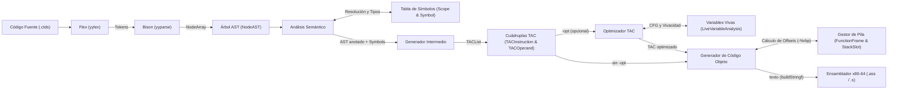

# Visión General y Arquitectura

Compilador de múltiples pasadas para el lenguaje **C-TDS (TDS26)**. La arquitectura desacopla el análisis sintáctico de la validación semántica y de la posterior emisión de código, utilizando el Árbol de Sintaxis Abstracta (AST) como estructura central de comunicación entre etapas.

---

## Pipeline de Compilación

La transformación del código fuente se estructura en siete fases secuenciales:

1. **Análisis Léxico:** Reconoce y clasifica los caracteres del código fuente en tokens (palabras clave, identificadores, literales, operadores). Descarta espacios en blanco y comentarios, y rastrea números de línea para reportes de error.
2. **Análisis Sintáctico:** Verifica que la secuencia de tokens respete la gramática libre de contexto de C-TDS mediante análisis LALR(1). Ante el primer error formal, interrumpe el proceso.
3. **Construcción del AST:** Durante las reducciones sintácticas se construye un árbol jerárquico representativo del programa, filtrando detalles puramente sintácticos que no aportan semántica (puntos y comas, paréntesis, llaves).
4. **Análisis Semántico y Resolución de Ámbitos:**
   - Construye la jerarquía de ámbitos (*scopes*) para variables globales, locales y parámetros.
   - Aplica reglas de alcance (*scope chaining* y *shadowing*).
   - Valida el tipado estático, coherencia de retornos en funciones y condiciones booleanas en estructuras de control.
   - A diferencia del analizador sintáctico, acumula y reporta todos los errores encontrados antes de abortar.
5. **Generación de Código Intermedio (TAC):** Recorre el AST validado y emite Código de Tres Direcciones linealizado con variables temporales y etiquetas para control de saltos.
6. **Análisis de Variables Vivas y Optimización (`-opt`):** Paso opcional controlado por línea de comandos. Construye el grafo de flujo de control (CFG) sobre el TAC, resuelve vivacidad por punto fijo (`LiveVariableAnalysis`, `BasicBlock`) y ejecuta iterativamente las transformaciones activas (`const-fold`, `const-prop`, `dead-code`, `const-branch`, `self-assign`, `peephole`), más `strength-reduce` al emitir objeto.
7. **Generación de Código Objeto y Gestión del Stack:** Recorre la lista TAC (original u optimizada), dimensiona los marcos de activación de pila (`FunctionFrame` y `StackSlot`) según la convención System V AMD64 ABI, y emite las instrucciones en lenguaje ensamblador x86-64 como texto, con `buildStringf`.

---

## Flujo de Datos entre Etapas

El siguiente diagrama ilustra cómo las estructuras principales se generan y transforman a través de las distintas fases:



---

## Diagramas UML de Clases y Estructuras

=== "Vista Global Completa"

    Modelo global integrado con todas las estructuras de datos (`structs`) y enumeraciones (`enums`) del compilador, ilustrando cómo se conectan las entidades a lo largo de todo el pipeline:

    ```mermaid
    classDiagram
        direction TB

        %% ========================================================
        %% CONFIGURACIÓN Y PIPELINE (CLI & DRIVER)
        %% ========================================================
        class Options {
            +const char* input
            +char* output
            +Target target
            +int explicitTarget
            +int debug
            +OptimizationSet optimizations
        }

        class Target {
            <<enumeration>>
            TARGET_SCAN
            TARGET_PARSE
            TARGET_SEM
            TARGET_CODINTER
            TARGET_ASSEMBLY
        }

        class Optimization {
            <<enumeration>>
            OPTIMIZATION_NONE
            OPTIMIZATION_CONST_FOLD
            OPTIMIZATION_CONST_PROP
            OPTIMIZATION_DEAD_CODE
            OPTIMIZATION_CONST_BRANCH
            OPTIMIZATION_SELF_ASSIGN
            OPTIMIZATION_PEEPHOLE
            OPTIMIZATION_STRENGTH
        }

        Options --> Target : target
        Options ..> Optimization : optimizations (bitmask)

        %% ========================================================
        %% FRONTEND Y PARSER (BISON & HELPERS)
        %% ========================================================
        class NodeArray {
            +NodeAST** items
            +int count
            +int capacity
            +appendNode(node)
            +mergeNodeArrays(other)
        }

        %% ========================================================
        %% ÁRBOL DE SINTAXIS ABSTRACTA (AST)
        %% ========================================================
        class NodeAST {
            +NodeType nodeType
            +DataType type
            +Symbol* symbol
            +OperationType operationType
            +int line
            +NodeAST** children
            +int childCount
            +newNode(nodeType, symbol, ...)
            +newOperatorNode(op, left, right)
        }

        class NodeType {
            <<enumeration>>
            VARIABLE_DECLARATION_NODE
            ID_NODE
            ASSIGNMENT_NODE
            CONSTANT_NODE
            RETURN_NODE
            IF_ELSE_NODE
            WHILE_NODE
            OPERATOR_NODE
            BLOCK_NODE
            METHOD_CALL_NODE
            PARAMETERS_NODE
            METHOD_DECLARATION_NODE
        }

        class OperationType {
            <<enumeration>>
            OP_ADD, OP_SUB, OP_MUL, OP_DIV, OP_MOD
            OP_LT, OP_GT, OP_EQ
            OP_AND, OP_OR, OP_NOT, OP_UMINUS
        }

        NodeArray "1" o-- "many" NodeAST : agrupa en parser
        NodeAST "1" *-- "many" NodeAST : children
        NodeAST --> NodeType : nodeType
        NodeAST --> OperationType : operationType

        %% ========================================================
        %% ANÁLISIS SEMÁNTICO Y TABLA DE SÍMBOLOS
        %% ========================================================
        class DataType {
            <<enumeration>>
            TYPE_INT
            TYPE_BOOL
            TYPE_FLOAT
            TYPE_VOID
            TYPE_ERROR
        }

        class Scope {
            +int level
            +Symbol** symbols
            +int symbolCount
            +int symbolCapacity
            +Symbol* function
            +Scope* parent
            +Scope** children
            +int childrenCount
            +int childrenCapacity
            +createScope(level, parent, function)
            +appendSymbol(symbol)
            +lookupSymbol(id)
        }

        class Symbol {
            +char* id
            +int uid
            +DataType type
            +SymbolType symbolType
            +bool isGlobal
            +NodeAST* parameters
            +ValueUnion value
            +newSymbol(id, symbolType, type, params)
        }

        class SymbolType {
            <<enumeration>>
            VARIABLE_SYMBOL
            METHOD_SYMBOL
            CONSTANT_SYMBOL
        }

        NodeAST --> DataType : type
        NodeAST "0..1" o-- "0..1" Symbol : symbol
        Scope "1" *-- "many" Scope : children
        Scope "1" o-- "0..1" Scope : parent
        Scope "1" *-- "many" Symbol : symbols
        Scope "0..1" o-- "0..1" Symbol : function (método contenedor)
        Symbol --> SymbolType : symbolType
        Symbol --> DataType : type
        Symbol "0..1" o-- "0..1" NodeAST : parameters (firma método)

        %% ========================================================
        %% CÓDIGO INTERMEDIO (TAC)
        %% ========================================================
        class TACList {
            +TACInstruction* head
            +TACInstruction* tail
            +int count
            +appendInstruction(op, res, arg1, arg2)
        }

        class TACInstruction {
            +TACOperation operation
            +TACOperand result
            +TACOperand firstOperand
            +TACOperand secondOperand
            +TACInstruction* next
        }

        class TACOperand {
            +OperandKind kind
            +DataType type
            +char name[256]
            +Symbol* symbol
            +ValueUnion value
            +tacTemp(name, type)
            +tacVariable(symbol)
            +tacConstantInt(val)
        }

        class TACOperation {
            <<enumeration>>
            TAC_BEGIN_FUNC, TAC_END_FUNC
            TAC_PARAM_DECL, TAC_RETURN, TAC_CALL, TAC_PARAM
            TAC_GLOBAL_DECL, TAC_LOCAL_DECL
            TAC_LABEL, TAC_GOTO, TAC_IF_FALSE, TAC_IF_TRUE
            TAC_ASSIGN, TAC_ADD, TAC_SUB, TAC_MUL, ...
        }

        class OperandKind {
            <<enumeration>>
            OPERAND_NONE
            OPERAND_TEMP
            OPERAND_VARIABLE
            OPERAND_CONSTANT
            OPERAND_LABEL
            OPERAND_METHOD
        }

        TACList "1" *-- "many" TACInstruction : contiene
        TACInstruction --> TACOperation : operation
        TACInstruction "1" *-- "1" TACOperand : result
        TACInstruction "1" *-- "1" TACOperand : firstOperand
        TACInstruction "1" *-- "1" TACOperand : secondOperand
        TACInstruction "1" o-- "0..1" TACInstruction : next
        TACOperand --> OperandKind : kind
        TACOperand --> DataType : type
        TACOperand "0..1" o-- "0..1" Symbol : symbol (resolución uid)

        %% ========================================================
        %% OPTIMIZACIÓN Y ANÁLISIS DE VARIABLES VIVAS
        %% ========================================================
        class LiveVariableAnalysis {
            +TACList* tacList
            +BasicBlock** blocks
            +size_t blockCount
            +char variableNames[64][256]
            +size_t variableCount
            +createLiveVariableAnalysis(tacList)
            +isDeadDefinitionInBlock(block, instr)
        }

        class BasicBlock {
            +int id
            +TACInstruction* firstInstruction
            +TACInstruction* lastInstruction
            +BasicBlock* successors[2]
            +size_t successorCount
            +VariableSet use
            +VariableSet def
            +VariableSet liveIn
            +VariableSet liveOut
        }

        LiveVariableAnalysis "1" o-- "1" TACList : analiza CFG
        LiveVariableAnalysis "1" *-- "many" BasicBlock : blocks
        BasicBlock "1" o-- "0..2" BasicBlock : successors
        BasicBlock "1" o-- "many" TACInstruction : rango [first..last]

        %% ========================================================
        %% CÓDIGO OBJETO Y GESTIÓN DEL STACK (x86-64)
        %% ========================================================
        class FunctionFrame {
            +char functionName[256]
            +DataType returnType
            +StackSlot* slots
            +int slotCount
            +int slotCapacity
            +int nextOffset
            +int frameSize
            +int* pendingParamSlots
            +int pendingParamCount
            +int pendingParamCapacity
            +int maxPendingParams
            +int integerParamCount
            +int stackParamCount
            +createFrame(functionName)
            +addSlot(operand)
        }

        class StackSlot {
            +char name[256]
            +int offset
        }

        FunctionFrame "1" *-- "many" StackSlot : slots (-offset de %rbp)
        FunctionFrame --> DataType : returnType

        %% Conexión inter-etapa TAC -> Frame
        FunctionFrame ..> TACOperand : asigna offsets a variables y temporales
    ```

=== "1. Frontend y AST"

    Estructuras asociadas a la reducción sintáctica en Bison y la construcción del Árbol de Sintaxis Abstracta:

    ```mermaid
    classDiagram
        direction TB

        class NodeArray {
            +NodeAST** items
            +int count
            +int capacity
            +createNodeArray(cap) NodeArray*
            +appendNode(node) NodeArray*
            +mergeNodeArrays(other) NodeArray*
            +resolveVariableDefinition(type, ids) NodeArray*
        }

        class NodeAST {
            +NodeType nodeType
            +DataType type
            +Symbol* symbol
            +OperationType operationType
            +int line
            +NodeAST** children
            +int childCount
            +newNode(type, sym, l, m, r) NodeAST*
            +newOperatorNode(op, l, r) NodeAST*
        }

        class NodeType {
            <<enumeration>>
            VARIABLE_DECLARATION_NODE
            ID_NODE
            ASSIGNMENT_NODE
            CONSTANT_NODE
            RETURN_NODE
            IF_ELSE_NODE
            WHILE_NODE
            OPERATOR_NODE
            BLOCK_NODE
            METHOD_CALL_NODE
            PARAMETERS_NODE
            METHOD_DECLARATION_NODE
        }

        class OperationType {
            <<enumeration>>
            OP_ADD, OP_SUB, OP_MUL, OP_DIV, OP_MOD
            OP_LT, OP_GT, OP_EQ
            OP_AND, OP_OR, OP_NOT, OP_UMINUS
        }

        class DataType {
            <<enumeration>>
            TYPE_INT
            TYPE_BOOL
            TYPE_FLOAT
            TYPE_VOID
            TYPE_ERROR
        }

        NodeArray "1" o-- "many" NodeAST : recolecta temporalmente
        NodeAST "1" *-- "many" NodeAST : children
        NodeAST --> NodeType : nodeType
        NodeAST --> OperationType : operationType
        NodeAST --> DataType : type
    ```

=== "2. Análisis Semántico y Ámbitos"

    Estructuras dedicadas a la gestión jerárquica de tablas de símbolos (`Scope`), asignación de `uid` y resolución de tipos:

    ```mermaid
    classDiagram
        direction TB

        class Scope {
            +int level
            +Symbol** symbols
            +int symbolCount
            +int symbolCapacity
            +Symbol* function
            +Scope* parent
            +Scope** children
            +int childrenCount
            +int childrenCapacity
            +createScope(level, parent, func) Scope*
            +appendSymbol(symbol) void
            +lookupSymbol(id) Symbol*
        }

        class Symbol {
            +char* id
            +int uid
            +DataType type
            +SymbolType symbolType
            +bool isGlobal
            +NodeAST* parameters
            +ValueUnion value
            +newSymbol(id, symType, type, params) Symbol*
        }

        class SymbolType {
            <<enumeration>>
            VARIABLE_SYMBOL
            METHOD_SYMBOL
            CONSTANT_SYMBOL
        }

        class DataType {
            <<enumeration>>
            TYPE_INT
            TYPE_BOOL
            TYPE_FLOAT
            TYPE_VOID
            TYPE_ERROR
        }

        class NodeAST {
            +NodeType nodeType
            +DataType type
            +Symbol* symbol
        }

        Scope "1" *-- "many" Scope : children (sub-ámbitos)
        Scope "1" o-- "0..1" Scope : parent (ámbito contenedor)
        Scope "1" *-- "many" Symbol : symbols
        Scope "0..1" o-- "0..1" Symbol : function (método asociado)
        Symbol --> SymbolType : symbolType
        Symbol --> DataType : type
        Symbol "0..1" o-- "0..1" NodeAST : parameters (firma de método)
        NodeAST "0..1" o-- "0..1" Symbol : symbol
    ```

=== "3. Código Intermedio (TAC)"

    Estructuras que definen las cuádruplas atómicas de Código de Tres Direcciones y sus operandos fuertemente tipados:

    ```mermaid
    classDiagram
        direction TB

        class TACList {
            +TACInstruction* head
            +TACInstruction* tail
            +int count
            +createTACList() TACList*
            +appendInstruction(op, res, a1, a2) TACInstruction*
        }

        class TACInstruction {
            +TACOperation operation
            +TACOperand result
            +TACOperand firstOperand
            +TACOperand secondOperand
            +TACInstruction* next
        }

        class TACOperand {
            +OperandKind kind
            +DataType type
            +char name[256]
            +Symbol* symbol
            +ValueUnion value
            +tacTemp(name, type) TACOperand
            +tacVariable(symbol) TACOperand
            +tacConstantInt(val) TACOperand
        }

        class TACOperation {
            <<enumeration>>
            TAC_BEGIN_FUNC, TAC_END_FUNC
            TAC_PARAM_DECL, TAC_RETURN, TAC_CALL, TAC_PARAM
            TAC_GLOBAL_DECL, TAC_LOCAL_DECL
            TAC_LABEL, TAC_GOTO, TAC_IF_FALSE, TAC_IF_TRUE
            TAC_ASSIGN, TAC_ADD, TAC_SUB, TAC_MUL, ...
        }

        class OperandKind {
            <<enumeration>>
            OPERAND_NONE
            OPERAND_TEMP
            OPERAND_VARIABLE
            OPERAND_CONSTANT
            OPERAND_LABEL
            OPERAND_METHOD
        }

        class Symbol {
            +char* id
            +int uid
            +DataType type
        }

        TACList "1" *-- "many" TACInstruction : contiene
        TACInstruction --> TACOperation : operation
        TACInstruction "1" *-- "1" TACOperand : result
        TACInstruction "1" *-- "1" TACOperand : firstOperand
        TACInstruction "1" *-- "1" TACOperand : secondOperand
        TACInstruction "1" o-- "0..1" TACInstruction : next
        TACOperand --> OperandKind : kind
        TACOperand "0..1" o-- "0..1" Symbol : symbol
    ```

=== "4. Optimización y Variables Vivas"

    Estructuras de control y flujo de datos para construir el CFG, resolver conjuntos de vivacidad (`VariableSet`) y aplicar pasadas iterativas sobre el TAC:

    ```mermaid
    classDiagram
        direction TB

        class Optimization {
            <<enumeration>>
            OPTIMIZATION_NONE
            OPTIMIZATION_CONST_FOLD
            OPTIMIZATION_CONST_PROP
            OPTIMIZATION_DEAD_CODE
            OPTIMIZATION_CONST_BRANCH
            OPTIMIZATION_SELF_ASSIGN
            OPTIMIZATION_PEEPHOLE
            OPTIMIZATION_STRENGTH
        }

        class LiveVariableAnalysis {
            +TACList* tacList
            +BasicBlock** blocks
            +size_t blockCount
            +char variableNames[64][256]
            +size_t variableCount
            +createLiveVariableAnalysis(tacList) LiveVariableAnalysis*
            +freeLiveVariableAnalysis(analysis) void
            +isDeadDefinitionInBlock(block, instr) bool
        }

        class BasicBlock {
            +int id
            +TACInstruction* firstInstruction
            +TACInstruction* lastInstruction
            +BasicBlock* successors[2]
            +size_t successorCount
            +VariableSet use
            +VariableSet def
            +VariableSet liveIn
            +VariableSet liveOut
        }

        LiveVariableAnalysis "1" *-- "many" BasicBlock : blocks (CFG)
        BasicBlock "1" o-- "0..2" BasicBlock : successors
    ```

=== "5. Código Objeto y Stack (x86-64)"

    Estructuras para el dimensionamiento del marco de activación (`FunctionFrame`) y la emisión de instrucciones Assembly:

    ```mermaid
    classDiagram
        direction TB

        class FunctionFrame {
            +char functionName[256]
            +DataType returnType
            +StackSlot* slots
            +int slotCount
            +int slotCapacity
            +int nextOffset
            +int frameSize
            +int* pendingParamSlots
            +int pendingParamCount
            +int pendingParamCapacity
            +int maxPendingParams
            +int integerParamCount
            +int stackParamCount
            +createFrame(name) FunctionFrame*
            +addSlot(operand) int
            +getSlotOffset(name, outOffset) bool
        }

        class StackSlot {
            +char name[256]
            +int offset
        }

        FunctionFrame "1" *-- "many" StackSlot : slots (-offset de %rbp)
    ```

---

## Relación entre Entidades por Etapas

| Etapa | Estructuras Principales | Enumeraciones Clave | Relación y Conexión con otras Etapas |
|---|---|---|---|
| **Control y CLI** | `Options`, `OptimizationSet` | `Target`, `Optimization` | Conduce el pipeline invocando las etapas correspondientes (`TARGET_SCAN` hasta `TARGET_ASSEMBLY`) y configura las pasadas de optimización activas (`-opt`). |
| **Sintaxis y Parsing** | `NodeArray` | - | Agrupador temporal en Bison que colecta secuencias de nodos (sentencias, declaraciones, listas de argumentos) antes de transferirlos en $O(1)$ a un nodo padre `NodeAST`. |
| **Árbol de Sintaxis (AST)** | `NodeAST` | `NodeType`, `OperationType` | Estructura universal arbórea. Cada nodo aloja sus hijos en `children`. Enlaza con `Symbol` para identificar variables y métodos, y con `DataType` para su tipo semántico. |
| **Análisis Semántico** | `Scope`, `Symbol` | `SymbolType`, `DataType` | Organiza los identificadores en un árbol de entornos léxicos (`parent` / `children`). Asigna `uid` único para resolver colisiones por *shadowing*. El `Symbol` de métodos conserva el puntero a su subárbol `parameters` en el AST. |
| **Código Intermedio (TAC)** | `TACList`, `TACInstruction`, `TACOperand` | `TACOperation`, `OperandKind` | Transforma el AST en una lista enlazada de cuádruplas atómicas. Cada `TACOperand` puede referenciar al `Symbol` original para propagar nombres calificados (`id@uid`), ámbito (`isGlobal`) y tipos de datos. |
| **Optimización y Variables Vivas** | `LiveVariableAnalysis`, `BasicBlock`, `VariableSet` | `Optimization` | Particiona el TAC en bloques básicos formando un CFG, calcula conjuntos `use`/`def`/`liveIn`/`liveOut` por punto fijo y reescribe el `TACList` iterativamente según la máscara de `-opt`. |
| **Código Objeto y Stack** | `FunctionFrame`, `StackSlot` | `OperandLocation` (privado de `object_code.c`) | El backend recorre el TAC: dimensiona el marco de pila (`FunctionFrame`) asignando a cada variable/temporal un `StackSlot` con desplazamiento negativo respecto a `%rbp`, y emite el assembly x86-64 en sintaxis AT&T como texto, instrucción por instrucción (`strength-reduce` incluida). |

---

## Principios de Diseño

- **Desacoplamiento Front-End / Back-End:** La gramática únicamente produce el AST. Ninguna regla de tipo ni validación de identificadores se ejecuta durante el parseo, evitando complejizar las acciones sintácticas.
- **Representación Uniforme en Memoria:** Todos los nodos del programa comparten una estructura base en el AST (`NodeAST`), permitiendo recorridos recursivos homogéneos para análisis semántico, impresión y generación de código intermedio.
- **Ámbitos Jerárquicos en Árbol:** Cada bloque delimitado por llaves o firma de función posee su propio entorno léxico (`Scope`) con puntero ascendente a su ámbito contenedor (`parent`), permitiendo resolución de identificadores en tiempo ascendente hacia la raíz.
- **Identificación Única de Símbolos (`uid`):** Cada variable registrada en la tabla de símbolos obtiene un número secuencial inequívoco, permitiendo al generador TAC calificar variables (`x@uid`) y resolver el *shadowing* sin ambigüedad en el backend.
- **Linealización Atómica:** El generador intermedio convierte bifurcaciones y expresiones anidadas en instrucciones elementales de a lo sumo tres direcciones (`TACInstruction`), facilitando el mapeo a registros y offsets de memoria en x86-64.
- **Optimización Iterativa sobre TAC hasta Punto Fijo:** Las optimizaciones independientes de la máquina operan sobre la lista lineal ya tipada de TAC (apoyadas en el análisis de flujo de datos de variables vivas) en rondas sucesivas hasta que ninguna transformación produce cambios, dejando intacto el pipeline cuando no se pasa `-opt`.
- **Dimensionamiento de Marco en Dos Pasadas:** El backend analiza primero todas las cuádruplas de una función para conocer el espacio exacto de memoria (`FunctionFrame`), alinearlo a 16 bytes según la ABI System V AMD64, y reservar la pila en una única instrucción en el prólogo.

---

**Siguiente:** [Entrada y Línea de Comandos](01.2-cli.md)
