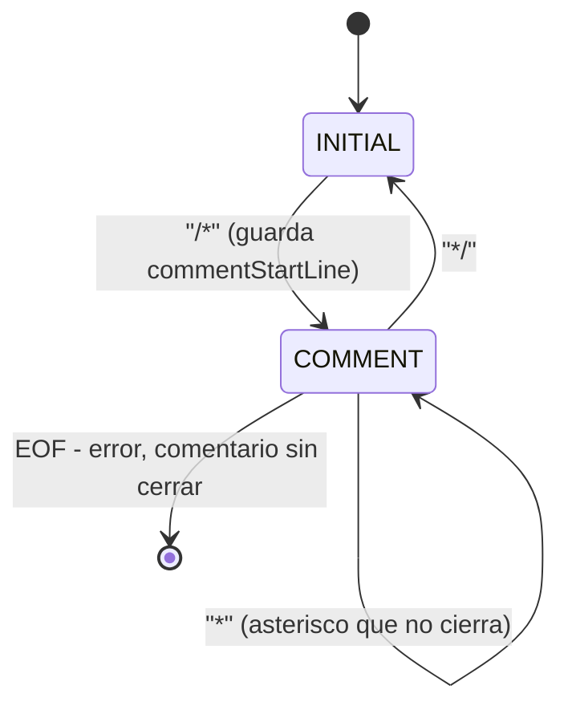

# Análisis Léxico

**Ficha F05** · Archivo: `src/parser/lexer.l` (78 líneas)

---

## 1. Qué problema resuelve

Convertir la secuencia de caracteres del archivo fuente en una secuencia de
**tokens**: las unidades mínimas con significado del lenguaje. Descarta lo que no
aporta (espacios, comentarios) y reporta los caracteres que no pertenecen al
alfabeto de C-TDS.

Es la única fase que ve el texto crudo. Todo lo que sigue trabaja sobre tokens.

---

## 2. Interfaz pública

El archivo no declara funciones propias: Flex genera `build/lex.yy.c` a partir
de él, y lo que se expone es la interfaz estándar de Flex.

| Símbolo | Qué es | Quién lo usa |
| --- | --- | --- |
| `yylex()` | Devuelve el siguiente token, o `0` al llegar al fin de archivo | El parser (`yyparse()`) lo llama en bucle; `runScan` en `driver.c` también, para `-target scan` |
| `yytext` | El lexema: los caracteres que acaba de matchear la regla | Las propias reglas, y `runScan` para imprimirlo |
| `yyleng` | Longitud de `yytext` | No se usa en este proyecto |
| `yylineno` | Línea actual, mantenida por Flex | Todos los mensajes de error de todas las fases |
| `yylval` | Unión con el **valor semántico** del token | Lo escriben las reglas, lo lee el parser como `$1`, `$2`… |
| `yyin` | El `FILE *` de entrada | Lo setea `main.c` al abrir el fuente |

El `yylval` es la unión declarada en `bison.y`. El léxico usa tres de sus campos:

```c
%union {
    int intval;       /* NUMBER y BOOL_CONST */
    float floatval;   /* FLOAT_CONST */
    char *strval;     /* ID */
    ...
}
```

**Dos consumidores, un solo escáner.** Esto es importante: `yylex()` no sabe
quién lo llama. Con `-target scan` el driver lo invoca en bucle y descarta los
valores semánticos, solo imprime nombre y lexema. En cualquier otro `-target`, el
que llama es el parser y los valores semánticos sí se usan. El léxico es idéntico
en los dos casos.

---

## 3. Configuración del escáner

### Opciones

```
%option yylineno noyywrap nounput noinput
```

| Opción | Qué hace | Por qué está |
| --- | --- | --- |
| `yylineno` | Flex mantiene `yylineno` contando los `\n` del texto consumido | Todos los errores del compilador reportan línea; sin esto habría que contarlos a mano en cada regla |
| `noyywrap` | Al llegar a EOF no busca otro archivo: termina | El compilador procesa un único archivo de entrada |
| `nounput` / `noinput` | No genera las funciones `unput()` e `input()` | No se usan, y sin esto GCC avisa por función definida y no usada |

### Estados (start conditions)

```
%x COMMENT
```

Declara un estado **exclusivo**: mientras el escáner está en `COMMENT`, solo se
consideran las reglas marcadas `<COMMENT>`, y ninguna de las normales. Esa
exclusividad es la que permite que dentro de un comentario no se reconozca
ningún token. Con un estado inclusivo (`%s`) las reglas normales seguirían
activas y `int` dentro de un comentario devolvería el token `INT`.

El estado inicial es el predefinido `INITIAL`.

### Definiciones nombradas

Abreviaturas que se expanden en las reglas. No generan código: son macros de
expresiones regulares.

| Definición | Expresión | Qué describe |
| --- | --- | --- |
| `DIGIT` | `[0-9]` | Un dígito |
| `ALPHA` | `[a-zA-Z]` | Una letra, sin acentos ni `ñ` |
| `ALPHA_NUM` | `{ALPHA}\|{DIGIT}\|"_"` | Un carácter válido **a partir del segundo** de un identificador |
| `ID` | `{ALPHA}({ALPHA_NUM})*` | Letra inicial, después letras, dígitos o guiones bajos |
| `NUMBER` | `{DIGIT}+` | Literal entero |
| `FLOAT` | `{DIGIT}+"."{DIGIT}+` | Literal real: obliga dígitos **a los dos lados** del punto |

Dos consecuencias que se preguntan:

- **Un identificador no puede empezar con `_`.** `ALPHA_NUM` incluye el guión
  bajo, pero `ID` exige `{ALPHA}` como primer carácter. `_foo` no es un
  identificador: el `_` cae en la regla de error y produce
  `simbolo no permitido '_'`. Verificado.
- **`3.` y `.5` no son literales reales.** `FLOAT` pide `{DIGIT}+` antes y
  después del punto. `3.` se escanea como `NUMBER(3)` seguido del carácter `.`,
  que no tiene regla y da error léxico.

---

## 4. Inventario de reglas

Las reglas son el equivalente a los "métodos" de este archivo: cada una es un
patrón y la acción que ejecuta al matchearlo. Están todas, en el orden en que
aparecen, porque **el orden es parte de la semántica** (ver §5).

### Palabras reservadas

| Patrón | Acción | Token |
| --- | --- | --- |
| `"boolean"` | `return BOOLEAN;` | Tipo |
| `"int"` | `return INT;` | Tipo |
| `"float"` | `return FLOAT;` | Tipo |
| `"void"` | `return VOID;` | Tipo de retorno |
| `"if"` | `return IF;` | Control |
| `"else"` | `return ELSE;` | Control |
| `"while"` | `return WHILE;` | Control |
| `"return"` | `return RETURN;` | Control |

Ninguna carga valor semántico: la palabra misma es toda la información.

### Constantes y literales

| Patrón | Acción | Comentario |
| --- | --- | --- |
| `"true"` | `yylval.intval = 1; return BOOL_CONST;` | Los booleanos se representan como enteros 1/0 en todo el compilador |
| `"false"` | `yylval.intval = 0; return BOOL_CONST;` | Ídem |
| `{FLOAT}` | `yylval.floatval = atof(yytext); return FLOAT_CONST;` | `atof` devuelve `double` y se trunca a `float`: los reales son de precisión simple |
| `{NUMBER}` | `yylval.intval = atoi(yytext); return NUMBER;` | `atoi` no detecta desborde: ver §9 |

### Identificadores

| Patrón | Acción |
| --- | --- |
| `{ID}` | `yylval.strval = strdup(yytext); return ID;` |

Es la única regla que **reserva memoria**. Ver §7.

### Operadores y delimitadores

| Patrón | Acción | Nota |
| --- | --- | --- |
| `"="` | `return '=';` | Se devuelve el carácter como token |
| `"+"\|"-"\|"*"\|"/"\|"%"` | `return yytext[0];` | Una regla para los cinco aritméticos |
| `"=="` | `return EQ;` | Token con nombre, porque son dos caracteres |
| `"<"\|">"` | `return yytext[0];` | Los dos relacionales |
| `"&&"` | `return AND;` | |
| `"\|\|"` | `return OR;` | |
| `"!"` | `return NOT;` | |
| `"("\|")"\|"{"\|"}"\|";"\|","` | `return yytext[0];` | Delimitadores |

**Por qué algunos tokens son caracteres y otros constantes.** Bison acepta
usar directamente el código ASCII de un carácter como número de token. Para los
operadores de un solo carácter eso alcanza y evita declarar un `%token`; la
gramática los escribe como `'+'`, `'<'`, `';'`. Los de dos caracteres (`==`,
`&&`, `||`) no tienen un código único, así que necesitan un `%token` con nombre
(`EQ`, `AND`, `OR`). `NOT` es de un carácter y aun así tiene nombre, porque la
gramática le declara precedencia propia junto a `UMINUS`.

Los operadores que el lenguaje **no** tiene (`!=`, `<=`, `>=`, `++`, `+=`) no
aparecen acá y por eso son error léxico: ver §8 para agregarlos.

### Comentarios y espacios

| Patrón | Estado | Acción |
| --- | --- | --- |
| `[ \t\r\n]+` | INITIAL | Descartar. Sin `return`, así que `yylex()` sigue buscando |
| `"//".*` | INITIAL | Descartar hasta fin de línea. `.` no matchea `\n`, así que el salto queda para la regla de blancos, que lo cuenta |
| `"/*"` | INITIAL | `commentStartLine = yylineno; BEGIN(COMMENT);` |
| `"*/"` | COMMENT | `BEGIN(INITIAL);` — vuelve al estado normal |
| `[^*]+` | COMMENT | Descartar cualquier corrida sin asteriscos, **incluidos los `\n`** |
| `"*"` | COMMENT | Descartar un asterisco que no cierra el comentario |
| `<<EOF>>` | COMMENT | Error: comentario sin cerrar |

### Errores léxicos

| Patrón | Acción |
| --- | --- |
| `.` | `lexicalError(yylineno, "simbolo no permitido '%s'", yytext);` |

Regla de último recurso: matchea cualquier carácter único que no haya encajado
antes. **No hace `return`**, así que no interrumpe el escaneo: reporta y sigue.

### Variable de estado

| Variable | Tipo | Para qué |
| --- | --- | --- |
| `commentStartLine` | `static int` | Guarda la línea del `/*` para poder reportar el error en la apertura y no en el EOF |

---

## 5. El algoritmo: cómo Flex elige la regla

Flex compila todas las expresiones regulares en **un solo autómata finito
determinista**, y en cada posición del texto aplica dos criterios en este orden:

1. **Match más largo** (*maximal munch*): entre todas las reglas que matchean, gana
   la que consume más caracteres.
2. **Primera regla**, solo para desempatar: si dos reglas matchean la misma
   cantidad de caracteres, gana la que aparece antes en el archivo.

Casi todo el comportamiento no obvio del léxico sale de estos dos criterios.

### Por qué las palabras reservadas van antes que `{ID}`

Para la entrada `int`, dos reglas matchean **tres caracteres**: la literal
`"int"` y `{ID}`. Hay empate en longitud, así que decide el orden, y como
`"int"` está escrita antes, devuelve `INT`.

Si `{ID}` estuviera primero, `int` sería un identificador y la gramática no
reconocería ninguna declaración. **Por eso el bloque de palabras reservadas
tiene que estar arriba.**

En cambio `intx` no se ve afectado: `"int"` matchea 3 caracteres y `{ID}`
matchea 4, así que gana `{ID}` por longitud. Verificado:

```
int intx;
```

```
[Linea 1] INT          int
[Linea 1] ID           intx
[Linea 1] ';'          ;
```

### Por qué `"="` antes de `"=="` no es un bug

A primera vista parece un error: la regla de `=` está en la línea 44 y la de
`==` en la 50, así que `==` se escanearía como dos `=`. No pasa, porque el
criterio de longitud va **antes** que el de orden: sobre `==`, la regla `"="`
matchea 1 carácter y `"=="` matchea 2, y gana la más larga. Verificado:

```
a = 3; if (a == 3)
```

```
[Linea 1] '='          =
[Linea 1] EQ           ==
```

El orden solo decide cuando hay empate exacto de longitud, que es el caso de
palabra reservada contra identificador y de nada más en este archivo.

### Por qué `{FLOAT}` antes de `{NUMBER}` tampoco depende del orden

Sobre `3.14`, `{NUMBER}` matchea 1 carácter y `{FLOAT}` matchea 4: gana `{FLOAT}`
por longitud, estén en el orden que estén. Escribirlo primero es solo
documentación de la intención. Verificado: `3.14` produce un único token
`FLOAT_CONST`, no `NUMBER . NUMBER`.

---

## 6. Los comentarios como autómata

El comentario multilínea es la única parte del léxico con estado propio, porque
no se puede describir con una sola expresión regular razonable: hay que consumir
texto arbitrario hasta un delimitador de cierre.



**Por qué hacen falta dos reglas para consumir el contenido.** `[^*]+` no puede
tragarse los asteriscos, porque entonces se comería también el `*` del `*/` de
cierre. Entonces el asterisco se trata aparte: la regla `"*"` consume uno
suelto, y `"*/"` gana sobre ella por el criterio de longitud cuando además viene
la barra. Así `/* un * suelto y ** dobles */` se cierra en el lugar correcto.
Verificado: el token siguiente queda en la línea 3, como corresponde.

**El conteo de líneas sigue funcionando** porque `[^*]+` incluye los `\n` y
`yylineno` cuenta los saltos del texto consumido, sea que la acción lo use o lo
descarte. Verificado:

```
int a;
/* linea 2
linea 3
linea 4 */
int b;
```

```
[Linea 1] INT          int
...
[Linea 5] INT          int    <- 'b' aparece en la linea 5
```

**El comentario sin cerrar se reporta en la apertura, no en el EOF.** Esa es toda
la razón de existir de `commentStartLine`: cuando salta `<COMMENT><<EOF>>`,
`yylineno` ya vale la última línea del archivo, que no le dice nada al
programador. El error apunta al `/*` que quedó abierto. Verificado sobre un
archivo de 4 líneas con el comentario abierto en la 3:

```
Error lexico en la linea 3: comentario multilinea sin cerrar
```

Esa regla además hace `BEGIN(INITIAL)` antes de `return 0`. Devolver el estado
no cambia nada en una compilación normal, pero evita que el escáner quede en
`COMMENT` si se lo reutiliza: es lo que pasa en los tests unitarios, donde
`yylex()` se llama muchas veces en el mismo proceso.

---

## 7. Dueño de la memoria de los identificadores

`{ID}` hace `strdup(yytext)`, y hay que saber por qué y quién libera eso.

**Por qué no se puede guardar `yytext` directo.** `yytext` apunta al buffer
interno de Flex, que se sobreescribe en el match siguiente. Si el parser
guardara ese puntero, el nombre de la variable cambiaría solo al leerse el token
siguiente.

**La cadena de propiedad**, que conviene tener memorizada porque es una pregunta
natural sobre gestión de memoria:

```
lexer.l: strdup(yytext)          <- se reserva aca
   v  yylval.strval
bison.y: $1 de la regla
   v
symbol_table.c: newSymbol(id, ...) ejecuta symbol->id = id;   <- NO copia, se queda el puntero
   v
symbol_table.c: freeSymbol() ejecuta free(symbol->id)         <- se libera aca
```

Es decir: el léxico reserva y la tabla de símbolos libera. `newSymbol` **adopta**
el puntero en lugar de copiarlo, lo cual evita una copia por identificador pero
ata las dos fases: si alguna vez se llamara a `newSymbol` con un literal de
string, `freeSymbol` intentaría liberar memoria estática.

---

## 8. Cómo se extiende

### Agregar un operador de dos caracteres (`!=`, `<=`, `>=`)

Es la extensión más pedida, porque el lenguaje no los tiene.

1. **Acá:** una regla `"!="  { return NEQ; }`. Puede ir en cualquier lugar del
   bloque de relacionales: el criterio de longitud garantiza que gane sobre `"!"`
   y sobre `"="`.
2. `bison.y`: declarar `%token NEQ`, darle precedencia (`%left NEQ` junto a `EQ`)
   y agregar la producción de expresión.
3. `ast.h`: un `OperationType` nuevo (`OP_NEQ`).
4. `type_checker.c`: la regla de tipos, que para `!=` sería la misma que `==`.
5. `intermediate_code.c` y `object_code.c`: el opcode TAC y su traducción
   (`setne`).

Alternativa sin tocar las fases finales: desazucarlo en la gramática como
`!(a == b)`, construyendo el AST de la negación. Cuesta menos abajo y más en el
parser.

### Agregar una palabra reservada (`for`, `do`, `break`)

Una regla literal **dentro del bloque de palabras reservadas**, es decir antes
de `{ID}`. Si se agrega después, por el desempate por orden la palabra se
escanearía como identificador y el síntoma sería un error de sintaxis
incomprensible, no un error léxico. Es el error más fácil de cometer en este
archivo.

### Agregar un tipo de literal (notación científica, hexadecimal)

Una definición nombrada nueva y su regla, con un campo de `yylval` si el valor no
entra en los existentes. Ojo con la interacción de longitudes: `0x1F` con las
reglas actuales se escanea como `NUMBER(0)` seguido de `ID(x1F)`, sin dar error,
así que una regla nueva tiene que matchear más largo que `{NUMBER}` para ganarle.

### Permitir identificadores que empiecen con `_`

Cambiar `ID {ALPHA}({ALPHA_NUM})*` por `ID ({ALPHA}|"_")({ALPHA_NUM})*`. Un
solo carácter de cambio, pero conviene pensar si conviene: habilita nombres como
`__x` que podrían chocar con la convención de los `uid` internos.

---

## 9. Trampas y límites conocidos

- **`atoi` no detecta desborde.** Un literal como `99999999999` se convierte con
  comportamiento indefinido y termina en un valor cualquiera, sin ningún aviso.
  La letra no pide validarlo y el chequeo no está. Si hiciera falta, el lugar es
  esta regla, con `strtol` y `errno`.
- **`atof` trunca a `float`.** La unión declara `float floatval`, así que la
  precisión del literal es la de 4 bytes desde el primer momento. Es coherente
  con que el lenguaje tenga precisión simple, pero significa que `0.1` ya entra
  al compilador con el error de representación.
- **Los errores léxicos no abortan.** Un archivo con tres símbolos inválidos
  reporta los tres y el escaneo continúa. Verificado: `1 # 2 $ 3 @ 4` produce
  tres mensajes y termina con código 1. Es una decisión deliberada (reportar
  todo lo que se pueda de una pasada) y es distinta del análisis sintáctico, que
  sí corta en el primer error.
- **El léxico no valida nada contextual.** Que un identificador exista, que un
  tipo sea compatible o que un método esté declarado no es asunto de esta fase:
  todo eso ocurre en el análisis semántico. El léxico acepta `if if if` sin una
  queja.
- **No hay anidamiento de comentarios.** `/* a /* b */ c */` cierra en el primer
  `*/`, y el ` c */` sobrante produce errores léxicos. Soportar anidamiento
  pediría un contador de profundidad, no alcanza con el estado.

---

## 10. La teoría detrás

Lo que implementa esta fase, con los nombres de la bibliografía:

- **Análisis léxico** (*scanning*): la primera fase de un compilador, que
  convierte caracteres en tokens. Un **token** es el par (clase, valor
  semántico); el **lexema** es el texto concreto que lo produjo (`yytext`).
- **Expresiones regulares a autómata finito**: Flex toma las ER de las reglas,
  construye un AFN (típicamente por el método de Thompson), lo convierte a AFD y
  lo minimiza. El resultado es una tabla de transiciones en `lex.yy.c`. Por eso
  el escaneo es lineal en el tamaño de la entrada: un carácter, una transición.
- **Maximal munch** (match más largo): la regla de desambiguación estándar de los
  analizadores léxicos, y la razón de que `==` no se lea como dos `=`.
- **Start conditions**: el mecanismo con el que un escáner regular reconoce
  construcciones que no son regulares en una sola ER, como los comentarios
  delimitados. Equivale a tener varios autómatas y conmutar entre ellos.
- **Separación léxico/sintáctico**: se podría reconocer todo con la gramática,
  pero dividirlo hace al parser mucho más chico y permite usar la herramienta
  adecuada para cada nivel (ER para tokens, gramática libre de contexto para
  estructura).

---

## 11. Cómo se valida

- **Suite:** `tests/test_lexer.c` (454 líneas). Cubre palabras reservadas,
  identificadores, literales enteros y reales, todos los operadores,
  comentarios de las dos clases, errores léxicos y el conteo de líneas.
- **A mano:** `-target scan` escribe la secuencia completa de tokens con línea y
  lexema en un archivo `.lex`, que es la forma más rápida de ver qué está
  haciendo el escáner:

```bash
./mi_compilador -target scan examples/programa.ctds
```

---

**Siguiente:** [Análisis Sintáctico](02.5-syntax-analysis.md)
