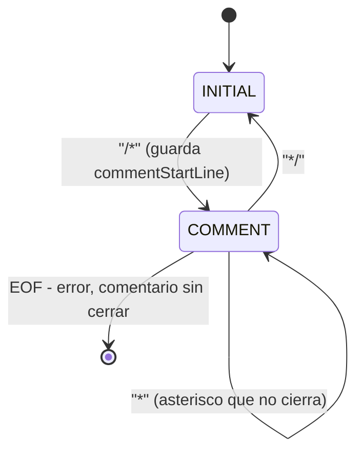

# Análisis Léxico

**Archivo:** `src/parser/lexer.l` (78 líneas)

---

## 1. Qué problema resuelve

Convertir la secuencia de caracteres del archivo fuente en una secuencia de tokens (par clase de token y valor semántico), descartando espacios y comentarios, y reportando los caracteres que no pertenecen al alfabeto de C-TDS.

Es la única fase que opera sobre el texto crudo; el resto del compilador consume tokens o estructuras derivadas de ellos.

---

## 2. Interfaz pública

Flex genera `build/lex.yy.c` a partir de `src/parser/lexer.l` y expone su interfaz estándar:

| Símbolo | Qué es | Quién lo usa |
| --- | --- | --- |
| `yylex()` | Devuelve el siguiente token, o `0` al llegar a `EOF` | `yyparse()` durante el parseo; `runScan` en `driver.c` para `-target scan` |
| `yytext` | Puntero al lexema recién reconocido | Las acciones de `lexer.l` y `runScan` al imprimir tokens |
| `yyleng` | Longitud de `yytext` | No se utiliza en el proyecto |
| `yylineno` | Línea actual, mantenida automáticamente por Flex | Reporte de errores en todas las fases y registro de línea en nodos del AST |
| `yylval` | Unión con el valor semántico del token | Escrita por las reglas léxicas; leída por el parser como `$1`, `$2`, … |
| `yyin` | `FILE *` de entrada | Inicializado en `main.c` al abrir el archivo fuente |

`yylval` corresponde a la `%union` declarada en `bison.y`. El analizador léxico escribe tres de sus campos:

```c
%union {
    int intval;       /* NUMBER y BOOL_CONST */
    float floatval;   /* FLOAT_CONST */
    char *strval;     /* ID */
    ...
}
```

`yylex()` es independiente del consumidor: con `-target scan`, el driver lo invoca en bucle e imprime el nombre del token y su lexema ignorando `yylval`; en el resto de los modos lo invoca `yyparse()` y consume los valores semánticos.

---

## 3. Configuración del escáner

### Opciones

```
%option yylineno noyywrap nounput noinput
```

| Opción | Efecto | Motivo |
| --- | --- | --- |
| `yylineno` | Incrementa `yylineno` al consumir `\n` | Provee el número de línea a los diagnósticos sin contadores manuales |
| `noyywrap` | Termina al llegar a `EOF` sin invocar `yywrap()` | El compilador procesa un único archivo por ejecución |
| `nounput` / `noinput` | Omite la generación de `unput()` e `input()` | Evita advertencias de `-Wunused-function` en GCC |

### Condiciones de arranque (*start conditions*)

```
%x COMMENT
```

Declara un estado exclusivo para comentarios multilínea. Las *start conditions* permiten conmutar entre distintos autómatas finitos dentro del mismo escáner: mientras está activo `COMMENT`, solo se evalúan las reglas prefijadas con `<COMMENT>`, desactivando el reconocimiento de tokens normales (a diferencia de un estado inclusivo `%s`, donde las reglas sin prefijo seguirían activas). El estado inicial predefinido es `INITIAL`.

### Definiciones nombradas

Macros de expresiones regulares que se expanden en las reglas:

| Definición | Expresión | Descripción |
| --- | --- | --- |
| `DIGIT` | `[0-9]` | Dígito decimal |
| `ALPHA` | `[a-zA-Z]` | Letra ASCII (sin acentos ni `ñ`) |
| `ALPHA_NUM` | `{ALPHA}\|{DIGIT}\|"_"` | Carácter válido a partir del segundo carácter de un identificador |
| `ID` | `{ALPHA}({ALPHA_NUM})*` | Identificador: letra inicial seguida de letras, dígitos o `_` |
| `NUMBER` | `{DIGIT}+` | Literal entero |
| `FLOAT` | `{DIGIT}+"."{DIGIT}+` | Literal de punto flotante con dígitos a ambos lados del punto |

Consecuencias directas de estas definiciones:

- Un identificador no puede comenzar con `_`: `ID` exige `{ALPHA}` como primer carácter. Una entrada como `_foo` produce error léxico sobre `_` y luego reconoce `foo` como `ID`.
- `3.` y `.5` no son literales reales válidos: `FLOAT` requiere `{DIGIT}+` antes y después del punto. `3.` se tokeniza como `NUMBER(3)` seguido de un error léxico sobre `.`.

---

## 4. Reglas léxicas

Las reglas aparecen en el siguiente orden en `src/parser/lexer.l` (relevante en caso de empate en longitud; ver §5).

### Palabras reservadas

| Patrón | Acción | Token |
| --- | --- | --- |
| `"boolean"` | `return BOOLEAN;` | Tipo |
| `"int"` | `return INT;` | Tipo |
| `"float"` | `return FLOAT;` | Tipo |
| `"void"` | `return VOID;` | Tipo de retorno |
| `"if"` | `return IF;` | Control |
| `"else"` | `return ELSE;` | Control |
| `"while"` | `return WHILE;` | Control |
| `"return"` | `return RETURN;` | Control |

No asignan `yylval`: la clase de token contiene toda la información necesaria.

### Constantes y literales

| Patrón | Acción | Notas |
| --- | --- | --- |
| `"true"` | `yylval.intval = 1; return BOOL_CONST;` | Los booleanos se representan como enteros `1`/`0` en todo el compilador |
| `"false"` | `yylval.intval = 0; return BOOL_CONST;` | Ídem |
| `{FLOAT}` | `yylval.floatval = atof(yytext); return FLOAT_CONST;` | `atof` devuelve `double` y se trunca a `float` (precisión simple) |
| `{NUMBER}` | `yylval.intval = atoi(yytext); return NUMBER;` | `atoi` no verifica desborde (ver §9) |

### Identificadores

| Patrón | Acción |
| --- | --- |
| `{ID}` | `yylval.strval = strdup(yytext); return ID;` |

Es la única regla del escáner que reserva memoria dinámica (ver §7).

### Operadores y delimitadores

| Patrón | Acción | Notas |
| --- | --- | --- |
| `"="` | `return '=';` | Carácter ASCII como código de token |
| `"+"\|"-"\|"*"\|"/"\|"%"` | `return yytext[0];` | Operadores aritméticos |
| `"=="` | `return EQ;` | Token con nombre (dos caracteres) |
| `"<"\|">"` | `return yytext[0];` | Operadores relacionales |
| `"&&"` | `return AND;` | Conjunción lógica |
| `"\|\|"` | `return OR;` | Disyunción lógica |
| `"!"` | `return NOT;` | Negación lógica |
| `"("\|")"\|"{"\|"}"\|";"\|","` | `return yytext[0];` | Delimitadores |

Bison permite usar el código ASCII de un carácter directamente como identificador de token (`'+'`, `'<'`, `';'`). Los operadores compuestos (`==`, `&&`, `||`) requieren un `%token` simbólico (`EQ`, `AND`, `OR`). `NOT` es de un solo carácter pero usa nombre simbólico porque declara precedencia junto con `UMINUS` en `bison.y`. Operadores ausentes en C-TDS (`!=`, `<=`, `>=`, `++`, `+=`) caen en la regla de error léxico (ver §8).

### Comentarios y espacios

| Patrón | Estado | Acción |
| --- | --- | --- |
| `[ \t\r\n]+` | `INITIAL` | Descarta blancos y saltos de línea; continúa el escaneo |
| `"//".*` | `INITIAL` | Descarta hasta fin de línea (`.` no consume `\n`) |
| `"/*"` | `INITIAL` | `commentStartLine = yylineno; BEGIN(COMMENT);` |
| `"*/"` | `COMMENT` | `BEGIN(INITIAL);` |
| `[^*]+` | `COMMENT` | Consume secuencias sin asteriscos, incluidos `\n` |
| `"*"` | `COMMENT` | Consume un `*` que no forma `*/` |
| `<<EOF>>` | `COMMENT` | Reporta comentario sin cerrar en `commentStartLine`, restaura `INITIAL` y devuelve `0` |

### Errores léxicos y estado interno

| Elemento | Descripción |
| --- | --- |
| `.` | Regla comodín final: invoca `lexicalError(yylineno, "simbolo no permitido '%s'", yytext)` sin ejecutar `return`, permitiendo continuar el escaneo |
| `static int commentStartLine` | Conserva la línea donde se abrió `/*` para reportar allí el error si se alcanza `EOF` |

---

## 5. Selección de reglas y precedencia léxica

Flex compila todas las expresiones regulares de un estado en un único autómata finito determinista (AFD), por lo que el reconocimiento es lineal en el tamaño de la entrada. En cada posición aplica dos reglas de desambiguación:

1. **Match más largo (*maximal munch*):** gana la expresión regular que consume más caracteres.
2. **Orden de declaración:** si dos reglas consumen exactamente la misma cantidad de caracteres, gana la que aparece primero en `lexer.l`.

### Palabras reservadas frente a `{ID}`

Para la entrada `int`, tanto la regla `"int"` como `{ID}` consumen 3 caracteres. El empate se resuelve por orden de declaración, por lo que las palabras reservadas deben ubicarse antes de `{ID}`. En cambio, para `intx`, `"int"` consume 3 caracteres e `{ID}` consume 4; gana `{ID}` por *maximal munch*:

```
[Linea 1] INT          int
[Linea 1] ID           intx
[Linea 1] ';'          ;
```

### Operadores de uno y dos caracteres (`"="` frente a `"=="`)

Aunque `"="` se declara antes que `"=="`, la entrada `==` coincide con 1 carácter en la primera regla y con 2 en la segunda. Gana `"=="` por longitud sin depender del orden relativo entre ambas.

### `{FLOAT}` frente a `{NUMBER}`

Sobre `3.14`, `{NUMBER}` consume 1 carácter (`3`) y `{FLOAT}` consume 4 (`3.14`), resultando en `FLOAT_CONST` por longitud independientemente del orden de las reglas.

---

## 6. Comentarios multilínea

El comentario delimitado por `/* ... */` se implementa mediante el estado exclusivo `COMMENT`:



- **Separación entre `[^*]+` y `"*"`:** `[^*]+` consume cualquier corrida sin asteriscos (incluidos saltos de línea, que actualizan `yylineno`). Los asteriscos se procesan con una regla separada `"*"` de longitud 1; cuando aparece `*/`, la regla `"*/"` de longitud 2 prevalece por *maximal munch*.
- **Reporte en la línea de apertura:** al dispararse `<COMMENT><<EOF>>`, `yylineno` ya apunta al final del archivo. Usar `commentStartLine` permite indicar la línea exacta donde quedó abierto el `/*`.
- **Reinicio de estado en `EOF`:** la regla `<COMMENT><<EOF>>` ejecuta `BEGIN(INITIAL)` antes de `return 0`, garantizando que el escáner quede en el estado inicial cuando se lo invoca múltiples veces dentro del mismo proceso (como ocurre en la suite de tests unitarios).

---

## 7. Propiedad de memoria de los identificadores

`yytext` apunta al buffer interno de Flex, cuyo contenido se sobrescribe al escanear el siguiente token. Por eso la regla `{ID}` duplica el lexema con `strdup(yytext)` y transfiere la propiedad del puntero a través del parser hasta la tabla de símbolos:

```
lexer.l:        yylval.strval = strdup(yytext)      <- reserva en heap
   v
bison.y:        $1 en las reglas con ID
   v
symbol_table.c: newSymbol(id, ...) -> symbol->id = id  <- adopta el puntero sin copiar
   v
symbol_table.c: freeSymbol() -> free(symbol->id)       <- libera la memoria
```

`newSymbol` adopta el puntero directamente en lugar de volver a copiar la cadena; en consecuencia, cualquier identificador pasado a `newSymbol` (o descartado ante un error de reserva en `ast.c`) debe provenir de memoria dinámica liberable con `free()`.

---

## 8. Cómo se extiende

### Agregar un operador de dos caracteres (`!=`, `<=`, `>=`)

1. `lexer.l`: agregar la regla `"!=" { return NEQ; }` (el criterio de longitud garantiza que prevalezca sobre `"!"` y `"="`).
2. `bison.y`: declarar `%token NEQ`, ubicarlo en la precedencia correspondiente (`%left EQ NEQ`) y añadir la producción en `Expression`.
3. `types.h` y `ast.c`: agregar `OP_NEQ` a `OperationType` y su nombre en `getOperationName`.
4. `type_checker.c`, `intermediate_code.c` y `object_code.c`: añadir la validación de tipos, la instrucción TAC y su traducción a x86-64 (`setne`). Como alternativa sin modificar las fases posteriores, puede desazucararse en `bison.y` construyendo `!(a == b)`.

### Agregar una palabra reservada (`for`, `do`, `break`)

Declarar la regla literal dentro del bloque de palabras reservadas, antes de `{ID}`. Si se ubica después de `{ID}`, el empate de longitud se resolverá a favor de `ID` y la palabra reservada será tratada como identificador.

### Agregar un nuevo formato de literal (notación científica, hexadecimal)

Definir la expresión regular y su regla antes o después de `{NUMBER}` asegurando que el patrón consuma más caracteres que `{NUMBER}` (por ejemplo, sin una regla específica, `0x1F` se divide en `NUMBER(0)` seguido de `ID(x1F)`).

### Permitir identificadores que comiencen con `_`

Reemplazar `ID {ALPHA}({ALPHA_NUM})*` por `ID ({ALPHA}|"_")({ALPHA_NUM})*`.

---

## 9. Consideraciones y límites

- **`atoi` no detecta desborde:** literales enteros fuera del rango de `int` tienen comportamiento indefinido en `atoi`. Para validarlo habría que usar `strtol` y verificar `errno == ERANGE`.
- **`atof` trunca a `float`:** el valor se almacena en `float floatval` (32 bits) desde el análisis léxico, en concordancia con la precisión simple del lenguaje.
- **Los errores léxicos no detienen el escaneo:** la regla `.` reporta cada carácter inválido mediante `lexicalError` y continúa consumiendo la entrada para reportar todos los errores léxicos en una sola pasada, a diferencia del parser que corta en el primer error sintáctico.
- **Sin anidamiento de comentarios:** `/* a /* b */ c */` cierra el comentario en el primer `*/` y tokeniza `c */` como código normal. Soportar comentarios anidados requeriría mantener un contador de profundidad en el estado `COMMENT`.

---

## 10. Cómo se valida

- **Tests unitarios:** `tests/test_lexer.c` verifica palabras reservadas, identificadores, literales enteros y flotantes, operadores, comentarios de línea y multilínea, errores léxicos y conteo de `yylineno`.
- **Inspección manual:** `-target scan` ejecuta únicamente el escáner y genera un archivo `.lex` con la secuencia de tokens, línea y lexema:

```bash
./mi_compilador -target scan examples/valido_completo.ctds
```

---

**Siguiente:** [Análisis Sintáctico](02-analisis-sintactico.md)
