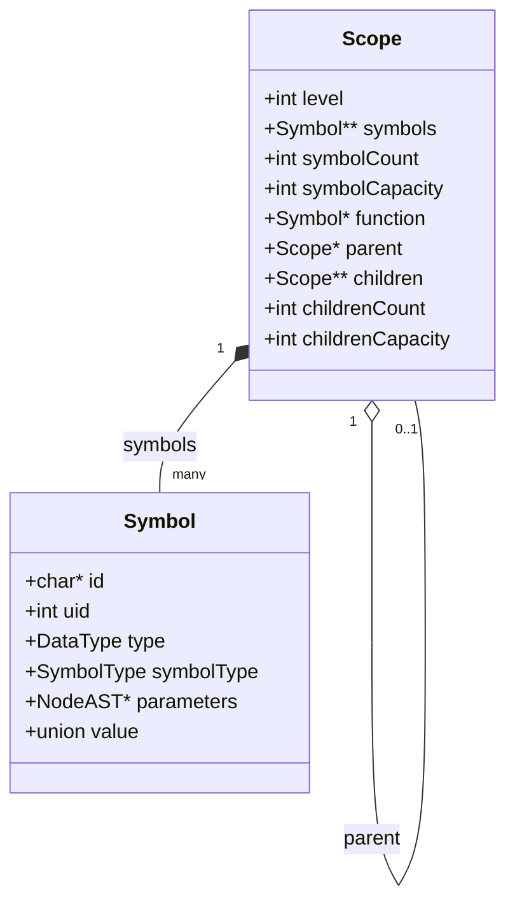

# Tabla de Símbolos y Ámbitos

**Archivos:** `include/symbol_table.h`, `src/semantic/symbol_table.c` (278 líneas)

Estructura de datos que registra los identificadores declarados en el programa, su tipo y el ámbito léxico al que pertenecen.

---

## 1. Qué problema resuelve

El [AST](../03-lexico-sintactico-y-ast/04-ast.md) conserva los nombres de los identificadores, pero un nodo `ID_NODE` con el nombre `x` no indica a qué declaración refiere. La tabla de símbolos resuelve cada uso respetando el alcance léxico (*static scoping*) y el anidamiento de ámbitos del lenguaje, donde la visibilidad queda determinada por la posición en el texto fuente y una declaración interna puede ocultar (*shadowing*) a una externa del mismo nombre.

Es una estructura auxiliar construida y consultada durante el [análisis semántico](03-analisis-semantico.md).

---

## 2. Interfaz pública

### Símbolos

| Función | Descripción |
| --- | --- |
| `newSymbol(id, symbolType, type, parameters)` | Crea e inicializa un símbolo en el heap |
| `freeSymbol(symbol)` | Libera el símbolo junto con su cadena `id` |

### Ámbitos

| Función | Descripción |
| --- | --- |
| `createScope(level, parent, function)` | Crea un ámbito enlazado a su padre |
| `freeScope(scope)` | Libera recursivamente el ámbito, sus sub-ámbitos y sus símbolos |
| `appendSymbol(scope, symbol)` | Registra un símbolo en el ámbito y le asigna su `uid` |
| `appendChildScope(parent, child)` | Registra un sub-ámbito en el arreglo de hijos del padre |
| `lookupSymbol(scope, id)` | Busca un identificador en el ámbito actual y asciende por `parent` |
| `lookupSymbolInScope(scope, id)` | Busca únicamente en el ámbito indicado |
| `resetSymbolUids()` | Reinicia el contador global de `uid` a 1 |

Todas las funciones de ámbitos aceptan `NULL` de forma segura sin realizar ninguna operación.

---

## 3. La estructura `Symbol`

```c
typedef struct Symbol {
    char *id;
    int uid;                    /* 0 si aún no fue registrado en un ámbito */
    DataType type;
    SymbolType symbolType;
    struct NodeAST *parameters; /* Parámetros formales si es METHOD_SYMBOL */
    union {
        int intValue;
        float floatValue;
        NodeAST *function;
    } value;
} Symbol;
```

| Campo | Propósito |
| --- | --- |
| `id` | Nombre del identificador (`NULL` en las constantes literales) |
| `uid` | Identificador numérico único en todo el programa (ver §6) |
| `type` | Tipo de dato de la variable o constante, o tipo de retorno si es un método |
| `symbolType` | Categoría del símbolo (`VARIABLE_SYMBOL`, `METHOD_SYMBOL`, `CONSTANT_SYMBOL`) |
| `parameters` | Puntero al `PARAMETERS_NODE` del AST para validar los argumentos en las llamadas a métodos |
| `value` | Valor literal cuando el símbolo representa una constante (`intValue` para enteros y booleanos, `floatValue` para reales) |

### Variantes de `SymbolType` y reutilización para literales

| Variante | Origen | Campos utilizados |
| --- | --- | --- |
| `VARIABLE_SYMBOL` | Parser y `newParameterDeclaration` | `id`, `uid`, `type` |
| `METHOD_SYMBOL` | `newMethodDeclaration` | `id`, `uid`, `type` (retorno), `parameters` |
| `CONSTANT_SYMBOL` | Constructores `new*LiteralNode` en `ast.c` | `type`, `value` (`id == NULL`, `uid == 0`) |

La misma estructura `Symbol` se utiliza tanto para declaraciones registradas en la tabla como para literales colgados de un `CONSTANT_NODE`. En consecuencia, un símbolo con `id == NULL` y `uid == 0` no representa una entrada inválida, sino una constante anónima que nunca se inserta en un `Scope`.

### Propiedad de la cadena `id`

`newSymbol` asigna el puntero `id` directamente sin duplicar la cadena (`symbol->id = id`). El string proviene del `strdup` realizado en el [análisis léxico](../03-lexico-sintactico-y-ast/01-analisis-lexico.md) y es liberado por `freeSymbol`, evitando copias intermedias a lo largo del front-end.

---

## 4. La estructura `Scope`



```c
typedef struct Scope {
    int level;               /* 0 para el ámbito global */
    Symbol **symbols;
    int symbolCount;
    int symbolCapacity;
    Symbol *function;        /* Método contenedor (NULL si es global) */
    struct Scope *parent;    /* Ámbito padre (NULL en el global) */
    struct Scope **children;
    int childrenCount;
    int childrenCapacity;
} Scope;
```

| Campo | Propósito |
| --- | --- |
| `level` | Nivel de anidamiento léxico (informativo; la búsqueda sigue `parent`) |
| `symbols` / `symbolCount` / `symbolCapacity` | Arreglo dinámico de símbolos declarados en este ámbito |
| `function` | Símbolo del método contenedor, utilizado para validar el tipo de las sentencias `return` |
| `parent` | Puntero al ámbito padre para la resolución jerárquica de nombres |
| `children` / `childrenCount` / `childrenCapacity` | Sub-ámbitos hijos, utilizados por `freeScope` para liberar el árbol completo |

Cuando el análisis semántico abre el ámbito de un bloque interno, hereda el puntero `function` de su padre (`parent->function`). De este modo, una sentencia `return` ubicada dentro de bloques `if` o `while` anidados conserva el acceso a la firma del método que la contiene.

---

## 5. Búsqueda de identificadores

El módulo ofrece dos operaciones de consulta que corresponden a dos reglas semánticas distintas:

- **`lookupSymbolInScope(scope, id)`**: recorre linealmente el arreglo `symbols` del ámbito actual con `strcmp`. Se utiliza al procesar una declaración para detectar redeclaraciones ilegales dentro del mismo ámbito.
- **`lookupSymbol(scope, id)`**: invoca a `lookupSymbolInScope(scope, id)` y, si no halla el nombre, recurre sobre `scope->parent` hasta llegar al ámbito global (`parent == NULL`). Evaluar el ámbito actual antes de ascender al padre implementa directamente el ocultamiento de nombres (*shadowing*).

La búsqueda local es $O(n)$ en la cantidad de símbolos del ámbito y la jerárquica es $O(n \times \text{profundidad})$. Dado el tamaño reducido de los ámbitos en programas C-TDS, un arreglo dinámico resulta suficiente sin recurrir a tablas de hash.

---

## 6. Identificador único (`uid`) y renombrado

```c
static int nextSymbolUid = 1;   /* 0 reservado para símbolos no registrados */

void appendSymbol(Scope *scope, Symbol *symbol) {
    if (symbol->uid == 0) {
        symbol->uid = nextSymbolUid++;
    }
    ...
}
```

Cada símbolo registrado mediante `appendSymbol` recibe un número secuencial global al programa. Este identificador cumple dos funciones:

1. **Propiedad de memoria (`uid == 0`):** el valor `0` identifica símbolos que no pertenecen a ningún ámbito (literales o símbolos provisorios creados por el parser en nodos de uso). `freeAST` y `resolveNodeSymbol` utilizan esta marca para liberar únicamente los símbolos que no viven en la tabla (ver [AST](../03-lexico-sintactico-y-ast/04-ast.md)).
2. **Renombrado único para fases posteriores:** el código intermedio y el código objeto operan sobre listas planas de instrucciones sin estructura de ámbitos. Al formatear cada variable como `nombre@uid` en el TAC, las declaraciones homónimas en distintos ámbitos quedan desambiguadas de forma análoga a un renombrado alfa.

### Ejemplo de resolución y renombrado

```c
int x;
int main(){
    int x;
    x = 10;
    {
        int x;
        x = 20;
    }
    return x;
}
```

El archivo `.sem` refleja los `uid` asignados (donde `#2` corresponde a `main`):

```text
  | Declaracion Variable: x #1 (Tipo INT)
  | Metodo: main (Retorna INT)
  |   |   | Declaracion Variable: x #3 (Tipo INT)
  |   |   | Asignacion a: x #3 (Tipo INT)
  |   |   | Bloque
  |   |   |   | Declaracion Variable: x #4 (Tipo INT)
  |   |   |   | Asignacion a: x #4 (Tipo INT)
  |   |   | Return
  |   |   |   | ID: x #3 (Tipo INT)
```

En el archivo `.ci`, cada referencia queda calificada con su `@uid`:

```text
global x@1, INT
begin_func main, 0
local x@3, INT
x@3 = 10
local x@4, INT
x@4 = 20
ret x@3
end_func main
```

La función `resetSymbolUids()` reinicia el contador a 1 y es utilizada exclusivamente por las suites de tests (`test_semantic.c`, `test_tac.c`, `test_integration.c`) para garantizar numeraciones deterministas entre casos de prueba.

---

## 7. Reglas de alcance resultantes

La interacción entre `Scope` y el [análisis semántico](03-analisis-semantico.md) define el comportamiento del alcance en tres casos clave:

- **Parámetros y locales del cuerpo comparten ámbito:** `analyzeMethodNode` registra los parámetros formales y las declaraciones del bloque principal del método dentro del mismo `methodScope`. Declarar una variable local con el mismo nombre que un parámetro produce un error de redeclaración:

```c
int f(int n){ int n; n = 1; return n; }
// Error semantico en la linea 1: La variable 'n' ya fue declarada previamente en este ambito.
```

- **Bloques internos pueden ocultar parámetros:** un bloque `{ ... }` anidado dentro del método abre un ámbito hijo nuevo, por lo que una declaración de `n` allí oculta temporalmente al parámetro sin generar conflicto:

```c
int f(int n){ { int n; n = 99; } return n; }
int main(){ return f(7); } // retorna 7
```

- **Soporte para recursión directa:** el símbolo de un método se inserta en el ámbito global antes de analizar su cuerpo, permitiendo que las llamadas recursivas como `fact(n - 1)` resuelvan el identificador del propio método.

---

## 8. Conexión con las fases vecinas

| Módulo origen / destino | Interacción |
| --- | --- |
| `ast.c` (entrada) | Entrega nodos con instancias de `Symbol` provisorias (`uid == 0`) |
| `type_checker.c` (salida) | Usa `lookupSymbol` para resolver identificadores y consultar sus tipos y firmas |
| `semantic_analyzer.c` (salida) | Usa `lookupSymbolInScope` para detectar duplicados y `scope->function` para validar `return` |
| `intermediate_code.c` (salida) | Lee el `uid` de cada símbolo para construir los nombres calificados `x@uid` en el TAC |

Tras el análisis semántico, todos los nodos del AST que referencian a una misma variable o método apuntan a la misma instancia de `Symbol` almacenada en la tabla de símbolos.

---

## 9. Cómo se extiende

### Un `SymbolType` nuevo

Agregar la constante al `enum SymbolType` y definir qué campos de la estructura o de la unión `value` utiliza. Como no existe un `switch` centralizado sobre `SymbolType`, solo se modifican las funciones que deban consultar la nueva categoría.

### Guardar el offset de pila en el símbolo

Si se quisiera evitar la tabla de offsets separada del backend, podría añadirse un campo `int stackOffset` en `Symbol`. Actualmente esa información se mantiene en [`function_frame.c`](../07-codigo-objeto/01-marco-de-pila.md) indexada por nombre calificado, lo que evita acoplar la tabla de símbolos del front-end con detalles de la arquitectura x86-64.

### Reemplazar la búsqueda lineal por una tabla de hash

Puede sustituirse el arreglo dinámico `symbols` dentro de `Scope` por una tabla de hash sin alterar las firmas de `lookupSymbol`, `lookupSymbolInScope` ni `appendSymbol`, manteniendo intactos los demás módulos.

### Declaración adelantada de métodos

Actualmente un método solo puede invocar a los declarados previamente en el archivo porque el registro y el análisis de cuerpos ocurren en una sola pasada. Soportar recursión mutua o llamadas adelantadas solo requiere una pasada previa en el [análisis semántico](03-analisis-semantico.md) que invoque `appendSymbol` para todas las firmas globales antes de recorrer los cuerpos.

---

## 10. Trampas y límites conocidos

- **`uid == 0` está reservado:** el contador global comienza en 1 porque `0` indica que el símbolo no pertenece a ningún ámbito. Si un símbolo registrado conservara `uid == 0`, `freeAST` intentaría liberarlo causando una doble liberación.
- **El `uid` es global al programa, no local al ámbito:** dos variables en métodos distintos reciben números distintos, por lo que el `uid` no representa el índice de la variable dentro de su ámbito.
- **Fallo silencioso en `appendSymbol` ante falta de memoria:** si `realloc` falla al expandir el arreglo de símbolos, la función retorna sin registrar la entrada ni reportar error, lo que se manifestaría más adelante como un error de variable no declarada.
- **Doble rol de `Symbol` (§3):** un símbolo con `id == NULL` y `uid == 0` corresponde a una constante literal en el AST, no a una entrada corrupta.
- **El ámbito global no se libera al finalizar:** aunque `freeScope` libera recursivamente toda la jerarquía, el compilador no la invoca al cierre de `driver.c`, dejando que el sistema operativo recupere la memoria junto con el AST.

---

## 11. Cómo se valida

- **Suite unitaria:** `tests/test_symbol_table.c` ejercita la creación y liberación de ámbitos, asignación de `uid`, búsqueda local y jerárquica, ocultamiento de nombres y manejo de punteros `NULL`.
- **Inspección manual:** el archivo `.sem` muestra el `uid` resuelto de cada símbolo tras el carácter `#`, y el archivo `.ci` lo exhibe como sufijo `@n`:

```bash
./mi_compilador -target sem examples/programa.ctds
./mi_compilador -target codinter examples/programa.ctds
```

---

**Siguiente:** [Chequeo de Tipos](02-chequeo-de-tipos.md)
