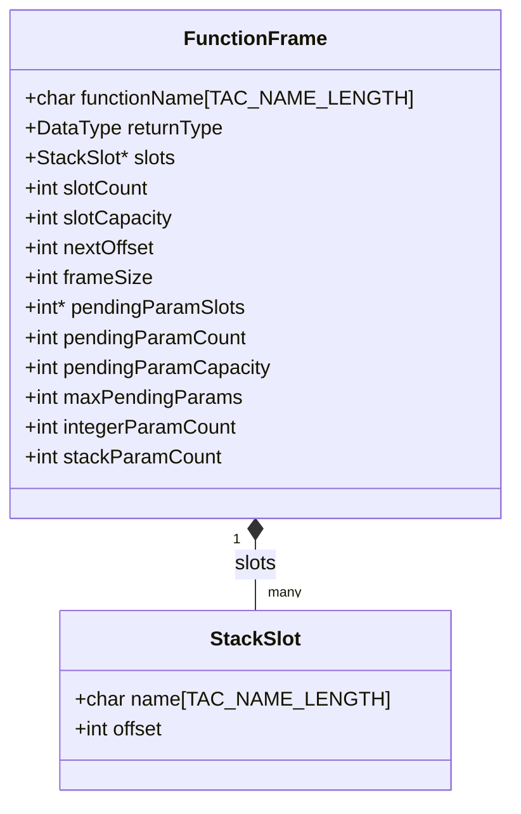

# Marco de Pila

**Archivos:** `include/function_frame.h`, `src/object_code/function_frame.c` (247 líneas)

Dónde vive cada variable, parámetro y temporal durante la ejecución de un
método.

!!! note "El marco solo ubica enteros y booleanos"
    El enunciado acota esta etapa a **tipos enteros y lógicos**, así que todas
    las ranuras son de 4 bytes y hay una sola clase de registro de argumento.
    Un programa con `float` se rechaza antes, al generar el código intermedio.

---

## 1. Qué problema resuelve

El [TAC](../05-codigo-intermedio/01-representacion-tac.md) tiene **temporales ilimitados** con nombres
simbólicos (`t0`, `x@3`), y la máquina tiene dieciséis registros y memoria. Hay
que decidir dónde queda cada uno.

La decisión de este compilador es la más simple que es correcta: **cada variable,
parámetro y temporal recibe su propia ranura de 4 bytes en la pila**, y los
registros solo se usan de paso para operar. Este módulo lleva esa contabilidad:
nombre → desplazamiento respecto de `%rbp`.

La alternativa es la **asignación de registros**, que mantiene los valores más
usados en registros y solo derrama a memoria lo que no entra. Es muchísimo más
rápida y muchísimo más difícil; el enunciado pide correctitud, no eficiencia.

---

## 2. Cómo queda la pila

En x86-64 la pila **crece hacia direcciones más bajas**. El marco de una función
queda así:

```text
Direcciones altas
  ▲
  │   ┌──────────────────────────────────────────┐
  │   │ Parámetros 7 en adelante (si existieran) │ > +16(%rbp)
  │   ├──────────────────────────────────────────┤
  │   │ Dirección de retorno (colocada por call) │  +8(%rbp)
  │   ├──────────────────────────────────────────┤
  │   │ %rbp anterior (guardado en el prólogo)   │   0(%rbp)  ◄── %rbp
  │   ├──────────────────────────────────────────┤
  │   │ Primer slot: parámetro o local           │  -4(%rbp)
  │   │ Segundo slot                             │  -8(%rbp)
  │   │ Variable local x@3                       │ -12(%rbp)
  │   │ Temporal t0                              │ -16(%rbp)
  │   │ ...                                      │ ...
  │   │ Ranuras de argumentos pendientes (§5)    │
  │   │ Relleno de alineación a 16 bytes         │
  ▼   └──────────────────────────────────────────┘            ◄── %rsp
Direcciones bajas
```

**Los dos registros que sostienen el marco:**

- **`%rbp`** (*base pointer*) queda **fijo** durante toda la ejecución del método.
  Todo se referencia como desplazamiento negativo suyo: `-4(%rbp)`, `-8(%rbp)`.
  Por eso el marco es estable aunque `%rsp` se mueva.
- **`%rsp`** (*stack pointer*) apunta a la cima. El compilador calcula el espacio
  total de antemano y lo resta **una sola vez** en el prólogo con
  `subq $frameSize, %rsp`.

Que los offsets sean negativos y relativos a `%rbp` y no a `%rsp` es lo que
permite no recalcular nada: con `%rsp` como referencia, cada `push` cambiaría la
dirección de todas las variables.

**Lo que está arriba de `%rbp` no lo escribe esta función**: la dirección de
retorno la pone la instrucción `call` del llamador, y el `%rbp` anterior lo
guarda el prólogo. De ahí que los parámetros que no entraron en registros
aparezcan en `+16(%rbp)` y siguientes: están en el marco **del llamador**.

---

## 3. Las estructuras



### `StackSlot`: nombre y desplazamiento

```c
typedef struct StackSlot {
    char name[TAC_NAME_LENGTH];
    int offset;      /* relativo a %rbp: -4, -8, -12... */
} StackSlot;
```

Nada más. Es una entrada de un mapa nombre → offset, y el nombre es el del
operando TAC tal cual, con su sufijo `@uid`. **Ahí se cobra el renombrado único**
de la [tabla de símbolos](../04-semantico/01-tabla-de-simbolos.md): como los nombres ya son irrepetibles en todo el programa, buscar
por nombre no puede confundir dos variables homónimas de ámbitos distintos.

### `FunctionFrame`: trece campos en cuatro grupos

| Campo | Para qué |
| --- | --- |
| `functionName` | El nombre, usado para la etiqueta y para `.L_<fn>_epilogue` |
| `returnType` | El tipo de retorno. Hace falta en el **epílogo**, para poner `%eax` en cero cuando `main` es `void` |
| `slots`, `slotCount`, `slotCapacity` | El arreglo dinámico de ranuras |
| `nextOffset` | Bytes ocupados hasta ahora. **Se incrementa, el offset es su negativo** |
| `frameSize` | El total alineado a 16 bytes |
| `pendingParamSlots` | Las ranuras de los argumentos de la llamada en curso (§5) |
| `pendingParamCount`, `pendingParamCapacity`, `maxPendingParams` | Cuántos hay apilados, cuánto cabe, y el **pico** calculado antes de emitir |
| `integerParamCount`, `stackParamCount` | Cuántos parámetros formales ya se ubicaron en registros y cuántos vinieron por la pila |

Los dos últimos existen porque la convención de llamada manda los primeros seis
argumentos enteros a `%edi, %esi, %edx, %ecx, %r8d, %r9d` y **el resto por la
pila**: hay que saber cuántos registros se consumieron para decidir de dónde se
lee el siguiente parámetro. La ABI define además una secuencia aparte para los
reales (`%xmm0`–`%xmm7`) que avanza independientemente, pero esta etapa no
genera código para reales.

---

## 4. Las seis funciones

### `createFrame(functionName)` y `freeFrame(frame)`

`createFrame` reserva la estructura y sus dos arreglos: las ranuras con capacidad
16 y el de argumentos pendientes con capacidad `INITIAL_PENDING_PARAMS_CAPACITY`
(64). Si alguna reserva falla, llama a `freeFrame` y devuelve `NULL`.
`freeFrame` libera los dos arreglos y la estructura; como `free(NULL)` no hace
nada, ese camino de error es seguro sin chequeos adicionales.

### `addSlot(frame, operand)` — idempotente

```c
int existingOffset = 0;
if (getSlotOffset(frame, operand->name, &existingOffset)) {
    return existingOffset;                  /* ya tenia ranura */
}

frame->nextOffset += 4;
...
slot->offset = -frame->nextOffset;
```

**Primero busca**, con la misma `getSlotOffset` que usa el generador. Si el
operando ya tiene ranura, devuelve la que tenía sin reservar otra. Esa idempotencia es lo que permite que la pasada de
dimensionamiento recorra todas las instrucciones llamando a `addSlot` sobre cada
operando sin preocuparse por los repetidos: `t0` aparece en dos instrucciones y
recibe una sola ranura.

**Cada ranura ocupa 4 bytes, sin importar el tipo.** `int` y `boolean`
miden lo mismo en C-TDS (32 bits, 32 bits y 1/0 guardado como entero), así que no
hay caso especial. Soportar `double` rompería esa uniformidad y exigiría mirar el
tipo al reservar.

La búsqueda es un recorrido lineal con `strcmp`, igual que en la tabla de
símbolos: O(ranuras) por consulta. Para funciones de decenas de slots es
irrelevante.

### `addAnonymousSlot(frame)` — reserva sin registrar

```c
frame->nextOffset += 4;
return -frame->nextOffset;
```

Mueve el acumulador y devuelve el offset, **sin agregar nada a `slots`**. Por eso
`getSlotOffset` no puede encontrar estas ranuras: no tienen nombre.

Es deliberado y lo usan los argumentos pendientes (§5), que no son variables ni
temporales del TAC sino lugares de estacionamiento, y se identifican **por
posición** en la pila de argumentos, no por nombre.

### `getSlotOffset(frame, name, outOffset)`

La consulta que usa el generador al traducir cada instrucción: dado el nombre de
un operando, dónde está. Devuelve `false` si no lo encuentra, y ese `false` es lo
que el generador convierte en un error interno, porque significa que la pasada de
dimensionamiento se salteó un operando.

### `ensurePendingParamCapacity(frame, needed)`

Crecimiento por duplicación del arreglo de argumentos pendientes: duplica la
capacidad hasta cubrir `needed` y hace un único `realloc`. Si falla, devuelve
`false` sin tocar el arreglo, que sigue siendo válido con su capacidad anterior.

---

## 5. El mecanismo de argumentos pendientes

Es la parte menos obvia del módulo, y resuelve un problema concreto: **una
llamada anidada destruiría los argumentos que ya están en los registros**.

```c
f(g(1), h(2))
```

Si `f` recibiera sus argumentos directamente en `%edi` y `%esi`, al evaluar
`h(2)` la llamada a `h` sobrescribiría `%edi` con su propio argumento.

La solución es que **cada `param` del TAC copia su valor a una ranura propia del
marco**, y el `call` consume las últimas N justo antes de cargarlas a los
registros. Las ranuras son del marco de la función actual, así que ninguna
llamada anidada las toca.

### Cómo se dimensiona: la simulación del pico

`allocatePendingParamSlots` recorre el TAC de la función **simulando la pila** de
argumentos, sin emitir nada:

```c
if (scan->operation == TAC_PARAM) {
    pendingCount++;
    if (pendingCount > frame->maxPendingParams) frame->maxPendingParams = pendingCount;
} else if (scan->operation == TAC_CALL) {
    pendingCount -= arity;          /* la aridad viene en el segundo operando */
    if (pendingCount < 0) pendingCount = 0;
}
```

Después reserva exactamente `maxPendingParams` ranuras anónimas. **No hace falta
una por argumento del programa, sino una por cada argumento que puede estar
pendiente al mismo tiempo**, que es el pico de esa simulación.

### Verificación con una llamada anidada

```c
int g(int x){ return x * 10; }
int h(int x){ return x + 100; }
int f(int a, int b){ return a + b; }
int main(){ return f(g(1), h(2)); }
```

El TAC de `main`:

```
param 1
t3 = call g, 1      <- pendientes: 1 -> 0,  pico 1
param t3            <- pendientes: 1
param 2             <- pendientes: 2,       pico 2
t4 = call h, 1      <- pendientes: 1
param t4            <- pendientes: 2
t5 = call f, 2      <- pendientes: 0
ret t5
```

Pico = 2. Entonces el marco de `main` lleva: 3 temporales (`t3`, `t4`, `t5`) más
2 ranuras anónimas = **5 ranuras × 4 bytes = 20 bytes**, que alineado da **32**.
Y es exactamente lo que emite:

```asm
main:
    pushq %rbp
    movq %rsp, %rbp
    subq $32, %rsp
```

Los offsets que usa son `-4` a `-20`, los cinco. El programa devuelve 112, que es
`1*10 + 2+100`. Verificado.

---

## 6. La alineación a 16 bytes

```c
#define ALIGN_UP(value, alignment) (((value) + (alignment) - 1) & ~((alignment) - 1))

frame->frameSize = ALIGN_UP(frame->nextOffset, 16);
```

**Por qué hace falta.** La convención System V AMD64 exige que `%rsp` esté
alineado a 16 bytes **inmediatamente antes de cada `call`**. No es una
recomendación: varias instrucciones SSE fallan con operandos desalineados, y una
función de libc puede usarlas. Un marco desalineado produce un fallo de
segmentación en un lugar que no tiene nada que ver con la causa.

**Cómo funciona la macro.** `(value + alignment - 1)` sube al siguiente múltiplo
o más, y `& ~(alignment - 1)` apaga los bits bajos, que es dividir y multiplicar
por la potencia de dos de una sola vez. Para 16, `~15` es `...11110000`: apaga los
cuatro bits bajos. **Solo funciona si `alignment` es potencia de dos**, que es una
precondición no verificada de la macro.

| `nextOffset` | `frameSize` | Relleno |
| :---: | :---: | :---: |
| 4 (1 ranura) | 16 | 12 |
| 12 (3 ranuras) | 16 | 4 |
| 16 (4 ranuras) | 16 | 0 |
| 20 (5 ranuras) | 32 | 12 |

Verificado en los dos extremos: un `main` con 3 ranuras reserva `subq $16`, y el
de la llamada anidada con 5 reserva `subq $32`.

---

## 7. Las dos pasadas

El generador recorre cada función **dos veces**, y la razón es el prólogo: para
emitir `subq $frameSize, %rsp` hay que conocer `frameSize`, y para conocerlo hay
que haber visto todas las instrucciones.

### Pasada 1: `buildFrameLayout`

```c
allocateLocalSlots(frame, functionStart);        /* ranuras con nombre */
allocatePendingParamSlots(frame, functionStart); /* ranuras anonimas, por el pico */
frame->frameSize = ALIGN_UP(frame->nextOffset, 16);
```

`allocateLocalSlots` llama a `addSlot` sobre:

| Instrucción | Qué reserva |
| --- | --- |
| `TAC_PARAM_DECL` | El parámetro formal |
| `TAC_LOCAL_DECL` | La variable local |
| Cualquier operación cuyo `result` sea `OPERAND_TEMP` | El temporal |

Nótese que **las globales no reciben ranura**: viven en `.data` y se acceden con
`nombre(%rip)`. La distinción la hereda del opcode del TAC, que ya separaba
`GLOBAL_DECL` de `LOCAL_DECL`.

### Pasada 2: `emitFunction`

Prólogo, traducir instrucción por instrucción consultando `getSlotOffset`,
epílogo. Es la parte documentada en [generación de código objeto](02-generacion-codigo-objeto.md).

---

## 8. Prólogo y epílogo

### Prólogo

```asm
.globl sumar
.type sumar, @function
sumar:
    pushq %rbp              # guarda el frame pointer del llamador
    movq %rsp, %rbp         # fija el nuevo frame pointer
    subq $16, %rsp          # reserva el espacio calculado
```

El `subq` **solo se emite si `frameSize > 0`**: una función sin locales ni
temporales no reserva nada.

### Epílogo

```asm
.L_sumar_epilogue:
    leave                   # equivale a: movq %rbp, %rsp ; popq %rbp
    ret
```

**La etiqueta de epílogo es un punto de convergencia.** Todos los `return` de la
función saltan ahí con un `jmp` en lugar de duplicar el desarmado del marco. Por
eso `functionName` tiene que estar en el frame: la etiqueta se llama
`.L_<nombre>_epilogue` y hay que poder construirla tanto al emitir el salto como
al emitir el destino.

El prefijo `.L` no es decorativo: marca la etiqueta como **local al archivo**, así
que no entra en la tabla de símbolos del objeto y no puede chocar con un nombre de
otra unidad.

`leave` es una sola instrucción que hace `movq %rbp, %rsp` seguido de
`popq %rbp`: devuelve `%rsp` a donde estaba y restaura el marco del llamador. Y
`ret` saca la dirección de retorno que `call` había dejado en la pila.

---

## 9. Conexión con las fases vecinas

| Viene de | Qué cruza la frontera |
| --- | --- |
| `tac.h` | Los `TACOperand`, de los que se usa el `name` como clave |

| Va hacia | Qué entrega |
| --- | --- |
| `object_code.c` | `frameSize` para el prólogo, y un offset por cada operando, que se escribe como `offset(%rbp)` |

El módulo **no emite assembly**: no incluye `string_builder.h`. Es pura
contabilidad, y eso lo hace testeable sin generar una línea de código.

---

## 10. Cómo se extiende

### Un tipo de otro tamaño (`double`, `char`)

Es el cambio que más toca este módulo. Hoy `addSlot` suma 4 fijo; habría que
mirar `operand->type` y sumar lo que corresponda, **más respetar la alineación
natural**: un `double` de 8 bytes tiene que quedar en un offset múltiplo de 8, lo
que puede exigir relleno entre ranuras. El patrón habitual es ordenar las
ranuras de mayor a menor tamaño para minimizar el desperdicio.

### Arrays

Una ranura de `n × tamaño` en vez de una de 4, y el acceso pasa a ser
`base + índice × tamaño`, o sea direccionamiento indexado en lugar de un offset
fijo. `StackSlot` necesitaría un campo de tamaño.

### Asignación de registros

La mejora grande. En vez de darle ranura a cada temporal, mantener los más usados
en registros. Se construye el **grafo de interferencia** a partir del
[análisis de variables vivas](../06-optimizador/01-variables-vivas.md) —dos valores vivos al mismo
tiempo interfieren y no pueden compartir registro— y se lo colorea con tantos
colores como registros haya; lo que no se puede colorear se derrama a la pila.
Este módulo seguiría existiendo para los derrames.

### Reducir el tamaño del marco

Hoy cada temporal tiene ranura propia aunque su vida sea de dos instrucciones.
Con el análisis de vivacidad ya implementado, dos temporales cuyas vidas no se
solapan podrían **compartir** ranura. Es la versión en memoria del mismo problema
de coloreo, y es bastante más simple que hacerlo con registros.

---

## 11. Trampas y límites conocidos

- **`addAnonymousSlot` no registra la ranura**, así que `getSlotOffset` nunca la
  encuentra. No es un bug: esas ranuras se referencian por posición (§5).
- **`addSlot` devuelve 0 ante un error**, y 0 es también un offset sintácticamente
  válido (`0(%rbp)`, que es el `%rbp` guardado). El llamador no puede distinguir
  "falló" de "offset 0" por el valor de retorno. En la práctica nunca se asigna el
  offset 0 porque `nextOffset` se incrementa **antes** de calcularlo, así que el
  primer slot es `-4`; pero el contrato es ambiguo.
- **`ALIGN_UP` exige que la alineación sea potencia de dos** y no lo verifica.
  Con 16 funciona; con 12 daría un resultado sin sentido.
- **Todas las ranuras son de 4 bytes** (§4). Es correcto para los tres tipos del
  lenguaje y no para ninguno más.
- **La búsqueda es lineal.** O(ranuras) por consulta, y el generador consulta una
  o dos veces por instrucción, así que el dimensionamiento es cuadrático en el
  tamaño de la función. Irrelevante en estas escalas.
- **El marco no reutiliza ranuras** (§10). Una función con cien temporales de vida
  corta reserva cuatrocientos bytes.

---

## 12. La teoría detrás

- **Registro de activación** (*activation record* o *stack frame*): el bloque de
  memoria que una invocación de función necesita para sus datos locales. Se crea
  al llamar y se destruye al retornar, y la disciplina de pila es lo que hace que
  la recursión funcione sin esfuerzo: cada invocación tiene su propio marco.
- **Puntero de marco contra puntero de pila**: usar `%rbp` fijo como referencia
  cuesta un registro y una instrucción de prólogo, y a cambio da offsets
  constantes. Los compiladores optimizadores suelen **omitir el frame pointer**
  (`-fomit-frame-pointer`) y referenciar todo desde `%rsp`, lo que libera un
  registro a costa de recalcular offsets cada vez que `%rsp` se mueve. Acá se
  eligió `%rbp` por claridad.
- **Convención de llamada** (*calling convention* / ABI): el acuerdo sobre quién
  pone los argumentos dónde, quién preserva qué registros y por dónde vuelve el
  resultado. System V AMD64 es la de Linux; Windows usa otra. Respetarla es lo que
  permite que el código generado llame a libc y que `gcc` enlace el resultado.
- **Clases de registros**: la ABI reparte los argumentos según su clase —entera o
  de punto flotante— en **dos secuencias independientes**. Como esta etapa solo
  genera enteros y booleanos, el frame lleva una sola cuenta de registros
  (`integerParamCount`) más la de los que llegaron por la pila (§3).
- **Alineación de la pila**: el requisito de 16 bytes viene de que las
  instrucciones SSE operan sobre 16 bytes y algunas exigen alineación. Es un
  contrato de la ABI, y violarlo da fallos lejanos a la causa.
- **Asignación de almacenamiento** (*storage allocation*): decidir dónde vive cada
  valor. El espectro va desde "todo en memoria" —lo de acá, simple y lento— hasta
  la asignación de registros por coloreo de grafos. La información que habilita lo
  segundo es exactamente el [análisis de variables vivas](../06-optimizador/01-variables-vivas.md), lo cual
  explica por qué ese análisis es la pieza central de un back-end optimizador.
- **Derrame** (*spilling*): cuando no hay registros suficientes, mover un valor a
  memoria. En este compilador **todo está derramado desde el principio**, que es el
  caso degenerado.

---

## 13. Cómo se valida

- **Suite:** `tests/test_object_code.c` incluye los casos de
  dimensionamiento del marco y de offsets asignados.
- **A mano:** el prólogo del `.ass` muestra el tamaño calculado, y los offsets
  usados se leen en el cuerpo:

```bash
./mi_compilador -target assembly examples/factorial.ctds
grep -A3 '^factorial:' examples/factorial.ass          # el subq del prologo
```

- **Chequeos que el marco siempre debe cumplir:**

| Propiedad | Por qué |
| --- | --- |
| `frameSize` es múltiplo de 16 | Lo exige la ABI antes de cada `call` |
| Ningún offset usado excede `frameSize` en valor absoluto | Si no, se escribe fuera del marco reservado |
| Todo offset es negativo | Lo positivo es del llamador |

- **La prueba de fondo** es que el programa corra. Un marco mal dimensionado se
  manifiesta como corrupción de variables o fallo de segmentación, no como un
  error de ensamblado, así que lo que detecta el problema es ejecutar:

```bash
./mi_compilador -o /tmp/f examples/factorial.ctds && /tmp/f; echo $?
```

---

**Siguiente:** [Generación de Código Objeto](02-generacion-codigo-objeto.md)
