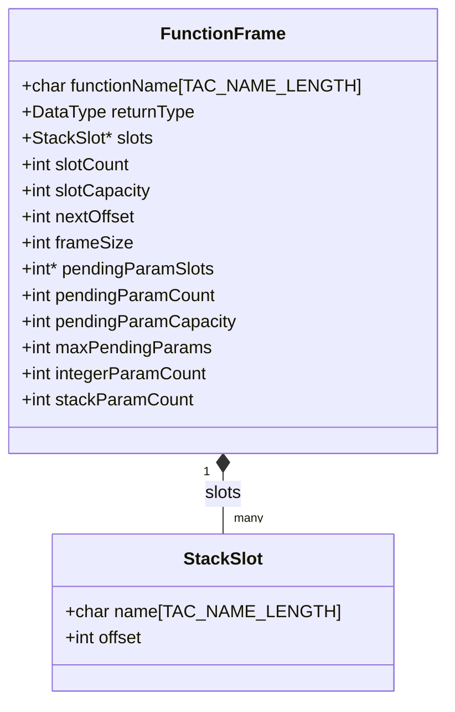

# Marco de Pila

**Archivos:** `include/function_frame.h`, `src/object_code/function_frame.c` (247 líneas)

El módulo de marco de pila (*function frame*) administra la disposición en memoria de los parámetros, variables locales, temporales y argumentos en tránsito durante la ejecución de un método, asociando cada operando simbólico con su desplazamiento respecto de `%rbp`.

!!! note "El marco solo ubica enteros y booleanos"
    El enunciado acota esta etapa a tipos enteros y lógicos, por lo que todas
    las ranuras son de 4 bytes y se utiliza únicamente la secuencia entera de
    registros de argumentos. Los programas que utilizan `float` se rechazan al
    generar el código intermedio.

---

## 1. Asignación en pila y diseño del registro de activación

El [TAC](../05-codigo-intermedio/01-representacion-tac.md) opera con una cantidad ilimitada de temporales y nombres simbólicos (`t0`, `x@3`), mientras que la arquitectura x86-64 dispone de un conjunto fijo de registros y memoria principal. En lugar de implementar asignación de registros por coloreo de grafos, este compilador asigna una ranura dedicada de 4 bytes en la pila a cada parámetro, variable local y temporal, empleando los registros físicos únicamente como almacenamiento de paso al traducir cada instrucción.

En x86-64 la pila crece hacia direcciones de memoria más bajas. El registro de activación de una función se organiza de la siguiente manera:

```text
Direcciones altas
  ▲
  │   ┌──────────────────────────────────────────┐
  │   │ Parámetros 7 en adelante (si existieran) │ > +16(%rbp)
  │   ├──────────────────────────────────────────┤
  │   │ Dirección de retorno (colocada por call) │  +8(%rbp)
  │   ├──────────────────────────────────────────┤
  │   │ %rbp anterior (guardado en el prólogo)   │   0(%rbp)  ◄── %rbp
  │   ├──────────────────────────────────────────┤
  │   │ Primer slot: parámetro o local           │  -4(%rbp)
  │   │ Segundo slot                             │  -8(%rbp)
  │   │ Variable local x@3                       │ -12(%rbp)
  │   │ Temporal t0                              │ -16(%rbp)
  │   │ ...                                      │ ...
  │   │ Ranuras de argumentos pendientes (§3.2)  │
  │   │ Relleno de alineación a 16 bytes (§3.3)  │
  ▼   └──────────────────────────────────────────┘            ◄── %rsp
Direcciones bajas
```

- **Puntero de marco (`%rbp`):** permanece fijo durante toda la ejecución del método. Todos los datos locales se direccionan con desplazamientos negativos constantes (`-4(%rbp)`, `-8(%rbp)`), evitando recalcular posiciones cuando `%rsp` varía durante el apilado de argumentos.
- **Puntero de pila (`%rsp`):** apunta al extremo inferior del marco. El espacio total requerido se calcula antes de emitir la función y se reserva en una sola instrucción en el prólogo (`subq $frameSize, %rsp`).
- **Datos en el marco del llamador (`+8(%rbp)` y `+16(%rbp)`):** la instrucción `call` apila la dirección de retorno en `+8(%rbp)` y el prólogo guarda el `%rbp` previo en `0(%rbp)`. En consecuencia, los argumentos pasados por pila (del séptimo en adelante según la ABI System V AMD64) quedan ubicados a partir de `+16(%rbp)`.

---

## 2. Estructuras e interfaz pública



### `StackSlot` y `FunctionFrame`

Cada `StackSlot` asocia el nombre de un operando TAC con su desplazamiento negativo respecto de `%rbp`:

```c
typedef struct StackSlot {
    char name[TAC_NAME_LENGTH];
    int offset;      /* relativo a %rbp: -4, -8, -12... */
} StackSlot;
```

Como los operandos de variables locales y parámetros llegan al TAC calificados con el sufijo `@uid` asignado por la [tabla de símbolos](../04-semantico/01-tabla-de-simbolos.md), el nombre es único dentro de la función y la búsqueda por cadena distingue variables homónimas declaradas en bloques anidados.

| Campo de `FunctionFrame` | Descripción |
| :--- | :--- |
| `functionName` | Nombre del método, utilizado en su etiqueta de entrada y en `.L_<fn>_epilogue`. |
| `returnType` | Tipo de retorno del método; permite inicializar `%eax` en `0` en el epílogo cuando `main` es `void`. |
| `slots`, `slotCount`, `slotCapacity` | Arreglo dinámico de ranuras con nombre. |
| `nextOffset` | Total acumulado de bytes asignados a ranuras (`offset = -nextOffset`). |
| `frameSize` | Tamaño total del marco en bytes, redondeado al siguiente múltiplo de 16 (§3.3). |
| `pendingParamSlots` | Arreglo dinámico con los offsets de los argumentos apilados por instrucciones `TAC_PARAM` en curso (§3.2). |
| `pendingParamCount`, `pendingParamCapacity`, `maxPendingParams` | Cantidad actual de argumentos pendientes, capacidad del arreglo y pico máximo simultáneo. |
| `integerParamCount`, `stackParamCount` | Contadores de parámetros formales recibidos por registro (`%edi`..`%r9d`) y por pila (`+16(%rbp)`..). |

### Funciones públicas (`include/function_frame.h`)

| Función | Descripción |
| :--- | :--- |
| `createFrame(functionName)` | Reserva e inicializa el `FunctionFrame`, el arreglo `slots` (capacidad inicial 16) y `pendingParamSlots` (capacidad inicial 64). |
| `freeFrame(frame)` | Libera los arreglos internos y la estructura. Acepta `NULL`. |
| `addSlot(frame, operand)` | Asigna una ranura de 4 bytes al operando y devuelve su offset negativo. Es idempotente: si el nombre ya existe en `slots`, devuelve el offset previamente asignado. |
| `addAnonymousSlot(frame)` | Incrementa `nextOffset` en 4 bytes y devuelve `-nextOffset` sin registrar entrada en `slots`. |
| `getSlotOffset(frame, name, outOffset)` | Busca linealmente el nombre en `slots`; escribe el offset en `*outOffset` y devuelve `true`, o `false` si no existe. |
| `ensurePendingParamCapacity(frame, needed)` | Duplica la capacidad de `pendingParamSlots` mediante `realloc` hasta cubrir `needed`. |

El módulo no incluye `string_builder.h` ni emite instrucciones assembly: actúa exclusivamente como tabla de ubicaciones para el generador de código objeto.

---

## 3. Dimensionamiento en dos pasadas y argumentos pendientes

Para emitir `subq $frameSize, %rsp` en el prólogo de una función es necesario conocer de antemano el espacio total ocupado por sus locales, temporales y argumentos en tránsito. Por ello, el generador de código objeto recorre cada función en dos pasadas:

1. **Pasada 1 (`buildFrameLayout`):** recorre las instrucciones entre `TAC_BEGIN_FUNC` y `TAC_END_FUNC` para asignar todas las ranuras y calcular `frameSize`.
2. **Pasada 2 (`emitFunction`):** emite el prólogo, traduce cada instrucción consultando `getSlotOffset` y cierra con el epílogo (ver [generación de código objeto](02-generacion-codigo-objeto.md)).

### 3.1 Ranuras con nombre (`allocateLocalSlots`)

Recorre el cuerpo de la función invocando `addSlot` sobre:
- El operando de cada `TAC_PARAM_DECL` y `TAC_LOCAL_DECL`.
- El operando `result` de cualquier instrucción cuando es un temporal (`OPERAND_TEMP`).

Gracias a la idempotencia de `addSlot`, si un temporal se asigna o menciona más de una vez recibe una única ranura. Las variables globales (`TAC_GLOBAL_DECL`) no reciben ranura en el marco porque se alojan en la sección `.data` y se acceden mediante direccionamiento relativo al contador de programa (`nombre(%rip)`).

### 3.2 Argumentos pendientes para llamadas anidadas (`allocatePendingParamSlots`)

En una llamada anidada como `f(g(1), h(2))`, si el primer argumento de `f` (el resultado de `g(1)`) se colocara directamente en `%edi`, la evaluación posterior de `h(2)` sobrescribiría `%edi` con `2` antes de invocar a `f`.

Para evitar esa colisión sin necesidad de preservar registros en mitad de una expresión, cada instrucción `TAC_PARAM` copia su operando a una ranura anónima propia dentro del marco de la función llamadora, y `TAC_CALL` consume las últimas `arity` ranuras justo antes de cargar los registros de la ABI.

`allocatePendingParamSlots` determina cuántas ranuras anónimas se necesitan simulando la pila de parámetros pendientes a lo largo de la función:

```c
if (scan->operation == TAC_PARAM) {
    pendingCount++;
    if (pendingCount > frame->maxPendingParams) {
        frame->maxPendingParams = pendingCount;
    }
} else if (scan->operation == TAC_CALL) {
    pendingCount -= arity;
    if (pendingCount < 0) pendingCount = 0;
}
```

Al finalizar el recorrido, reserva exactamente `maxPendingParams` ranuras mediante `addAnonymousSlot(frame)`. De este modo, la cantidad de ranuras reservadas equivale al máximo de argumentos simultáneamente en vuelo, y no al total de instrucciones `param` de la función.

Por ejemplo, para `return f(g(1), h(2));` en `main`:

```text
param 1             # pendientes: 1 (pico = 1)
t3 = call g, 1      # pendientes: 1 - 1 = 0
param t3            # pendientes: 1
param 2             # pendientes: 2 (pico = 2)
t4 = call h, 1      # pendientes: 2 - 1 = 1
param t4            # pendientes: 2
t5 = call f, 2      # pendientes: 2 - 2 = 0
ret t5
```

El marco reserva 3 ranuras con nombre (`t3`, `t4`, `t5`) y 2 ranuras anónimas (pico = 2), totalizando $5 \times 4 = 20$ bytes, que alineados a 16 bytes resultan en `frameSize = 32`.

### 3.3 Alineación a 16 bytes (System V AMD64 ABI)

La especificación System V AMD64 ABI exige que `%rsp` esté alineado a 16 bytes inmediatamente antes de toda instrucción `call`. Cuando el llamador ejecuta `call`, el procesador apila los 8 bytes de la dirección de retorno, y cuando el prólogo de la función llamada ejecuta `pushq %rbp`, apila otros 8 bytes, dejando `%rsp` nuevamente en un múltiplo de 16. Para conservar esa alineación, el tamaño restado a `%rsp` en el prólogo (`frameSize`) debe ser siempre múltiplo de 16:

```c
#define ALIGN_UP(value, alignment) (((value) + (alignment) - 1) & ~((alignment) - 1))

frame->frameSize = ALIGN_UP(frame->nextOffset, 16);
```

| `nextOffset` (bytes usados) | `frameSize` (alineado) | Relleno (bytes) |
| :---: | :---: | :---: |
| 0 (sin locales ni temporales) | 0 | 0 |
| 4 (1 ranura) | 16 | 12 |
| 12 (3 ranuras) | 16 | 4 |
| 16 (4 ranuras) | 16 | 0 |
| 20 (5 ranuras) | 32 | 12 |

---

## 4. Prólogo y epílogo

### Prólogo (`emitPrologue`)

```asm
.globl sumar
.type sumar, @function
sumar:
    pushq %rbp              # preserva el frame pointer del llamador
    movq %rsp, %rbp         # establece el nuevo frame pointer
    subq $16, %rsp          # reserva frameSize bytes (se omite si frameSize == 0)
```

### Epílogo (`emitEpilogue`)

```asm
.L_sumar_epilogue:
    leave                   # equivale a: movq %rbp, %rsp ; popq %rbp
    ret
```

Todas las instrucciones `return` de una función saltan a la etiqueta única `.L_<functionName>_epilogue` mediante `jmp`, centralizando el desarmado del marco en un solo punto. El prefijo `.L` indica al ensamblador que la etiqueta es local al archivo objeto y no debe exportarse en la tabla de símbolos.

---

## 5. Límites conocidos

- **Valor de retorno de `addSlot` ante error:** si falla la reserva de memoria o recibe argumentos nulos, `addSlot` devuelve `0`. Aunque en ejecución normal ninguna ranura recibe el offset `0` (porque `nextOffset` se incrementa antes de negar el valor, comenzando en `-4`), el tipo de retorno no distingue un fallo de un desplazamiento nulo.
- **Precondición de `ALIGN_UP`:** la máscara bit a bit `& ~(alignment - 1)` requiere que `alignment` sea potencia de dos.
- **Tamaño uniforme de 4 bytes:** todas las ranuras reservan 4 bytes (`int` y `boolean` de 32 bits). No contempla tipos de 8 bytes ni alineaciones internas diferenciadas.
- **Búsqueda lineal sin reutilización de ranuras:** `getSlotOffset` realiza una búsqueda lineal $O(n)$ sobre `slots`, y cada temporal conserva su ranura durante toda la función aunque su tiempo de vida abarque solo dos instrucciones.

---

## 6. Cómo se extiende

- **Tipos de distinto tamaño (`double`, `char`):** `addSlot` debería consultar `operand->type` para determinar el tamaño en bytes (por ejemplo, 8 bytes para `double`) y alinear `nextOffset` al múltiplo natural de cada tipo antes de asignar el desplazamiento.
- **Arreglos locales:** requeriría añadir un campo de tamaño en `StackSlot` para reservar $N \times \text{sizeof(tipo)}$ bytes contiguos y calcular accesos mediante direccionamiento indexado a partir del offset base.
- **Compactación del marco y asignación de registros:** a partir de los conjuntos calculados por el [análisis de variables vivas](../06-optimizador/01-variables-vivas.md), es posible construir el grafo de interferencia entre variables y temporales. Dos temporales cuyas vidas no se solapan pueden compartir la misma ranura de pila o asignarse a registros físicos (*callee-saved* / *caller-saved*), reservando ranuras en el `FunctionFrame` únicamente para los valores derramados (*spilled*).

---

## 7. Validación

- **Suite unitaria:** `tests/test_object_code.c` verifica el cálculo de `frameSize`, la alineación a múltiplos de 16, los desplazamientos negativos consecutivos asignados por `addSlot` y el dimensionamiento ante llamadas anidadas.
- **Inspección manual del assembly:**

```bash
./mi_compilador -target assembly examples/factorial.ctds
grep -A3 '^factorial:' examples/factorial.ass
```

- **Invariantes verificados en cada marco:**
  1. `frameSize` es siempre múltiplo de 16.
  2. Todo offset asignado a locales, parámetros en registro o temporales pertenece al rango `[-frameSize, -4]`.
  3. Los parámetros recibidos por pila a partir del séptimo se leen de desplazamientos positivos `16 + 8 * k(%rbp)`.

---

**Siguiente:** [Generación de Código Objeto](02-generacion-codigo-objeto.md)
