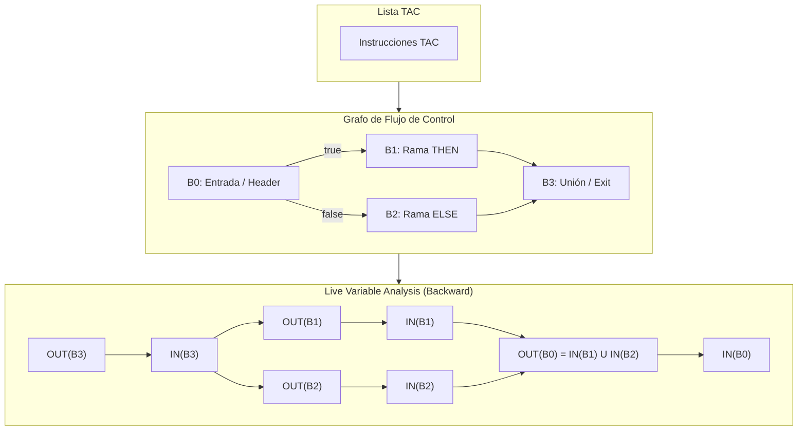

# Live Variable Analysis — Definición algebraica y Aplicación en C-TDS

Sea $B$ un bloque básico del Grafo de Flujo de Control (CFG).

Para cada bloque definimos cuatro conjuntos:

| Conjunto | Definición |
| :--- | :--- |
| $\text{USE}(B)$ | Variables utilizadas en $B$ antes de ser definidas en $B$. |
| $\text{DEF}(B)$ | Variables definidas en $B$ antes de ser utilizadas. |
| $\text{LIVE\_IN}(B)$ | Variables vivas al entrar a $B$. |
| $\text{LIVE\_OUT}(B)$ | Variables vivas al salir de $B$. |

---

## 1. Ecuaciones Fundamentales

### Ecuación 1 — $\text{LIVE\_OUT}$
$$\boxed{\text{LIVE\_OUT}(B) = \bigcup_{S \in \text{Succ}(B)} \text{LIVE\_IN}(S)}$$

Donde $\text{Succ}(B)$ es el conjunto de bloques sucesores de $B$.

> **Interpretación:** Una variable está viva al salir de $B$ si está viva al entrar a cualquiera de sus sucesores.

### Ecuación 2 — $\text{LIVE\_IN}$
$$\boxed{\text{LIVE\_IN}(B) = \text{USE}(B) \cup (\text{LIVE\_OUT}(B) - \text{DEF}(B))}$$

> **Interpretación:** Una variable está viva al entrar si:
> * Se utiliza dentro del bloque antes de ser definida ($\text{USE}(B)$).
> * O se necesita después del bloque ($\text{LIVE\_OUT}(B)$) y no fue redefinida dentro de él ($- \text{DEF}(B)$).

---

## 2. Condiciones Iniciales y Algoritmo de Punto Fijo

### Inicialización:
$$\text{LIVE\_IN}(B) = \emptyset$$
$$\text{LIVE\_OUT}(B) = \emptyset$$

### Algoritmo de Punto Fijo (*Fixed Point*):
Se aplican las ecuaciones iterativamente en orden inverso (de las salidas hacia las entradas) hasta que ningún conjunto cambie:

```
repetir
    para cada bloque B en CFG:
        LIVE_OUT[B] = UNION(LIVE_IN[S] para todo S en Succ(B))
        LIVE_IN[B]  = USE[B] UNION (LIVE_OUT[B] - DEF[B])
hasta que (ningún LIVE_IN o LIVE_OUT cambie)
```

---

## 3. Propiedades Importantes

* **Análisis *backward* (hacia atrás):** La información se propaga desde los sucesores hacia los predecesores.
* **Análisis *may* (posibilidad):** Considera que una variable está viva si *puede* utilizarse en algún camino posible de ejecución (por eso usa la unión $\bigcup$).
* **Unión de conjuntos:** Contempla la confluencia de múltiples caminos y bifurcaciones (`if`, `while`).
* **Identificación de valores muertos:** Si una variable $v$ es asignada en $B$ y no pertenece a $\text{LIVE\_OUT}(B)$ ni tiene usos posteriores en $B$, su valor **ya no necesita conservarse** y la asignación puede eliminarse.

---

## 4. Ejemplo Algebraico

Supongamos un bloque $B_1$ con los siguientes conjuntos:
$$\text{USE}(B_1) = \{x\}$$
$$\text{DEF}(B_1) = \{a\}$$
$$\text{LIVE\_OUT}(B_1) = \{a, b\}$$

Aplicando la Ecuación 2:
$$\text{LIVE\_IN}(B_1) = \{x\} \cup (\{a, b\} - \{a\})$$
$$\text{LIVE\_IN}(B_1) = \{x\} \cup \{b\}$$
$$\boxed{\text{LIVE\_IN}(B_1) = \{x, b\}}$$

*El valor de $a$ no necesita conservarse al entrar a $B_1$ porque $B_1$ lo redefine antes de leerlo.*

### Notación mnemotécnica:
$$\boxed{\text{IN} = \text{USE} \cup (\text{OUT} - \text{DEF})}$$
$$\boxed{\text{OUT} = \bigcup \text{IN}_{\text{sucesores}}}$$

---

## 5. Aplicación Concreta al Compilador C-TDS

Esta formulación algebraica resuelve de forma exacta el análisis de control de flujo al analizar estructuras con `if` y `while`.



### 5.1. Cómo se calculan $\text{USE}(B)$ y $\text{DEF}(B)$ a partir de `InstructionDataFlow`

Dentro de cada bloque básico $B$, recorremos sus instrucciones de arriba a abajo. Para cada instrucción con conjuntos locales $use_{inst}$ y $def_{inst}$:

* Una variable $v$ pertenece a $\text{USE}(B)$ si se lee antes de que cualquier instrucción previa en $B$ la haya escrito.
* Una variable $v$ pertenece a $\text{DEF}(B)$ si se escribe antes de que cualquier instrucción previa en $B$ la haya leído.

```c
void computeBlockDefUse(const BlockDataFlow *block, Set *useSet, Set *defSet) {
    setClear(useSet);
    setClear(defSet);

    for (size_t i = 0; i < block->count; i++) {
        const InstructionDataFlow *flow = &block->entries[i];

        // 1. Todo operando usado que NO haya sido definido previamente entra a USE(B)
        for (size_t u = 0; u < flow->useCount; u++) {
            const char *name = flow->uses[u]->name;
            if (!setIsMember(defSet, name)) {
                setAdd(useSet, name);
            }
        }

        // 2. Todo operando definido que NO haya sido usado previamente entra a DEF(B)
        for (size_t d = 0; d < flow->defCount; d++) {
            const char *name = flow->defs[d]->name;
            if (!setIsMember(useSet, name)) {
                setAdd(defSet, name);
            }
        }
    }
}
```

---

### 5.2. Cómo resuelve el problema de `if` / `else`

En el ejemplo que fallaba con el análisis lineal:
```
B0: if_false cond goto L_ELSE
B1: x = 1; goto L_END
B2: L_ELSE: x = 2
B3: L_END: ret x
```

* $\text{Succ}(B_0) = \{B_1, B_2\}$
* $\text{Succ}(B_1) = \{B_3\}$
* $\text{Succ}(B_2) = \{B_3\}$
* $\text{USE}(B_3) = \{x\}$, $\text{LIVE\_IN}(B_3) = \{x\}$.
* Para $B_1$: $\text{LIVE\_OUT}(B_1) = \text{LIVE\_IN}(B_3) = \{x\}$.  
  $\text{DEF}(B_1) = \{x\}$, $\text{USE}(B_1) = \emptyset$.  
  $\text{LIVE\_IN}(B_1) = \emptyset \cup (\{x\} - \{x\}) = \emptyset$.
* Para $B_2$: $\text{LIVE\_OUT}(B_2) = \text{LIVE\_IN}(B_3) = \{x\}$.  
  $\text{DEF}(B_2) = \{x\}$, $\text{USE}(B_2) = \emptyset$.  
  $\text{LIVE\_IN}(B_2) = \emptyset \cup (\{x\} - \{x\}) = \emptyset$.

**Resultado:** Al salir de $B_1$, $x$ **SÍ está viva** ($\text{LIVE\_OUT}(B_1) = \{x\}$). La asignación `x = 1` **NO se borra**, eliminando por completo el falso positivo del análisis lineal.

---

### 5.3. Cómo resuelve el problema de los ciclos `while`

En un bucle:
```
B0: goto L_COND
B1: L_LOOP: x = x + 1
B2: L_COND: if x < 10 goto L_LOOP
B3: ret 0
```
$\text{Succ}(B_2) = \{B_1, B_3\}$ (arista hacia atrás (*back-edge*) hacia $B_1$).

1. $\text{LIVE\_IN}(B_2)$ contiene $\{x\}$ porque la condición evalúa `x < 10`.
2. Como $B_2$ es sucesor de $B_1$, $\text{LIVE\_OUT}(B_1) \supseteq \text{LIVE\_IN}(B_2)$, por lo que $x \in \text{LIVE\_OUT}(B_1)$.
3. El algoritmo propaga $x$ hacia atrás en el ciclo hasta alcanzar el punto fijo: el compilador comprende que `x = x + 1` se necesita en la siguiente iteración.

---

## 6. Casos Interesantes para la Toma de Decisiones

### Caso 1: Eliminación Global de Asignaciones Muertas (*Global Dead Store Elimination*)
* **Criterio formal:** Dada una instrucción $i: v = \text{expr}$ al final de un bloque $B$:
  $$\text{Si } v \notin \text{LIVE\_OUT}(B) \text{ y } v \text{ no se usa después de } i \text{ en } B \implies i \text{ es código muerto}.$$
* **Decisión:** Esto permite eliminar de forma 100% segura todas las asignaciones residuales que deja `foldConstants` (`t0 = 3`, `t1 = 6`), incluso cuando hay bifurcaciones entre medio.

### Caso 2: Manejo de Variables Globales en `TAC_CALL`
* En C-TDS, las variables globales residen en el segmento de datos estático. Cualquier función externa puede leerlas o escribirlas.
* **Criterio formal:** En cada instrucción `TAC_CALL` o al salir de una función (`TAC_RETURN` / `TAC_END_FUNC`), **todas las variables globales se consideran vivas** ($\text{LIVE\_OUT} \supseteq \text{Globals}$).
* Los temporales (`OPERAND_TEMP`), al residir en el frame de activación local, son inmunes a este efecto colateral.

### Caso 3: Asignación de Registros e Interferencia de Variables
* Dos variables $u$ y $v$ pueden compartir el mismo registro físico de CPU (%rax, %r10, etc.) si sus rangos de vivacidad nunca se superponen:
  $$u \text{ y } v \text{ interfieren} \iff \exists \text{ punto de programa donde } u \in \text{LIVE} \land v \in \text{LIVE}$$
* Este análisis es la base teórica para la futura asignación de registros mediante coloración de grafos.

---