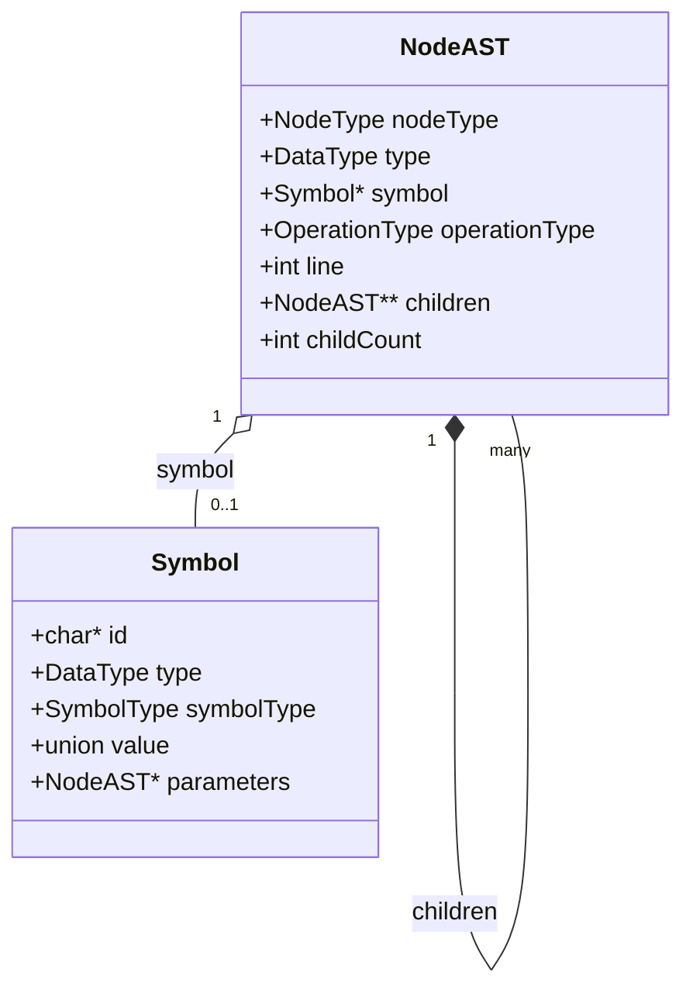

# Árbol de Sintaxis Abstracta (AST) y Modelado de Nodos

El Árbol de Sintaxis Abstracta (AST) es la estructura central de comunicación entre el front-end sintáctico, la validación semántica y la generación de código intermedio. Descompone el programa en una representación jerárquica limpia, descartando elementos auxiliares de la sintaxis concreta (paréntesis, llaves, puntos y comas) y conservando únicamente los elementos con significado semántico.

---

## 1. Estructura Universal de Nodos (`NodeAST`)

En lugar de definir estructuras separadas por cada construcción gramatical, el compilador implementa un modelo de nodo universal (`NodeAST`). Cada nodo adapta el uso de sus campos y el arreglo de hijos de acuerdo a su tipo (`nodeType`):



### Campos Principales
- **`nodeType`:** Valor del enumerado `NodeType` que identifica la clase de construcción (12 tipos activos).
- **`type`:** Tipo de dato semántico asociado (`TYPE_INT`, `TYPE_FLOAT`, `TYPE_BOOL`, `TYPE_VOID`, `TYPE_ERROR`).
- **`symbol`:** Puntero a la estructura `Symbol` con metadatos asociados (nombre de identificador, firma de función o valor constante).
- **`operationType`:** En nodos de operadores, almacena la operación concreta (`OP_ADD`, `OP_SUB`, `OP_EQ`, `OP_AND`, etc.). En los demás nodos permanece en valor neutro.
- **`line`:** Número de línea de origen en el código fuente, capturado automáticamente desde la variable global `yylineno` de Flex durante la invocación de `newNode()`.
- **`children` y `childCount`:** Arreglo dinámico de punteros a hijos y cantidad de hijos empaquetados.

### Macros de Acceso Rápido
Para evitar accesos crudos por índice en las etapas semánticas y de código intermedio, se definen macros de lectura directa:

```c
#define GET_EXPRESSION(node)   ((node)->childCount > 0 ? (node)->children[0] : NULL)
#define GET_LEFT(node)         ((node)->childCount > 0 ? (node)->children[0] : NULL)
#define GET_RIGHT(node)        ((node)->childCount > 1 ? (node)->children[1] : NULL)
#define GET_CONDITION(node)    ((node)->childCount > 0 ? (node)->children[0] : NULL)
#define GET_IF_BLOCK(node)     ((node)->childCount > 1 ? (node)->children[1] : NULL)
#define GET_ELSE_BLOCK(node)   ((node)->childCount > 2 ? (node)->children[2] : NULL)
#define GET_WHILE_BLOCK(node)  ((node)->childCount > 1 ? (node)->children[1] : NULL)
```

---

## 2. Modelado Detallado de Cada Tipo de Nodo

El compilador estructura el árbol mediante 12 tipos de nodos activos en el enumerado `NodeType` (el antiguo `TYPE_NODE` fue deprecado al hacer que las reglas de tipo en Bison retornen directamente `DataType` sin instanciar nodos):

### A. Declaraciones e Identificadores

#### `VARIABLE_DECLARATION_NODE`
- **Propósito:** Representa la declaración de una variable (ej: `int x;`).
- **Aridad:** Sin hijos (`childCount = 0`, `children = NULL`).
- **Carga (*Payload*):** El campo `symbol` apunta a un `Symbol` que contiene el identificador (`id`) y el tipo de dato (`type`).
- **Construcción y Aplanamiento:** Cuando se declaran múltiples variables en una misma línea (ej: `int a, b, c;`), la función `resolveVariableDefinition` genera un `VARIABLE_DECLARATION_NODE` independiente y aplanado para cada identificador, facilitando el recorrido semántico posterior.
- **Acción Semántica:** Se inserta en la tabla de símbolos del ámbito actual, validando que no exista una colisión de nombres en ese mismo nivel.

#### `ID_NODE`
- **Propósito:** Representa la referencia o uso de una variable dentro de una expresión o asignación (ej: `x + 1`).
- **Aridad:** Sin hijos (`childCount = 0`).
- **Carga:** Su campo `symbol` almacena el nombre del identificador a buscar.
- **Acción Semántica:** El analizador semántico busca el símbolo mediante `lookupVariable`, resolviendo su tipo y asegurando que haya sido declarado previamente en el ámbito actual o en algún ámbito ancestro.

#### `CONSTANT_NODE`
- **Propósito:** Representa literales numéricos o booleanos (ej: `42`, `3.14`, `true`, `false`).
- **Aridad:** Sin hijos (`childCount = 0`).
- **Carga:** El campo `symbol` contiene el tipo de dato (`TYPE_INT`, `TYPE_FLOAT` o `TYPE_BOOL`) y guarda directamente el valor primitivo en el campo `union value` (`int_val` o `float_val`), con `id = NULL`.
- **Constructores dedicados:** `newIntLiteralNode`, `newFloatLiteralNode` y `newBoolLiteralNode`. Evita conversiones redundantes de cadenas a números en etapas posteriores.


---

### B. Expresiones y Operaciones

#### `ASSIGNMENT_NODE`
- **Propósito:** Representa la asignación de una expresión a una variable (ej: `x = a + 2;`).
- **Mapeo de Hijos:** Aridad fija de 2:
  - `children[0]`: Nodo `ID_NODE` que representa la variable destino.
  - `children[1]`: Expresión evaluada cuyo resultado se asignará.
- **Carga:** Contiene el `symbol` de la variable destino para una rápida resolución de ámbito en el parseo y validación semántica.

#### `BINARYOPERATOR_NODE`
- **Propósito:** Operaciones aritméticas (`+`, `-`, `*`, `/`, `%`), de comparación (`==`, `<`, `>`) y lógicas (`&&`, `||`).
- **Mapeo de Hijos:** Aridad fija de 2:
  - `children[0]`: Sub-árbol del operando izquierdo (`GET_LEFT(node)`).
  - `children[1]`: Sub-árbol del operando derecho (`GET_RIGHT(node)`).
- **Carga:** El campo `operationType` almacena el operador específico (`OP_ADD`, `OP_SUB`, etc.). El campo `symbol` permanece en `NULL`.

---

### C. Estructuras de Control de Flujo

#### `BLOCK_NODE`
- **Propósito:** Representa un bloque de sentencias delimitado por llaves `{ ... }`.
- **Mapeo de Hijos:** Aridad dinámica (`children[0...n]`), donde cada entrada corresponde a una sentencia en orden secuencial.
- **Carga:** `symbol = NULL`.
- **Acción Semántica:** Marca la apertura de un nuevo ámbito léxico hijo (`Scope`). El análisis semántico recorre sus sentencias recursivamente y restaura el ámbito al finalizar el bloque.

#### `IF_ELSE_NODE`
- **Propósito:** Estructuras condicionales simples (`if`) o dobles (`if-else`).
- **Mapeo de Hijos:** Aridad de 2 o 3 según la presencia de la rama alternativa:
  - `children[0]`: Expresión condicional (`GET_CONDITION(node)`).
  - `children[1]`: Bloque o sentencia a ejecutar si es verdadera (`GET_IF_BLOCK(node)`).
  - `children[2]`: (Opcional) Bloque `else` (`GET_ELSE_BLOCK(node)`), presente si `childCount == 3`.

#### `WHILE_NODE`
- **Propósito:** Estructura de iteración condicional (`while (...) { ... }`).
- **Mapeo de Hijos:** Aridad fija de 2:
  - `children[0]`: Expresión de condición de continuación (`GET_CONDITION(node)`).
  - `children[1]`: Cuerpo del bucle a ejecutar en cada ciclo (`GET_WHILE_BLOCK(node)`, típicamente un `BLOCK_NODE`).

#### `RETURN_NODE`
- **Propósito:** Sentencia de retorno de una función (`return;` o `return expr;`).
- **Mapeo de Hijos:**
  - Sin hijos (`childCount = 0`, `children = NULL`) en métodos `void` con retorno vacío.
  - Con un hijo (`children[0]`, accesible con `GET_EXPRESSION(node)`) en retornos con valor.
- **Acción Semántica:** Verifica estar dentro del cuerpo de una función (`current_function != NULL`) y valida que el tipo de la expresión coincida o sea convertible al tipo de retorno declarado por el método contenedor.

---

### D. Métodos, Funciones y Parámetros

#### `METHOD_DECLARATION_NODE`
- **Propósito:** Declaración completa de una función o procedimiento.
- **Mapeo de Hijos:** Aridad fija de 2:
  - `children[0]`: Nodo `PARAMETERS_NODE` con la lista de parámetros formales.
  - `children[1]`: Nodo `BLOCK_NODE` con el cuerpo de sentencias del método.
- **Carga:** Su campo `symbol` almacena el nombre del método, su tipo de retorno (`type`) y un enlace directo a los parámetros (`symbol->parameters`). Su campo `node->type` refleja el tipo de retorno.
- **Acción Semántica:** Registra la firma del método en el ámbito global para permitir recursión y genera un ámbito propio para sus parámetros y cuerpo.

#### `METHOD_CALL_NODE`
- **Propósito:** Invocación a una función existente (ej: `sumar(10, x)`).
- **Mapeo de Hijos:** Aridad dinámica (`children[0...n]`), donde cada elemento es una expresión evaluada que conforma un argumento real.
- **Carga:** Su campo `symbol` contiene el nombre de la función invocada.
- **Acción Semántica:** Contrasta la cantidad y tipos de los argumentos con los parámetros formales de la función declarada.

#### `PARAMETERS_NODE`
- **Propósito:** Nodo de agrupación para la lista de parámetros formales en la firma de un método.
- **Mapeo de Hijos:** Aridad dinámica (`children[0...n]`), donde cada hijo es un `VARIABLE_DECLARATION_NODE`.
- **Carga:** Sin símbolo propio (`symbol = NULL`).

---

## 3. Mecanismo de Construcción y Aridad Dinámica

Para construir nodos con una cantidad variable de hijos (como listas de sentencias, parámetros y argumentos) sin degradar el rendimiento con recursión por la izquierda en Bison:

1. **Lista Transitoria (`NodeList`):** Durante el parseo se utiliza una estructura enlazada auxiliar con puntero `tail` en la cabecera:
   - `initializeTemporaryList`: Inicializa la cabecera apuntando a sí misma como último nodo.
   - `appendToTemporaryList`: Inserta nuevos elementos al final en tiempo constante $O(1)$.
   - `mergeNodeLists`: Concatena dos listas enlazadas en $O(1)$ vinculando directamente los punteros `tail`.
2. **Compactación en Arreglo (`resolveTemporaryList`):** Al completarse la reducción de la regla gramatical, se cuenta la cantidad total de elementos, se reserva el bloque contiguo `NodeAST** children` de tamaño exacto y se libera la estructura enlazada transitoria.

---

**Siguiente:** [Análisis Semántico y Tabla de Símbolos](04-semantic-analysis.md)
