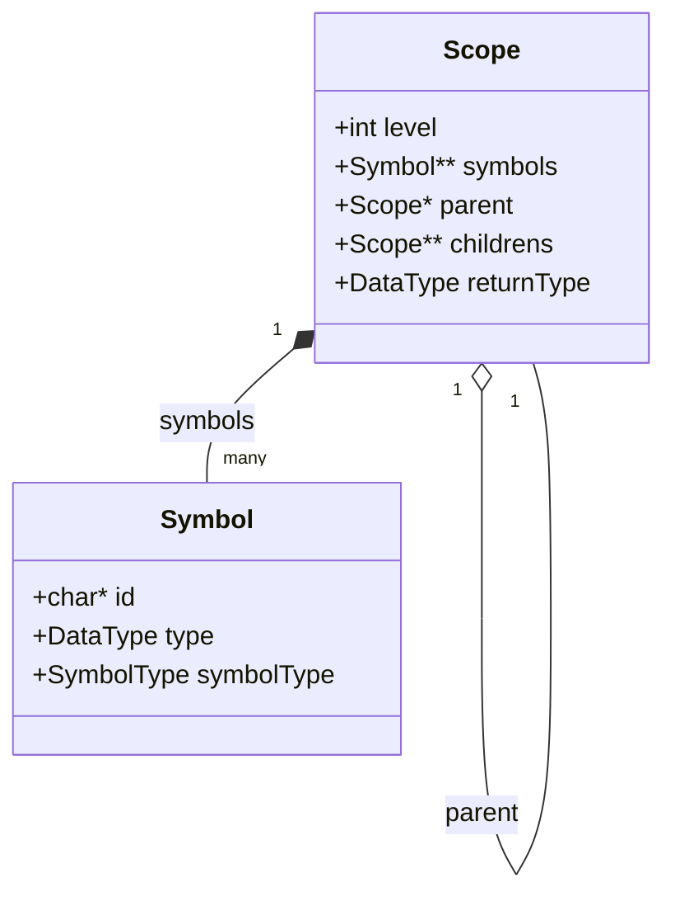

# Análisis Semántico, Ámbitos (Scopes) y Tabla de Símbolos

**TL;DR:** La fase semántica recorre el AST para poblar los Ámbitos (Scopes). Captura variables no declaradas, declaraciones múltiples, y vincula identificadores a estructuras `Symbol` dentro de una jerarquía de árbol de `Scope`s. Aquí se define qué se guarda, qué se ignora y cómo fluye la información.

## Diagrama de Arquitectura

## Archivos Fuente Relevantes
| Archivo | Descripción |
|---------|-------------|
| `src/types.h` | Definición de `DataType` y `OperationType`. |
| `src/symbol_table.h` / `.c` | Estructuras `Scope` y `Symbol`. Lógica de creación de scopes, inserción y búsqueda de variables. |
| `src/type_checker.h` / `.c` | Deducción de tipos, compatibilidad (`isAssignable`) y comprobación de expresiones y llamadas. |
| `src/semantic_analyzer.h` / `.c` | Recorrido del AST (`analyzeSemantics`), validación de sentencias (`if`, `while`, `return`) y método `main`. |

---

## Anatomía de un Ámbito (`Scope`)

Un `Scope` representa un bloque léxico aislado en el código (como el cuerpo de una función o un bloque dentro de un `if`/`while`). 

### ¿Qué se guarda en la Tabla de Símbolos (`symbols`)?
La tabla de símbolos de un ámbito (`scope->symbols`) **SOLO** almacena entidades que tienen nombre o representación explícita y necesitan ser recordadas:
1. **Variables Locales:** Originadas por un `VARIABLE_DECLARATION_NODE`. Entran a la tabla para evitar que otra variable use el mismo nombre en este mismo nivel, y para permitir que código dentro o más abajo de este ámbito las pueda leer/escribir.
2. **Parámetros de Métodos:** Se guardan como variables dentro del ámbito exclusivo del método para que puedan ser usados en su cuerpo.
3. **Declaraciones de Métodos:** El nombre del método y su firma se guardan en el ámbito *padre* (usualmente el global) para que otros métodos puedan invocarlo.

### ¿Qué se IGNORA y NO entra a la Tabla de Símbolos?
No todos los nodos del AST generan un `Symbol` dentro del `Scope`. Se ignoran de la tabla:
1. **Palabras Clave y Operadores:** Nodos como `BINARYOPERATOR_NODE`, `IF_ELSE_NODE`, `WHILE_NODE` **no** se insertan en la tabla de símbolos. Solo dictan el flujo.
2. **Asignaciones e Identificadores Simples:** Un `ASSIGNMENT_NODE` o un `ID_NODE` no *crea* un símbolo en el scope. Lo que hacen es *buscar* (`lookupVariable`) si el símbolo ya fue guardado previamente.
3. **Bloques (`BLOCK_NODE`):** No se guardan como símbolos. En su lugar, generan un nuevo `Scope` hijo, pero el bloque en sí no tiene un nombre guardado en la tabla de su padre.

---

## Dinámica de Ámbitos (Scope Chaining)

El compilador maneja la visibilidad de variables usando punteros `parent` y `childrens`.

### 1. Creación de un Nuevo Ámbito
Cada vez que `analyzeNodeSemantics` se cruza con un `BLOCK_NODE` o un `METHOD_DECLARATION_NODE`, invoca a `analyzeSemantics()` para instanciar un nuevo `Scope`.
- `level` aumenta en +1 respecto al padre.
- `returnType` se propaga de arriba hacia abajo: el método lo define según su firma, y los bloques hijos (`BLOCK_NODE`) lo heredan de su ámbito padre (`current_scope->returnType`) para validar cualquier `return` anidado en $O(1)$.
- El nuevo scope se inserta en el array `childrens` del padre.

### 2. Sombreado y Prevención de Colisiones (Shadowing)
Cuando declaramos una variable (`VARIABLE_DECLARATION_NODE`), el compilador usa **`lookupVariableCurrentScope`**:
- Revisa **únicamente** el array `symbols` del `Scope` exacto donde estamos parados.
- Si el identificador existe $\rightarrow$ **Error: Variable ya declarada.**
- Si no existe $\rightarrow$ Se inserta.
- *Nota:* Si existe una variable con el mismo nombre en el `parent`, no dará error. Esto permite el "Shadowing" (variables locales ocultando a las globales).

### 3. Resolución de Variables (Uso y Asignación)
Cuando leemos (`ID_NODE`) o escribimos (`ASSIGNMENT_NODE`) una variable, el compilador usa **`lookupVariable`**:
- Busca primero en el `Scope` actual.
- Si no lo encuentra, viaja al `scope->parent` y busca ahí.
- Repite recursivamente hasta llegar al Scope Global (`level 0`).
- Si llega al final y retorna `NULL` $\rightarrow$ **Error: Variable no declarada.**

### 4. Parámetros de Métodos y su Uso en el Cuerpo
El AST estructura cada método (`METHOD_DECLARATION_NODE`) con dos ramas principales:
* `children[0]`: `PARAMETERS_NODE` (hijos de tipo `VARIABLE_DECLARATION_NODE`).
* `children[1]`: `BLOCK_NODE` (el cuerpo de la función).

Durante el análisis semántico en `analyzeSemantics`:
1. **Registro:** El método se registra anticipadamente en el ámbito padre para soportar llamadas recursivas.
2. **Parámetros:** Al procesar `PARAMETERS_NODE`, cada parámetro se inserta en el `Scope` de la función con `appendSymbol()`.
3. **Cuerpo:** Al analizar `BLOCK_NODE`, se crea un `Scope` hijo cuyo `parent` apunta al `Scope` de la función.
4. **Uso:** Cuando una sentencia dentro del cuerpo referencia un parámetro, `lookupVariable` no lo encuentra en el bloque local y asciende automáticamente por `parent` al `Scope` de la función, asociando el `Symbol*` y su `DataType` sin ambigüedades.

---

## Análisis de Tipos (Type Checking)

Durante el recorrido del AST, además de la resolución de variables, se realiza el análisis de tipos de las expresiones matemáticas, retornos, sentencias de control y llamadas a métodos.

El punto de entrada para evaluar el tipo de una expresión es la función `analyzeExpression()`. 

### Validación de Expresiones y Asignaciones
Los nodos como las asignaciones (`ASSIGNMENT_NODE`), sentencias de retorno (`RETURN_NODE`), y expresiones condicionales, utilizan `analyzeExpression()` sobre sus sub-expresiones para determinar el `DataType` resultante (ej: `TYPE_INT`, `TYPE_BOOL`, o `TYPE_FLOAT`). 

En el caso de una asignación, el tipo devuelto por la expresión se contrasta contra el tipo estático de la variable destino utilizando la función `isAssignable()`. De no ser compatibles, se dispara un `semanticError` indicando que los tipos no coinciden.

### Validación de Sentencias de Retorno (`RETURN_NODE`)
El compilador utiliza la variable de contexto `static Symbol *current_function` junto con la herencia de `current_scope->returnType` para validar retornos de forma determinista en $O(1)$:
1. **Detección fuera de función:** Si `current_function == NULL`, se emite un error indicando que la sentencia `return` está fuera de una función.
2. **Retorno sin valor (`return;`):** Solo es válido si la función contenedora es `TYPE_VOID`. Si espera un tipo de dato, se emite un error con el nombre del método: *"El metodo 'X' espera un valor de retorno de tipo Y, pero no se especifico ninguno."*
3. **Retorno con valor (`return <expr>;`):**
   - Si la función es `TYPE_VOID`, se rechaza: *"El metodo 'X' es void y no deberia retornar un valor."*
   - Si es no-void, se evalúa `actualType = analyzeExpression(expr, current_scope)` y se comprueba compatibilidad con `isAssignable(expectedType, actualType)`. De no coincidir, se reporta: *"El tipo de retorno no coincide en el metodo 'X': se esperaba Y pero se obtuvo Z."*

### Sentencias de Control (`IF_ELSE_NODE` y `WHILE_NODE`)
En `analyzeIfElseNode` y `analyzeWhileNode`:
* Se extrae la expresión de condición (`GET_CONDITION(node)`).
* Se evalúa mediante `analyzeExpression(condicion, current_scope)`.
* Se valida estrictamente que el tipo resultante sea `TYPE_BOOL`. De lo contrario, se emite error semántico (*"La condicion debe ser de tipo BOOL"*).

### Operaciones Binarias
Para evaluar los árboles de operaciones matemáticas (`BINARYOPERATOR_NODE`), `analyzeBinaryOperator` llama recursivamente a `analyzeExpression` sobre los operandos izquierdo y derecho. Luego delega en `resolveBinaryOperation` para inferir el tipo resultante según el operador:
- Operaciones aritméticas (`+`, `-`, `*`, `/`) con operandos enteros devuelven `TYPE_INT`.
- Operaciones aritméticas con flotantes devuelven `TYPE_FLOAT`.
- Operaciones lógicas y de comparación devuelven `TYPE_BOOL`.
- Cualquier mezcla incompatible (ej: `bool + int`) retorna `TYPE_ERROR`.

Al detectarse un `TYPE_ERROR`, el compilador arroja un `semanticError("Tipos incompatibles en la operacion binaria.")` en la línea correspondiente.

### Llamadas a Métodos
Para los `METHOD_CALL_NODE`, el analizador de tipos valida que:
1. La cantidad de argumentos invocados coincida exactamente con la cantidad de parámetros de la firma del método.
2. Cada argumento suministrado (que se evalúa con `analyzeExpression`) pase el chequeo de compatibilidad de tipos (`isAssignable()`) respecto a su parámetro esperado. 
Finalmente, la expresión en su conjunto toma como tipo resultante el `type` declarado del método.

### Verificación Estructural del Programa
Al finalizar el análisis de todos los nodos, la función `checkMainMethodExists(globalScope)` verifica que exista una función con identificador `"main"` en el ámbito global. Si no existe, se emite un error semántico informando que falta el punto de entrada del programa.
