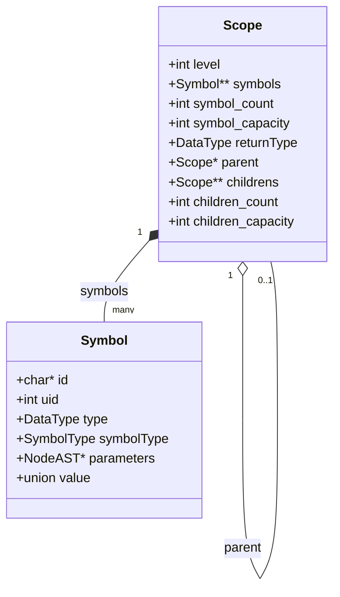
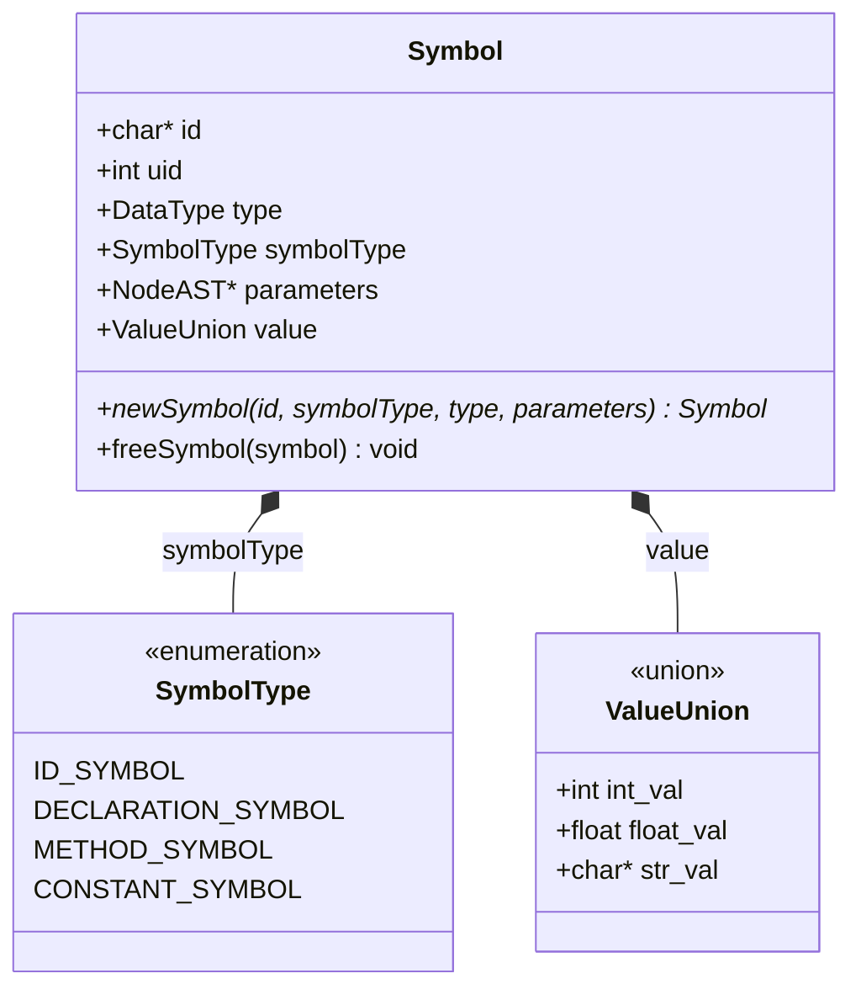

# Análisis Semántico, Símbolos y Tabla de Símbolos

La fase de análisis semántico valida que el programa fuente respete las restricciones contextuales, los ámbitos léxicos y las reglas de tipado estático de C-TDS. Opera sobre el Árbol de Sintaxis Abstracta (AST) construyendo la jerarquía de tablas de símbolos (`Scope`) y asociando cada identificador a una entidad `Symbol`.

---

## 1. Diagrama de Arquitectura



### Archivos Fuente Relevantes
- [src/symbol_table.h](file:///home/francisco/compiler/src/symbol_table.h): Definición de estructuras `Symbol`, `Scope`, enumerado `SymbolType` y firmas de operaciones.
- [src/symbol_table.c](file:///home/francisco/compiler/src/symbol_table.c): Implementación de creación de ámbitos, redimensionamiento dinámico, asignación de UID y algoritmos de búsqueda.
- [src/types.h](file:///home/francisco/compiler/src/types.h): Definición de enumerados `DataType` (`TYPE_INT`, `TYPE_FLOAT`, `TYPE_BOOL`, `TYPE_VOID`, `TYPE_ERROR`).
- [src/type_checker.c](file:///home/francisco/compiler/src/type_checker.c): Reglas de compatibilidad (`isAssignable`), inferencia de expresiones y validación de tipos.
- [src/semantic_analyzer.c](file:///home/francisco/compiler/src/semantic_analyzer.c): Recorrido del AST, control de flujo, validación de retornos y verificación del método `main()`.

---

## 2. Modelado de Símbolos (`Symbol`)

Un `Symbol` ([src/symbol_table.h](file:///home/francisco/compiler/src/symbol_table.h#L46-L63)) representa una entidad con nombre, tipo o valor semántico dentro del compilador (variable declarada, función o constante literal).



### Campos de la Estructura
- **`id` (`char*`):** Nombre del identificador o método. Duplicado en memoria dinámica con `strdup()`. En literales numéricos o constantes es `NULL`.
- **`uid` (`int`):** Identificador único secuencial de la entidad declarada:
  - Permite distinguir inequívocamente a dos variables con el mismo nombre declaradas en distintos ámbitos (*shadowing*).
  - Inicializado en `0` por `newSymbol()` para indicar entidad "no declarada".
  - Asignado a un valor autoincremental ($\ge 1$) por `appendSymbol()` en el momento exacto en que la variable o método se registra en un ámbito.
- **`type` (`DataType`):** Tipo de dato asociado (`TYPE_INT`, `TYPE_FLOAT`, `TYPE_BOOL`, `TYPE_VOID`).
- **`symbolType` (`SymbolType`):** Categoría del símbolo:
  - `ID_SYMBOL`: Uso o referencia a un identificador.
  - `DECLARATION_SYMBOL`: Símbolo intermedio producido durante la declaración de variables.
  - `METHOD_SYMBOL`: Declaración de función o método.
  - `CONSTANT_SYMBOL`: Literal numérico o booleano.
- **`parameters` (`NodeAST*`):** En símbolos de tipo `METHOD_SYMBOL`, almacena un puntero al sub-árbol del AST de parámetros (`PARAMETERS_NODE`) para validar argumentos en llamadas.
- **`value` (`union`):** Almacenamiento nativo del valor en constantes literales, evitando conversiones repetidas de texto a número:
  ```c
  union {
      int int_val;      // Enteros y booleanos (0 o 1)
      float float_val;  // Flotantes
      char *str_val;    // Cadenas
  } value;
  ```

### Ciclo de Vida
1. **Creación (`newSymbol`):** Reserva memoria en el heap, clona el identificador si no es nulo, enlaza los parámetros y fija `uid = 0`.
2. **Liberación (`freeSymbol`):** Libera la cadena duplicada `symbol->id` y luego la estructura del símbolo.

---

## 3. Modelado de la Tabla de Símbolos (`Scope`)

El entorno léxico del programa no es una tabla plana única, sino un **árbol jerárquico de ámbitos** (`Scope` en [src/symbol_table.h](file:///home/francisco/compiler/src/symbol_table.h#L31-L41)). Cada función y cada bloque delimitado por llaves `{ ... }` posee su propia tabla de símbolos.

### Campos de la Estructura `Scope`
- **`level` (`int`):** Nivel de profundidad léxica (`0` para el ámbito global, `1` para funciones, `2+` para bloques anidados).
- **`symbols` (`Symbol**`):** Arreglo dinámico de punteros a símbolos registrados en este nivel.
- **`symbol_count` y `symbol_capacity`:** Contador de símbolos activos y capacidad actual reservada (inicia con capacidad 8 y se duplica automáticamente mediante `realloc` cuando se llena).
- **`returnType` (`DataType`):** Tipo de retorno esperado en el ámbito. Al analizar una función se fija según su firma; los bloques internos lo heredan de su ámbito padre, permitiendo validar cualquier sentencia `return` anidada en tiempo constante $\mathcal{O}(1)$.
- **`parent` (`Scope*`):** Puntero al ámbito contenedor inmediato (es `NULL` para el ámbito global).
- **`childrens` (`Scope**`):** Arreglo dinámico de sub-ámbitos contenidos para navegación y persistencia.
- **`children_count` y `children_capacity`:** Contador y capacidad del arreglo de hijos (inicia en 4 y se duplica dinámicamente).

### ¿Qué se almacena en `symbols` y qué se ignora?
- **Se almacena:**
  1. *Variables Locales y Globales:* Generadas por `VARIABLE_DECLARATION_NODE`.
  2. *Parámetros de Métodos:* Se insertan como variables en el ámbito de la función para que el cuerpo pueda accederlos.
  3. *Firmas de Métodos:* Se registran en el ámbito padre (usualmente el global) para posibilitar invocaciones y llamadas recursivas.
- **Se ignora (no entra a la tabla):**
  - Palabras clave, operadores y sentencias de control (`if`, `while`).
  - Nodos de uso como `ID_NODE` o `ASSIGNMENT_NODE`: no crean símbolos en la tabla, sino que **consultan** la tabla existente mediante `lookupVariable`.
  - Bloques (`BLOCK_NODE`): generan un nuevo `Scope` hijo, pero el bloque en sí no se registra como símbolo dentro del padre.

---

## 4. Dinámica de Ámbitos y Resolución de Identificadores

```text
 Ámbito Global (level 0) [variables globales, métodos]
        ▲
        │ parent
 Ámbito Método (level 1) [parámetros formales]
        ▲
        │ parent
 Ámbito Bloque { ... } (level 2) [variables locales]
```

### Operaciones de Búsqueda

#### 1. Búsqueda Local (`lookupVariableCurrentScope`)
Recorre **únicamente** el arreglo `symbols` del ámbito actual, sin ascender a los padres.
- **Uso:** Al procesar un `VARIABLE_DECLARATION_NODE`, se invoca esta función para verificar que la variable no haya sido declarada previamente en el mismo nivel. Si existe, se emite error de redeclaración.

#### 2. Búsqueda Jerárquica (*Scope Chaining* con `lookupVariable`)
Busca el identificador en el ámbito actual; si no lo encuentra, continúa la búsqueda recursivamente a través del puntero `scope->parent` hasta alcanzar el ámbito global.
- **Uso:** Al evaluar un `ID_NODE` o una asignación (`ASSIGNMENT_NODE`), busca la declaración más cercana.
- **Sombreado (*Shadowing*):** Si una variable local tiene el mismo nombre que una variable en un ámbito padre, la búsqueda local la encuentra primero y detiene el ascenso, ocultando la variable externa sin generar conflicto.
- Si la recursión llega a `scope == NULL`, la variable no existe en ningún ámbito visible y se reporta error semántico.

### Parámetros y Cuerpo de Métodos
El nodo `METHOD_DECLARATION_NODE` contiene dos ramas: `children[0]` (`PARAMETERS_NODE`) y `children[1]` (`BLOCK_NODE`).
1. El método se registra en el ámbito global para permitir recursión.
2. Se crea el `Scope` de la función (con el `returnType` de la firma) y se agregan los parámetros formales con `appendSymbol()`.
3. Al procesar el cuerpo `BLOCK_NODE`, se crea un `Scope` hijo cuyo `parent` apunta al `Scope` de la función.
4. Cuando el cuerpo utiliza un parámetro, `lookupVariable` no lo encuentra en el bloque local, asciende al `Scope` de la función y lo resuelve con éxito.

---

## 5. Verificación de Tipos y Reglas Semánticas

Durante el recorrido del AST, el módulo `type_checker.c` deduce y comprueba los tipos de todas las expresiones:

- **Asignaciones:** El tipo de la expresión debe ser asignable a la variable destino según `isAssignable()`:
  - Tipos idénticos (`int` a `int`, `float` a `float`, `boolean` a `boolean`).
  - Coerción implícita permitida: valor `int` asignado a variable `float`.
  - Conversión rechazada: valor `float` a variable `int`, o mezclas con `boolean`.
- **Operaciones Binarias:**
  - `+`, `-`, `*`, `/`: Operandos enteros devuelven `TYPE_INT`. Si al menos uno es `float`, se promueve a `TYPE_FLOAT`.
  - `%`: Requiere estrictamente operandos `TYPE_INT` y devuelve `TYPE_INT`.
  - `&&`, `||`, `!`: Requieren operandos `TYPE_BOOL` y devuelven `TYPE_BOOL`.
  - `<`, `>`, `==`: Comparan tipos compatibles y devuelven `TYPE_BOOL`.
- **Sentencias de Control (`if`, `while`):** La condición debe evaluar obligatoriamente a `TYPE_BOOL`.
- **Sentencias `return`:**
  - Fuera de una función: error semántico.
  - En función `void`: debe ser `return;`.
  - En función no-void: debe ser `return <expr>;` donde `<expr>` sea compatible con `scope->returnType`.
- **Punto de Entrada (`main`):** Al concluir el análisis, `checkMainMethodExists` comprueba que en el ámbito global exista la función `void main()` sin parámetros.
- **Diagnóstico Acumulativo:** A diferencia del parser sintáctico (que aborta al primer error), el análisis semántico recopila todos los errores encontrados con su número de línea antes de finalizar el proceso.

---

**Siguiente:** [Generación de Código Intermedio (TAC)](05-intermediate-code.md)
