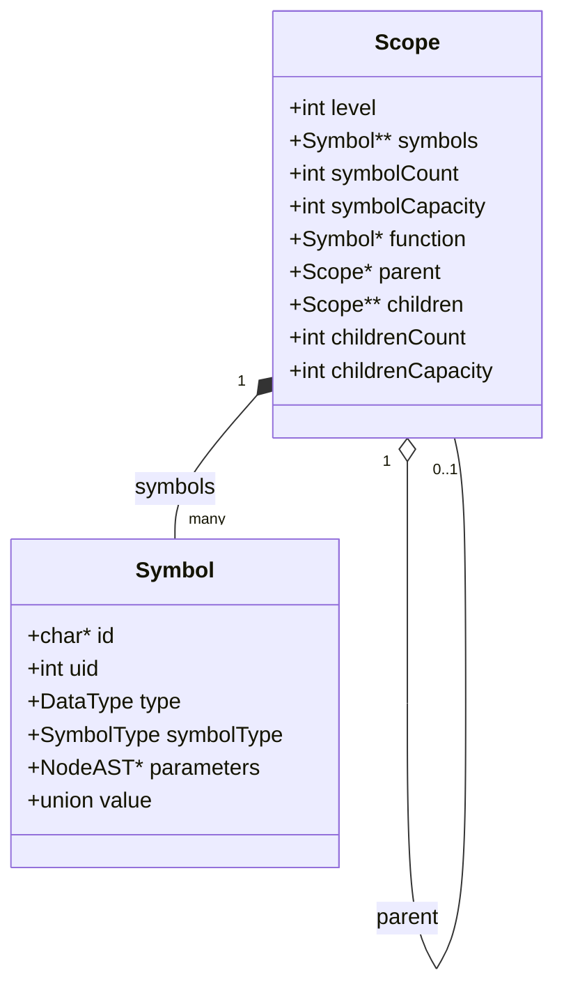

# Análisis Semántico, Símbolos y Tabla de Símbolos

La fase de análisis semántico valida que el programa fuente respete las restricciones contextuales, los ámbitos léxicos y las reglas de tipado estático de C-TDS. Opera sobre el Árbol de Sintaxis Abstracta (AST) construyendo la jerarquía de tablas de símbolos (`Scope`) y asociando cada identificador a una entidad `Symbol`.

---

## 1. Diagrama de Arquitectura



### Responsabilidades y Componentes de la Etapa
- **Tabla de Símbolos (`SymbolTable`):** Definición de las estructuras `Symbol`, `Scope`, enumerado `SymbolType` y operaciones sobre entornos.
- **Gestor de Ámbitos:** Creación de ámbitos jerárquicos, redimensionamiento dinámico, asignación de UID secuencial y algoritmos de búsqueda (*scoping*).
- **Sistema de Tipos:** Definición de enumerados `DataType` (`TYPE_INT`, `TYPE_FLOAT`, `TYPE_BOOL`, `TYPE_VOID`, `TYPE_ERROR`).
- **Verificador de Tipos (`TypeChecker`):** Reglas de compatibilidad (`isAssignable`), inferencia en expresiones y validación de tipos.
- **Analizador Semántico:** Recorrido recursivo del AST, control de flujo, validación de retornos y verificación del método principal `main()`.

---

## 2. Símbolos y tabla de símbolos

Las estructuras `Symbol` y `Scope`, la asignación de `uid`, la búsqueda local
contra jerárquica y las reglas de ocultamiento tienen ahora su propia página:
[Tabla de Símbolos y Ámbitos](04-symbol-table.md) (ficha F09).

---

## 3. Casos Anómalos y Gestión de Errores ("Casos Malos")

Cuando la resolución o verificación de un identificador falla, el compilador maneja la situación de forma robusta y determinista:

### 1. Variable no declarada en una expresión
- **Detección:** En [`analyzeIdentifier`](https://github.com/julivarea/compiler/blob/main/src/type_checker.c), `lookupSymbol(scope, node->symbol->id)` retorna `NULL`.
- **Acción:**
  1. Se emite un error con la línea exacta: `semanticError(node->line, "Variable no declarada: %s", id)`.
  2. El tipo del nodo se asigna a `TYPE_ERROR` (`node->type = TYPE_ERROR;`).
  3. Los operadores que consumen este nodo propagan `TYPE_ERROR`, previniendo reportes falsos de tipos incompatibles en cadena.

### 2. Asignación a variable no declarada
- **Detección:** En [`analyzeAssignmentNode`](https://github.com/julivarea/compiler/blob/main/src/semantic_analyzer.c), `lookupSymbol(currentScope, node->symbol->id)` retorna `NULL`.
- **Acción:**
  1. Se emite: `semanticError(node->line, "Asignacion a variable no declarada '%s'.", id)`.
  2. Se aborta el procesamiento de esa asignación sin enlazar el nodo al AST.

### 3. Conflicto de categoría de símbolo (Variable vs. Método)
- **Caso A (Usar método como variable):** Si un identificador fue declarado como función pero se usa como variable en una expresión o asignación (`symbol->symbolType != VARIABLE_SYMBOL`), se emite: `"El identificador '%s' no es una variable"` o `"Ese nombre de simbolo corresponde al metodo '%s'"`.
- **Caso B (Llamar a una variable como método):** En `analyzeMethodCall`, si el símbolo resuelto posee `symbolType != METHOD_SYMBOL`, se emite: `"El simbolo encontrado pertenece a una variable no a una llamada de un metodo"`.

### 4. Redeclaración en el mismo ámbito
- **Detección:** Al declarar una variable en [`analyzeVariableDeclarationNode`](https://github.com/julivarea/compiler/blob/main/src/semantic_analyzer.c), se consulta `lookupSymbolInScope(currentScope, node->symbol->id)`.
- **Acción:**
  1. Si retorna distinto de `NULL`, se emite: `semanticError(node->line, "La variable '%s' ya fue declarada previamente en este ambito.", id)`.
  2. El símbolo duplicado **no** se inserta en el `Scope` (`appendSymbol` se omite).

### 5. Resiliencia ante punteros nulos
Si `lookupSymbol` o `lookupSymbolInScope` reciben un `scope == NULL` o `id == NULL`, retornan `NULL` de inmediato sin generar fallos de segmentación ni interrupciones del proceso.

### 6. Política de Diagnóstico y Aborto en el Compilador
- **Diagnóstico Acumulativo:** El analizador semántico **no aborta en el primer error**. Continúa recorriendo el resto del AST para recopilar todos los errores del archivo fuente.
- **Incremento de Contador:** Cada llamado a `semanticError()` incrementa la variable global `semantic_errors`.
- **Corte de Pipeline (`driver.c`):** Al concluir el recorrido semántico, la función `runSemantic` inspecciona el contador:
  ```c
  if (semantic_errors > 0) {
      fprintf(stderr, "\nCompilacion abortada: se encontraron %d errores semanticos.\n", semantic_errors);
      return 1;
  }
  ```
  Si se detectó al menos un error, la compilación finaliza retornando `1` y **no se generan** ni el Código Intermedio (TAC) ni el Código Objeto (Assembly).

---

## 4. Verificación de Tipos y Reglas Semánticas

Durante el recorrido del AST, el componente de verificación de tipos deduce y comprueba los tipos de todas las expresiones:

- **Compatibilidad en Asignaciones (`isAssignable`):**
  - Tipos idénticos (`int` a `int`, `float` a `float`, `boolean` a `boolean`).
  - Coerción implícita permitida: valor `int` asignado a variable `float`.
  - Conversión rechazada: valor `float` a variable `int`, o mezclas con `boolean`.
- **Operaciones Binarias:**
  - `+`, `-`, `*`, `/`: Operandos enteros devuelven `TYPE_INT`. Si al menos uno es `float`, se promueve a `TYPE_FLOAT`.
  - `%`: Requiere estrictamente operandos `TYPE_INT` y devuelve `TYPE_INT`.
  - `&&`, `||`, `!`: Requieren operandos `TYPE_BOOL` y devuelven `TYPE_BOOL`.
  - `<`, `>`, `==`: Comparan tipos compatibles y devuelven `TYPE_BOOL`.
- **Sentencias de Control (`if`, `while`):** La condición debe evaluar obligatoriamente a `TYPE_BOOL`.
- **Sentencias `return`:**
  - Fuera de una función: error semántico.
  - En función `void`: debe ser `return;`.
  - En función no-void: debe ser `return <expr>;` donde `<expr>` sea compatible con el tipo de retorno de `scope->function`.
  - Garantía de retorno: los métodos no-void validan mediante `guaranteesReturn` que todos los caminos de ejecución finalicen en un `return`.
- **Punto de Entrada (`main`):** Al concluir el análisis, `checkMainMethodExists` comprueba que en el ámbito global exista la función `void main()` sin parámetros.

---

**Siguiente:** [Generación de Código Intermedio (TAC)](05-intermediate-code.md)
