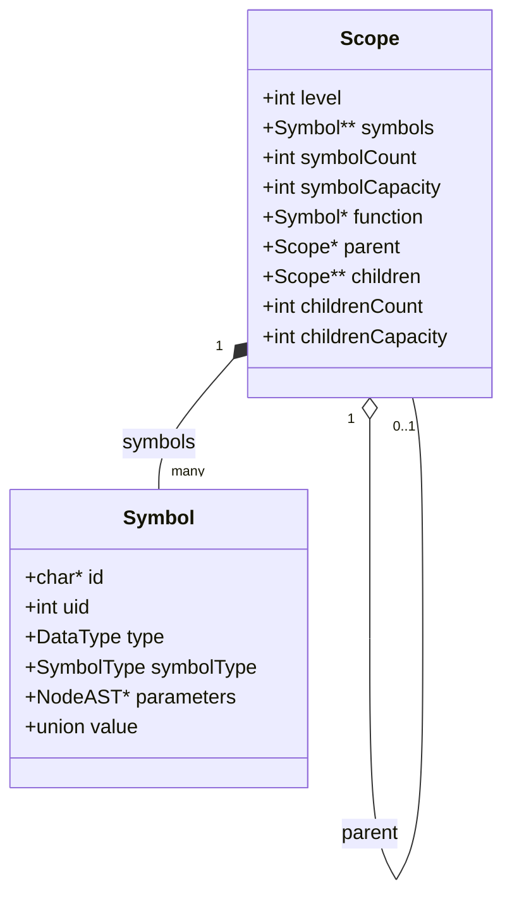
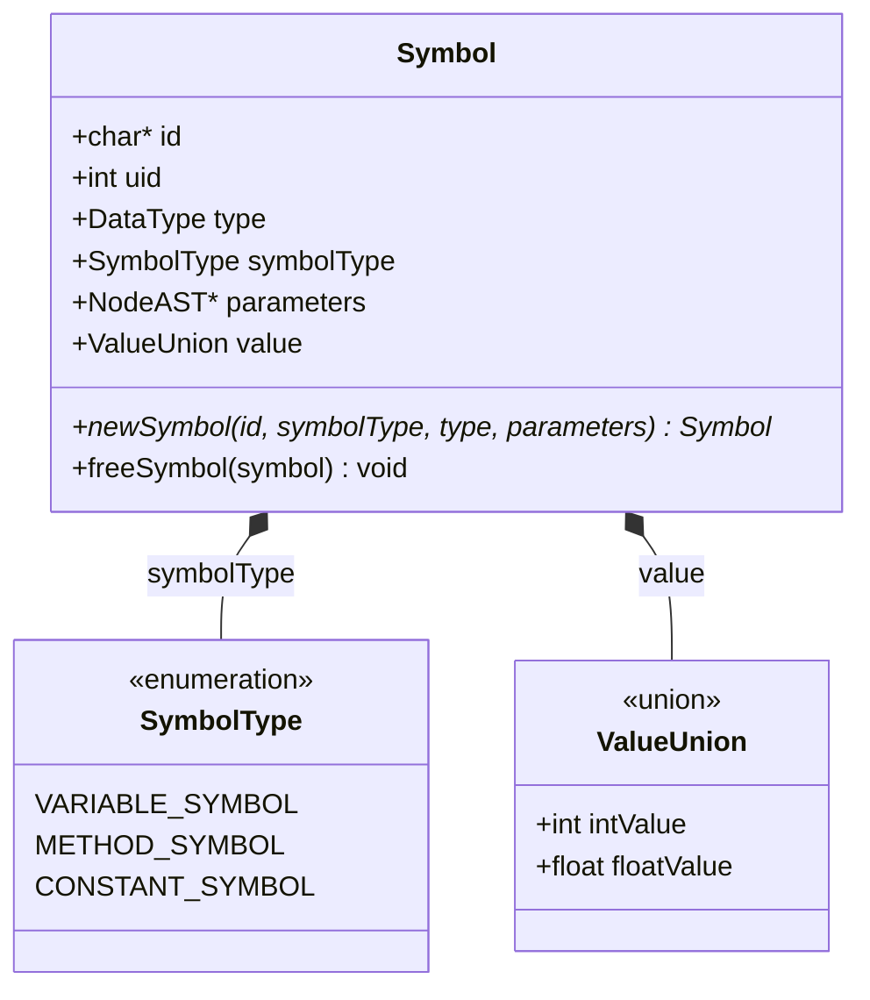
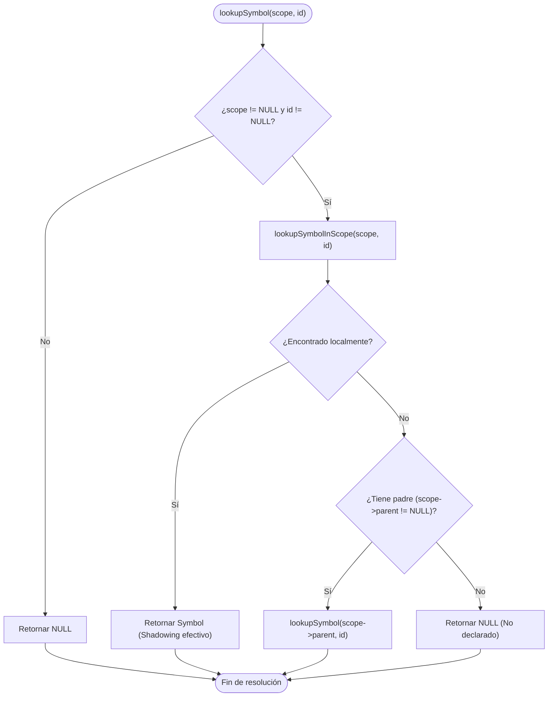

# Análisis Semántico, Símbolos y Tabla de Símbolos

La fase de análisis semántico valida que el programa fuente respete las restricciones contextuales, los ámbitos léxicos y las reglas de tipado estático de C-TDS. Opera sobre el Árbol de Sintaxis Abstracta (AST) construyendo la jerarquía de tablas de símbolos (`Scope`) y asociando cada identificador a una entidad `Symbol`.

---

## 1. Diagrama de Arquitectura



### Responsabilidades y Componentes de la Etapa
- **Tabla de Símbolos (`SymbolTable`):** Definición de las estructuras `Symbol`, `Scope`, enumerado `SymbolType` y operaciones sobre entornos.
- **Gestor de Ámbitos:** Creación de ámbitos jerárquicos, redimensionamiento dinámico, asignación de UID secuencial y algoritmos de búsqueda (*scoping*).
- **Sistema de Tipos:** Definición de enumerados `DataType` (`TYPE_INT`, `TYPE_FLOAT`, `TYPE_BOOL`, `TYPE_VOID`, `TYPE_ERROR`).
- **Verificador de Tipos (`TypeChecker`):** Reglas de compatibilidad (`isAssignable`), inferencia en expresiones y validación de tipos.
- **Analizador Semántico:** Recorrido recursivo del AST, control de flujo, validación de retornos y verificación del método principal `main()`.

---

## 2. Modelado de Símbolos (`Symbol`)

Un `Symbol` representa una entidad con nombre, tipo o valor semántico dentro del compilador (variable declarada, función o constante literal).



### Campos de la Estructura
- **`id` (`char*`):** Nombre del identificador o método. Duplicado en memoria dinámica con `strdup()`. En literales numéricos o constantes es `NULL`.
- **`uid` (`int`):** Identificador único secuencial de la entidad declarada:
  - Permite distinguir inequívocamente a dos variables con el mismo nombre declaradas en distintos ámbitos (*shadowing*).
  - Inicializado en `0` por `newSymbol()` para indicar entidad "no declarada".
  - Asignado a un valor autoincremental ($\ge 1$) por `appendSymbol()` en el momento exacto en que la variable o método se registra en un ámbito.
- **`type` (`DataType`):** Tipo de dato semántico asociado (`TYPE_INT`, `TYPE_FLOAT`, `TYPE_BOOL`, `TYPE_VOID`, `TYPE_ERROR`).
- **`symbolType` (`SymbolType`):** Categoría sintáctico-semántica del símbolo:
  - `VARIABLE_SYMBOL`: Identificador de variable local, global o parámetro formal.
  - `METHOD_SYMBOL`: Declaración de función o método.
  - `CONSTANT_SYMBOL`: Literal o valor primitivo constante.
- **`parameters` (`NodeAST*`):** En símbolos de tipo `METHOD_SYMBOL`, almacena un puntero al sub-árbol del AST de parámetros (`PARAMETERS_NODE`) para validar argumentos en llamadas.
- **`value` (`union`):** Almacenamiento nativo del valor en constantes literales, evitando conversiones repetidas de texto a número:
  ```c
  union {
      int intValue;      // Enteros y booleanos (0 o 1)
      float floatValue;  // Flotantes
  } value;
  ```

### Ciclo de Vida
1. **Creación (`newSymbol`):** Reserva memoria en el heap, clona el identificador si no es nulo, enlaza los parámetros y fija `uid = 0`.
2. **Liberación (`freeSymbol`):** Libera la cadena duplicada `symbol->id` y luego la estructura del símbolo en memoria.

---

## 3. Modelado de la Tabla de Símbolos (`Scope`)

El entorno léxico del programa no es una tabla plana única, sino un **árbol jerárquico de ámbitos** (`Scope`). Cada función y cada bloque delimitado por llaves `{ ... }` posee su propia tabla de símbolos.

### Campos de la Estructura `Scope`
- **`level` (`int`):** Nivel de profundidad léxica (`0` para el ámbito global, `1` para funciones, `2+` para bloques anidados).
- **`symbols` (`Symbol**`):** Arreglo dinámico de punteros a símbolos registrados en este nivel.
- **`symbolCount` y `symbolCapacity` (`int`):** Contador de símbolos activos y capacidad actual reservada (inicia con capacidad 8 y se duplica automáticamente mediante `realloc` cuando se llena).
- **`function` (`Symbol*`):** Puntero al símbolo del método contenedor inmediato (es `NULL` para el ámbito global). Permite consultar en tiempo constante $\mathcal{O}(1)$ el método al que pertenece un bloque interno (por ejemplo, para validar que el tipo de una sentencia `return` coincida con la firma de la función).
- **`parent` (`Scope*`):** Puntero al ámbito contenedor inmediato (es `NULL` para el ámbito global).
- **`children` (`Scope**`):** Arreglo dinámico de sub-ámbitos contenidos para navegación y persistencia.
- **`childrenCount` y `childrenCapacity` (`int`):** Contador y capacidad del arreglo de hijos (inicia en 4 y se duplica dinámicamente).

### ¿Qué se almacena en `symbols` y qué se ignora?
- **Se almacena:**
  1. *Variables Locales y Globales:* Generadas por `VARIABLE_DECLARATION_NODE`.
  2. *Parámetros de Métodos:* Se insertan como variables en el ámbito de la función para que el cuerpo pueda accederlos.
  3. *Firmas de Métodos:* Se registran en el ámbito padre (usualmente el global) para posibilitar invocaciones y llamadas recursivas.
- **Se ignora (no entra a la tabla):**
  - Palabras clave, operadores y sentencias de control (`if`, `while`).
  - Nodos de uso como `ID_NODE` o `ASSIGNMENT_NODE`: no crean símbolos en la tabla, sino que **consultan** la tabla existente mediante `lookupSymbol`.
  - Bloques (`BLOCK_NODE`): generan un nuevo `Scope` hijo, pero el bloque en sí no se registra como símbolo dentro del padre.

---

## 4. Dinámica de Ámbitos y Resolución de Identificadores

```text
 Ámbito Global (level 0) [variables globales, métodos]
        ▲
        │ parent
 Ámbito Método (level 1) [parámetros formales, variables del cuerpo]
        ▲
        │ parent
 Ámbito Bloque { ... } (level 2) [variables locales internas]
```

### Mecanismo de Búsqueda: Búsqueda Local vs. Ascendente

La resolución de símbolos se implementa en [`src/symbol_table.c`](file:///home/francisco/compiler/src/symbol_table.c) a través de dos funciones complementarias:

#### 1. Búsqueda Local (`lookupSymbolInScope`)
Realiza una inspección exclusivamente local sobre el arreglo `symbols` del ámbito actual:

```c
Symbol *lookupSymbolInScope(Scope *scope, const char *id) {
    if (scope == NULL || id == NULL) return NULL;

    for (int i = 0; i < scope->symbolCount; i++) {
        Symbol *currentSymbol = scope->symbols[i];
        if (currentSymbol->id != NULL && strcmp(currentSymbol->id, id) == 0) {
            return currentSymbol;
        }
    }
    return NULL;
}
```

- **Propósito:** Validar colisiones locales al **declarar** variables o funciones.
- **Comportamiento:** No consulta al padre (`scope->parent`). Si la variable no está en el nivel actual, retorna `NULL`.

#### 2. Búsqueda Jerárquica y Ascendente (`lookupSymbol`)
Resuelve un identificador inspeccionando primero el ámbito local y ascendiendo recursivamente por la cadena de padres:

```c
Symbol *lookupSymbol(Scope *scope, const char *id) {
    if (scope == NULL || id == NULL) {
        return NULL;
    }

    // 1. Búsqueda en el ámbito local
    Symbol *symbol = lookupSymbolInScope(scope, id);
    if (symbol != NULL) {
        return symbol;
    }

    // 2. Ascenso recursivo al ámbito padre
    return lookupSymbol(scope->parent, id);
}
```

- **Propósito:** Resolver identificadores en lecturas (`ID_NODE`), asignaciones (`ASSIGNMENT_NODE`) e invocaciones (`METHOD_CALL_NODE`).
- **Sombreado (*Shadowing*):** Si una variable local comparte identificador con otra en un ámbito externo, el paso 1 encuentra la versión local y detiene el ascenso, ocultando la variable externa sin generar conflicto.
- **Enlace al AST:** Cuando la búsqueda es exitosa, el nodo del AST actualiza su puntero interno `node->symbol` apuntando al `Symbol` resuelto (con su `uid` y tipo correspondiente), permitiendo que las etapas posteriores (código intermedio y ensamblador) accedan directamente a los metadatos correctos.



---

## 5. Casos Anómalos y Gestión de Errores ("Casos Malos")

Cuando la resolución o verificación de un identificador falla, el compilador maneja la situación de forma robusta y determinista:

### 1. Variable no declarada en una expresión
- **Detección:** En [`analyzeIdentifier`](file:///home/francisco/compiler/src/type_checker.c), `lookupSymbol(scope, node->symbol->id)` retorna `NULL`.
- **Acción:**
  1. Se emite un error con la línea exacta: `semanticError(node->line, "Variable no declarada: %s", id)`.
  2. El tipo del nodo se asigna a `TYPE_ERROR` (`node->type = TYPE_ERROR;`).
  3. Los operadores que consumen este nodo propagan `TYPE_ERROR`, previniendo reportes falsos de tipos incompatibles en cadena.

### 2. Asignación a variable no declarada
- **Detección:** En [`analyzeAssignmentNode`](file:///home/francisco/compiler/src/semantic_analyzer.c), `lookupSymbol(currentScope, node->symbol->id)` retorna `NULL`.
- **Acción:**
  1. Se emite: `semanticError(node->line, "Asignacion a variable no declarada '%s'.", id)`.
  2. Se aborta el procesamiento de esa asignación sin enlazar el nodo al AST.

### 3. Conflicto de categoría de símbolo (Variable vs. Método)
- **Caso A (Usar método como variable):** Si un identificador fue declarado como función pero se usa como variable en una expresión o asignación (`symbol->symbolType != VARIABLE_SYMBOL`), se emite: `"El identificador '%s' no es una variable"` o `"Ese nombre de simbolo corresponde al metodo '%s'"`.
- **Caso B (Llamar a una variable como método):** En `analyzeMethodCall`, si el símbolo resuelto posee `symbolType != METHOD_SYMBOL`, se emite: `"El simbolo encontrado pertenece a una variable no a una llamada de un metodo"`.

### 4. Redeclaración en el mismo ámbito
- **Detección:** Al declarar una variable en [`analyzeVariableDeclarationNode`](file:///home/francisco/compiler/src/semantic_analyzer.c), se consulta `lookupSymbolInScope(currentScope, node->symbol->id)`.
- **Acción:**
  1. Si retorna distinto de `NULL`, se emite: `semanticError(node->line, "La variable '%s' ya fue declarada previamente en este ambito.", id)`.
  2. El símbolo duplicado **no** se inserta en el `Scope` (`appendSymbol` se omite).

### 5. Resiliencia ante punteros nulos
Si `lookupSymbol` o `lookupSymbolInScope` reciben un `scope == NULL` o `id == NULL`, retornan `NULL` de inmediato sin generar fallos de segmentación ni interrupciones del proceso.

### 6. Política de Diagnóstico y Aborto en el Compilador
- **Diagnóstico Acumulativo:** El analizador semántico **no aborta en el primer error**. Continúa recorriendo el resto del AST para recopilar todos los errores del archivo fuente.
- **Incremento de Contador:** Cada llamado a `semanticError()` incrementa la variable global `semantic_errors`.
- **Corte de Pipeline (`driver.c`):** Al concluir el recorrido semántico, la función `runSemantic` inspecciona el contador:
  ```c
  if (semantic_errors > 0) {
      fprintf(stderr, "\nCompilacion abortada: se encontraron %d errores semanticos.\n", semantic_errors);
      return 1;
  }
  ```
  Si se detectó al menos un error, la compilación finaliza retornando `1` y **no se generan** ni el Código Intermedio (TAC) ni el Código Objeto (Assembly).

---

## 6. Verificación de Tipos y Reglas Semánticas

Durante el recorrido del AST, el componente de verificación de tipos deduce y comprueba los tipos de todas las expresiones:

- **Compatibilidad en Asignaciones (`isAssignable`):**
  - Tipos idénticos (`int` a `int`, `float` a `float`, `boolean` a `boolean`).
  - Coerción implícita permitida: valor `int` asignado a variable `float`.
  - Conversión rechazada: valor `float` a variable `int`, o mezclas con `boolean`.
- **Operaciones Binarias:**
  - `+`, `-`, `*`, `/`: Operandos enteros devuelven `TYPE_INT`. Si al menos uno es `float`, se promueve a `TYPE_FLOAT`.
  - `%`: Requiere estrictamente operandos `TYPE_INT` y devuelve `TYPE_INT`.
  - `&&`, `||`, `!`: Requieren operandos `TYPE_BOOL` y devuelven `TYPE_BOOL`.
  - `<`, `>`, `==`: Comparan tipos compatibles y devuelven `TYPE_BOOL`.
- **Sentencias de Control (`if`, `while`):** La condición debe evaluar obligatoriamente a `TYPE_BOOL`.
- **Sentencias `return`:**
  - Fuera de una función: error semántico.
  - En función `void`: debe ser `return;`.
  - En función no-void: debe ser `return <expr>;` donde `<expr>` sea compatible con el tipo de retorno de `scope->function`.
  - Garantía de retorno: los métodos no-void validan mediante `guaranteesReturn` que todos los caminos de ejecución finalicen en un `return`.
- **Punto de Entrada (`main`):** Al concluir el análisis, `checkMainMethodExists` comprueba que en el ámbito global exista la función `void main()` sin parámetros.

---

**Siguiente:** [Generación de Código Intermedio (TAC)](05-intermediate-code.md)
