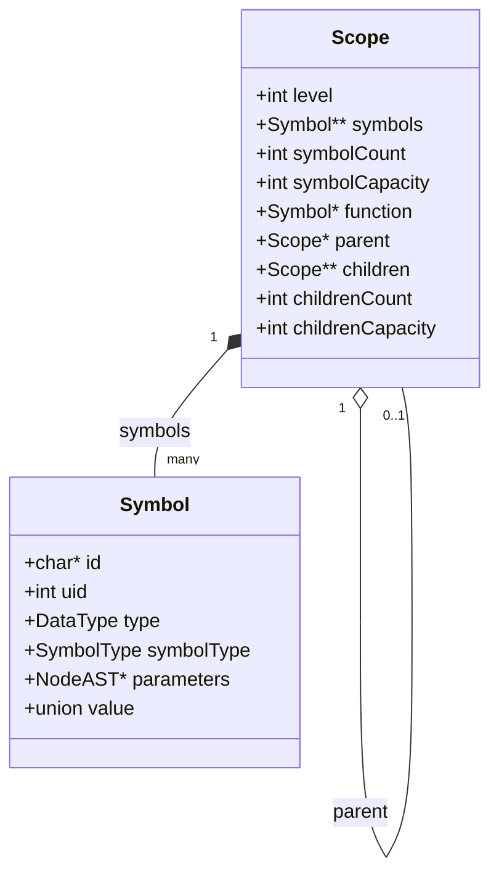

# Tabla de Símbolos y Ámbitos

**Ficha F09** · Archivos: `include/symbol_table.h`, `src/symbol_table.c` (358 líneas)

La estructura con la que el compilador sabe qué identificadores existen, de qué
tipo son y cuál de los que comparten nombre corresponde en cada punto del
programa.

---

## 1. Qué problema resuelve

El [AST](03-ast.md) tiene los nombres pero no sabe a qué se refieren: un `ID_NODE`
con el nombre `x` no dice qué `x`. La tabla de símbolos responde esa pregunta
respetando el **anidamiento de ámbitos** del lenguaje, donde una declaración
interna puede ocultar a una externa del mismo nombre.

Es una estructura de datos, no una fase: la construyen y consultan el
[análisis semántico](04-semantic-analysis.md) y el intérprete.

---

## 2. Interfaz pública

### Símbolos

| Función | Para qué |
| --- | --- |
| `newSymbol(id, symbolType, type, parameters)` | Crea un símbolo en el heap |
| `freeSymbol(symbol)` | Lo libera junto con su `id` |
| `makeIntSymbol(int)` | Símbolo constante entero **por valor** |
| `makeFloatSymbol(float)` | Ídem real |
| `makeBoolSymbol(bool)` | Ídem booleano |
| `makeVoidSymbol()` | Ídem void |

### Ámbitos

| Función | Para qué |
| --- | --- |
| `createScope(level, parent, function)` | Crea un ámbito |
| `freeScope(scope)` | Libera el ámbito, sus sub-ámbitos y todos sus símbolos |
| `appendSymbol(scope, symbol)` | Registra un símbolo y **le asigna su `uid`** |
| `appendChildScope(parent, child)` | Cuelga un sub-ámbito del padre |
| `lookupSymbol(scope, id)` | Busca en el ámbito y **sube** por los ancestros |
| `lookupSymbolInScope(scope, id)` | Busca **solo** en el ámbito dado |
| `resetSymbolUids()` | Reinicia el contador de `uid` a 1 |

Todas las funciones de ámbitos aceptan `NULL` y no hacen nada, así que el código
que las usa no está lleno de guardas.

---

## 3. La estructura `Symbol`

```c
typedef struct Symbol {
    char *id;
    int uid;                    /* 0 si aún no fue registrado en un ámbito */
    DataType type;
    SymbolType symbolType;
    struct NodeAST *parameters; /* Parámetros formales si es METHOD_SYMBOL */
    union {
        int intValue;
        float floatValue;
        NodeAST *function;
    } value;
} Symbol;
```

| Campo | Por qué existe |
| --- | --- |
| `id` | El nombre. **`NULL` en las constantes**, que no nombran nada |
| `uid` | Identificador único en todo el programa. Ver §6 |
| `type` | El tipo de dato. En un método es su **tipo de retorno** |
| `symbolType` | Qué clase de símbolo es, y por lo tanto qué campos tienen sentido |
| `parameters` | Puntero al `PARAMETERS_NODE` del AST. Es una **referencia hacia atrás** desde la tabla al árbol, y es lo que permite validar los argumentos de una llamada |
| `value` | El valor de una constante, o el nodo del método para el intérprete |

**La unión tiene tres miembros para tres usos que no coexisten:** `intValue`
guarda enteros y booleanos (1/0), `floatValue` los reales, y `function` el
`METHOD_DECLARATION_NODE` que el intérprete necesita para poder ejecutar el
cuerpo cuando encuentra una llamada. Un símbolo nunca es constante y método a la
vez, así que la unión no desperdicia nada.

### Las cuatro variantes de `SymbolType`

| Variante | Quién la crea | Qué campos usa |
| --- | --- | --- |
| `VARIABLE_SYMBOL` | El parser y `newParameterDeclaration` | `id`, `uid`, `type` |
| `METHOD_SYMBOL` | `newMethodDeclaration` | `id`, `uid`, `type` (retorno), `parameters` |
| `CONSTANT_SYMBOL` | Los `new*LiteralNode` y los `make*Symbol` | `type`, `value`. **Sin `id`** |
| `FUNCTION_ENTRY_SYMBOL` | **Solo el intérprete** (`interpreter.c`) | `id`, `type`, `parameters`, `value.function` |

La cuarta merece la aclaración, porque el header la comenta apenas con
`// for interpret`: el intérprete necesita registrar los métodos en su propio
ámbito global guardando **el nodo del AST** en `value.function`, para poder
ejecutarlo al encontrar la llamada. El compilador no la usa nunca: su camino es
`METHOD_SYMBOL`. Es la única parte de este módulo que existe por una extensión
nuestra y no por el compilador propiamente dicho.

### Las dos vidas de `Symbol`: heap y valor

Hay dos formas de obtener un `Symbol` y conviene no confundirlas, porque una es
para la tabla y la otra para evaluar expresiones.

| | `newSymbol` | `makeIntSymbol` y compañía |
| --- | --- | --- |
| Devuelve | `Symbol *` en el heap | `Symbol` **por valor** |
| Quién lo libera | `freeSymbol`, o `freeScope` si fue registrado | Nadie: vive en la pila |
| `id` | El que se le pase | Siempre `NULL` (hacen `memset` a 0) |
| `uid` | 0 hasta que `appendSymbol` lo registre | Siempre 0 |
| Para qué | **Declaraciones**: lo que se guarda en la tabla | **Valores intermedios** durante la evaluación en el intérprete |

O sea que `Symbol` cumple dos papeles: entrada de tabla de símbolos y
*resultado de evaluar una expresión*. Los `make*Symbol` existen porque el
intérprete necesita devolver "un entero con valor 7" de una función, y reusa la
misma estructura en lugar de definir un tipo propio. Es economía de código a
costa de que el nombre `Symbol` signifique dos cosas distintas según el contexto.

### `newSymbol` adopta el `id`, no lo copia

```c
symbol->id = id;   /* no hay strdup aca */
```

La cadena viene del `strdup` que hizo el [analizador léxico](02-lexical-analysis.md)
y se libera en `freeSymbol`. Es la misma cadena recorriendo todo el front-end sin
una sola copia intermedia; el precio es que pasarle un literal de string a
`newSymbol` haría que `freeSymbol` intentara liberar memoria estática.

---

## 4. La estructura `Scope`



```c
typedef struct Scope {
    int level;               /* 0 para el ámbito global */
    Symbol **symbols;
    int symbolCount;
    int symbolCapacity;
    Symbol *function;        /* Método contenedor (NULL si es global) */
    struct Scope *parent;    /* Ámbito padre (NULL en el global) */
    struct Scope **children;
    int childrenCount;
    int childrenCapacity;
} Scope;
```

| Campo | Por qué existe |
| --- | --- |
| `level` | Profundidad de anidamiento. Informativo: la búsqueda usa `parent`, no el nivel |
| `symbols` / `symbolCount` / `symbolCapacity` | Arreglo dinámico de los símbolos declarados **en este ámbito** |
| `function` | El símbolo del método que contiene a este ámbito. Es cómo se sabe **qué tipo de retorno se espera** dentro de un bloque anidado |
| `parent` | La **cadena de búsqueda**. Es el campo que implementa el anidamiento |
| `children` / `childrenCount` / `childrenCapacity` | Los sub-ámbitos |

**`parent` y `children` no son redundantes: sirven a cosas distintas.** `parent`
es lo que recorre la búsqueda, de adentro hacia afuera. `children` es lo que
recorre `freeScope` para liberar el árbol completo, y lo que permite recorrer la
jerarquía desde la raíz. Sin `children`, liberar la tabla exigiría llevar una
lista aparte de todos los ámbitos creados.

**`function` se hereda.** Cuando el análisis semántico abre el ámbito de un
bloque, lo crea con el `function` del padre:

```c
Symbol *function = !isGlobalScope ? parent->function : NULL;
Scope *currentScope = createScope(level, parent, function);
```

Así un `return` dentro de un `while` dentro de un `if` sigue sabiendo cuál es el
método que lo contiene y, por lo tanto, qué tipo tiene que devolver. Sin esa
herencia, un bloque anidado perdería el contexto del método.

---

## 5. La búsqueda de identificadores

Dos funciones, y la diferencia entre ellas es exactamente la diferencia entre
dos reglas del lenguaje.

### `lookupSymbolInScope`: solo acá

Recorrido lineal del arreglo con `strcmp`. Devuelve el primer símbolo cuyo `id`
coincida, o `NULL`.

Se usa para **detectar redeclaraciones**: una variable ya declarada *en el mismo
ámbito* es un error, pero una del mismo nombre en un ámbito externo no lo es.

### `lookupSymbol`: acá y hacia arriba

```c
Symbol *symbol = lookupSymbolInScope(scope, id);
if (symbol != NULL) return symbol;
return lookupSymbol(scope->parent, id);
```

Recursión sobre `parent`: prueba el ámbito actual y, si no está, sube. La
recursión termina porque el ámbito global tiene `parent == NULL` y la guarda de
entrada devuelve `NULL`.

**Que pruebe el ámbito actual antes de subir es todo el mecanismo de
ocultamiento.** No hay código específico de *shadowing*: sale del orden de la
búsqueda.

### Costo

`lookupSymbolInScope` es O(n) en la cantidad de símbolos del ámbito, y
`lookupSymbol` es O(n × profundidad). Para los programas de este lenguaje —
decenas de símbolos, tres o cuatro niveles — es irrelevante, y es la
implementación más simple que es correcta. Un compilador de producción usa una
tabla de hash por ámbito, o una sola tabla de hash global con una pila de
ámbitos por nombre.

---

## 6. El `uid` y para qué sirve

```c
static int nextSymbolUid = 1;   /* arranca en 1: el 0 significa "no declarado" */

void appendSymbol(Scope *scope, Symbol *symbol) {
    if (symbol->uid == 0) {
        symbol->uid = nextSymbolUid++;
    }
    ...
}
```

Un **contador global**, no por ámbito. Cada símbolo que se registra en algún
ámbito recibe un número único en todo el programa.

Esto tiene dos usos y los dos importan:

**1. `uid == 0` significa "nunca registrado".** Es lo que usa `freeAST` para
decidir si un nodo es dueño de su símbolo (ver la [ficha F08](03-ast.md)). Por eso
el contador arranca en 1 y no en 0.

**2. Desambiguar nombres repetidos en las fases posteriores.** El código
intermedio y el assembly no tienen ámbitos: son listas planas de instrucciones.
Si tres variables se llaman `x`, hace falta distinguirlas, y el `uid` es lo que
lo permite.

### Verificación

```c
int x;
int main(){
    int x;
    x = 10;
    {
        int x;
        x = 20;
    }
    return x;
}
```

El `.sem` muestra tres símbolos distintos (el `uid` 2 se lo llevó `main`):

```
  | Declaracion Variable: x #1 (Tipo INT)
  | Metodo: main (Retorna INT)
  |   |   | Declaracion Variable: x #3 (Tipo INT)
  |   |   | Asignacion a: x #3 (Tipo INT)
  |   |   | Bloque
  |   |   |   | Declaracion Variable: x #4 (Tipo INT)
  |   |   |   | Asignacion a: x #4 (Tipo INT)
  |   |   | Return
  |   |   |   | ID: x #3 (Tipo INT)
```

Y el `.ci` los nombra con el `uid` pegado al nombre:

```
global x@1, INT
begin_func main, 0
local x@3, INT
x@3 = 10
local x@4, INT
x@4 = 20
ret x@3
end_func main
```

El `return x` resolvió a `x@3`, el del ámbito del método, porque el `x@4` del
bloque interno ya está fuera de alcance. El programa devuelve 10.

### `resetSymbolUids`

Reinicia el contador. **Lo llaman únicamente las suites de tests**
(`test_tac.c`, `test_object_code.c`, `test_optimizer.c`,
`test_live_variable_analysis.c`), para que los `uid` sean deterministas y se
pueda comparar el TAC esperado carácter por carácter. El compilador no la usa:
procesa un archivo y termina.

---

## 7. Las reglas de alcance que resultan

La forma en que el análisis semántico usa esta estructura determina qué se puede
y qué no. Las tres verificadas:

### Un local no puede ocultar a un parámetro

Los parámetros y las variables declaradas al principio del método se registran
**en el mismo ámbito**: `analyzeMethodNode` crea un solo `methodScope` y analiza
en él tanto los parámetros como el cuerpo. Entonces repetir el nombre es una
redeclaración:

```c
int f(int n){ int n; n = 1; return n; }
```

```
Error semantico en la linea 1: La variable 'n' ya fue declarada previamente en este ambito.
```

### Pero un bloque interno sí puede

El bloque abre un ámbito nuevo, hijo del método:

```c
int f(int n){ { int n; n = 99; } return n; }
int main(){ return f(7); }
```

Devuelve **7**: el `return n` ve el parámetro, porque el `n` del bloque ya se
cerró.

### La recursión funciona porque el método se registra antes de su cuerpo

```c
appendSymbol(currentScope, node->symbol);   /* primero se registra */
...
/* despues se analiza el cuerpo */
```

Si el orden fuera el inverso, `fact(n-1)` dentro de `fact` daría "método no
declarado". Con este orden, `fact(5)` devuelve 120. Verificado.

---

## 8. Conexión con las fases vecinas

| Viene de | Qué cruza la frontera |
| --- | --- |
| `ast.c` (F08) | Los `Symbol` ya creados por el parser, con `uid` en 0 y tipo provisorio |

| Va hacia | Qué entrega |
| --- | --- |
| `type_checker.c` (F10) | `lookupSymbol` para resolver cada identificador y leer su tipo |
| `semantic_analyzer.c` (F11) | `lookupSymbolInScope` para detectar duplicados, `scope->function` para el tipo de retorno |
| `intermediate_code.c` (F13) | El `uid` de cada símbolo, que se convierte en el sufijo `@n` de los nombres del TAC |
| `interpreter.c` (F19) | Toda la estructura, usada en tiempo de ejecución con `FUNCTION_ENTRY_SYMBOL` y los `make*Symbol` |

El punto importante: después del análisis semántico, **los símbolos están
compartidos**. Todos los nodos del AST que mencionan la misma variable apuntan al
*mismo* `Symbol`, que vive en la tabla. Esa es la razón de la regla de propiedad
de `freeAST` y la razón de que el generador de código pueda leer el tipo de una
variable desde cualquier nodo que la mencione.

---

## 9. Cómo se extiende

### Un `SymbolType` nuevo

Agregar el valor al enum y decidir qué campos de la unión usa. No hay un `switch`
central sobre `SymbolType` que haya que completar, así que el cambio es local:
los lugares que lo necesiten lo comparan donde corresponda. La contracara es que
nada avisa si falta un caso.

### Guardar el offset de pila en el símbolo

Es la extensión que pediría el generador de código si se quisiera evitar el
cálculo de offsets aparte: un campo `int stackOffset` en `Symbol`, que el
generador rellenaría. Hoy eso vive en `function_frame.c` (ficha F17), indexado por
nombre. Ponerlo acá acoplaría la tabla de símbolos al backend, que es
justamente lo que la separación actual evita.

### Reemplazar la búsqueda lineal por una tabla de hash

Cambiar `symbols` por una tabla de hash dentro de cada `Scope`. La interfaz
(`lookupSymbol`, `lookupSymbolInScope`, `appendSymbol`) no cambia, así que
**ninguna otra ficha se entera**: es un buen ejemplo de para qué sirve que la
estructura esté detrás de funciones. Lo que se perdería es el orden de
declaración, que hoy el arreglo conserva gratis.

### Declaración adelantada de métodos

Hoy un método solo ve a los declarados antes que él, porque el registro ocurre
durante el mismo recorrido que analiza los cuerpos. Para permitirlo haría falta
**una pasada previa** que registre todas las firmas en el ámbito global antes de
analizar ningún cuerpo. Es un cambio en F11, no acá: la tabla ya soporta el caso.

---

## 10. Trampas y límites conocidos

- **`uid == 0` es un valor con significado**, no un identificador válido. El
  contador arranca en 1 para reservarlo. Si alguna vez `appendSymbol` asignara 0,
  la regla de propiedad de `freeAST` produciría dobles liberaciones.
- **El `uid` es global, no por ámbito.** Dos variables del mismo nombre en
  métodos distintos reciben números distintos, lo cual es necesario para el TAC,
  pero significa que el `uid` no dice nada sobre la posición dentro de un ámbito.
- **`createScope` no revisa `malloc` de a uno.** Reserva `symbols` y `children` y
  después chequea los dos juntos; si el primero falló, el segundo igual se
  intentó. Funciona porque `free(NULL)` es válido, pero se lee raro.
- **`appendSymbol` ignora en silencio un `realloc` fallido.** Devuelve sin
  registrar el símbolo y sin avisar, así que en un escenario de falta de memoria
  una declaración desaparecería y el error que se vería sería "variable no
  declarada", muy lejos de la causa.
- **`Symbol` significa dos cosas** según venga de `newSymbol` o de `make*Symbol`
  (§3). Un `Symbol` por valor con `id == NULL` y `uid == 0` no es una entrada de
  tabla rota: es un valor intermedio del intérprete.
- **La tabla de símbolos no se libera al terminar.** `freeScope` existe y es
  correcta, pero el compilador no la llama sobre el ámbito global: es parte de las
  fugas que reporta el detector al salir. Es la misma decisión que con el AST.
- **`level` no se usa para buscar.** Es informativo. Quien asuma que el nivel
  determina la visibilidad se va a equivocar: lo que la determina es la cadena de
  `parent`.

---

## 11. La teoría detrás

- **Tabla de símbolos**: la estructura que asocia cada identificador del programa
  con sus atributos (tipo, clase, ubicación). Junto con el AST es la
  representación con la que trabaja el análisis semántico.
- **Tabla de símbolos jerárquica** o **con ámbitos anidados**: la organización en
  árbol de ámbitos con búsqueda de adentro hacia afuera, que es la forma estándar
  de implementar reglas de alcance léxico. Las dos alternativas clásicas son
  esta (una tabla por ámbito, encadenadas por `parent`) y una tabla global única
  donde cada nombre guarda una pila de declaraciones; la primera es más simple de
  entender, la segunda más rápida de consultar.
- **Alcance léxico** (*static scoping*): el alcance de un identificador se
  determina por la **posición en el texto** del programa, no por el orden de
  llamadas en tiempo de ejecución. Es lo que implementa esta estructura, y la
  alternativa histórica es el alcance dinámico, donde `lookupSymbol` subiría por
  la pila de llamadas en lugar de por el anidamiento del código.
- **Ocultamiento** (*shadowing*): que una declaración interna tape a una externa
  del mismo nombre. Acá no se programa: es consecuencia de buscar en el ámbito
  actual antes que en el padre.
- **Resolución de nombres**: el proceso de decidir a qué declaración se refiere
  cada uso. Su resultado se materializa en que `node->symbol` del AST pase a
  apuntar al símbolo de la tabla, que es lo que hace el análisis semántico.
- **Renombrado único**: darle a cada declaración un nombre irrepetible para poder
  descartar los ámbitos en las representaciones posteriores. El sufijo `@uid` del
  TAC es exactamente eso, y es el mismo problema que resuelven las formas SSA en
  los compiladores modernos, aunque acá solo se aplique a declaraciones y no a
  cada asignación.

---

## 12. Cómo se valida

- **Suite:** `tests/test_symbol_table.c` (511 líneas). Creación y liberación de
  ámbitos, registro de símbolos, asignación de `uid`, búsqueda local contra
  jerárquica, ocultamiento y los casos con `NULL`.
- **A mano:** el `uid` de cada símbolo aparece en el archivo `.sem` después del
  `#`, así que mirar ese archivo es la forma de ver cómo quedó resuelto cada
  nombre:

```bash
./mi_compilador -target sem examples/programa.ctds
```

  Y el `.ci` muestra el mismo `uid` como sufijo `@n`, que es la prueba de que la
  desambiguación llegó al código intermedio:

```bash
./mi_compilador -target codinter examples/programa.ctds
```

---

**Siguiente:** [Chequeo de Tipos](04.5-type-checker.md)
