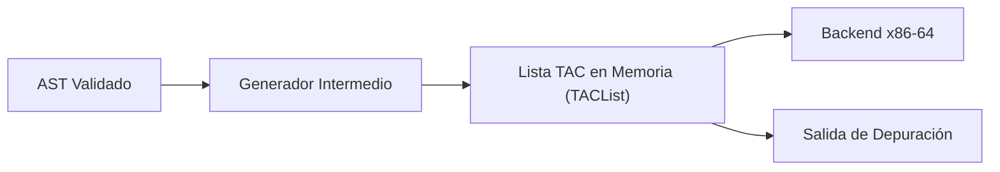
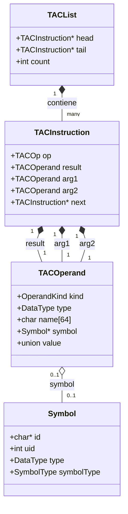

# Generación de Código Intermedio (TAC)

La etapa de código intermedio recibe el AST validado y genera una lista linealizada de cuádruplas en Código de Tres Direcciones (TAC). Esta representación desacopla el análisis del programa de la arquitectura de destino, resolviendo expresiones y estructuras de control complejas en instrucciones elementales.

El código intermedio se almacena en memoria como una lista enlazada (`TACList`). La impresión en texto se utiliza para depuración; el backend de código objeto recorre directamente los nodos de la lista e inspecciona sus campos tipados.



---

## 1. Modelo de Datos en Memoria

La representación intermedia se define a partir de tres estructuras: la instrucción (`TACInstruction`), el operando (`TACOperand`) y la lista contenedora (`TACList`).



### La Instrucción Cuádrupla (`TACInstruction`)

Cada cuádrupla agrupa la operación, tres operandos y un puntero al siguiente elemento:

```c
typedef struct TACInstruction {
    TACOp operator;
    TACOperand result;
    TACOperand arg1;
    TACOperand arg2;
    struct TACInstruction *next;
} TACInstruction;
```

- `op`: Código de operación (`TACOp`).
- `result`: Operando de destino, etiqueta en saltos o nombre de función en declaraciones.
- `arg1`: Primer operando fuente, argumento en operaciones unarias o valor de retorno.
- `arg2`: Segundo operando fuente, etiqueta en bifurcaciones condicionales o cantidad de parámetros en llamadas.
- `next`: Puntero a la siguiente instrucción de la secuencia.

### El Operando (`TACOperand`)

Cada operando almacena su clase, tipo de dato y valor para que el backend no necesite interpretar cadenas:

```c
typedef struct {
    OperandKind kind;
    DataType type;
    char name[TAC_NAME_LENGTH];
    Symbol *symbol;
    union {
        int int_val;
        float float_val;
    } value;
} TACOperand;
```

#### Tipos de Operando (`OperandKind`)

- `OPERAND_NONE`: Posición sin operando en instrucciones que usan menos de tres direcciones.
- `OPERAND_TEMP`: Temporal generado por el compilador (`t0`, `t1`, etc.).
- `OPERAND_VARIABLE`: Variable o parámetro del programa, identificado con su nombre calificado.
- `OPERAND_CONSTANT`: Valor literal entero, booleano o flotante guardado en la unión `value`.
- `OPERAND_LABEL`: Etiqueta de salto (`L0`, `L1`, etc.).
- `OPERAND_METHOD`: Identificador de un método.

#### Identificadores Calificados con `@uid`

En C-TDS pueden existir variables locales con el mismo nombre en distintos bloques (sombreado de variables). Para distinguirlas en una lista plana de instrucciones, el constructor `tacVariable` califica el nombre agregando el identificador numérico único asignado durante el análisis semántico:

```c
if (symbol->uid != 0) {
    snprintf(qualifiedName, sizeof(qualifiedName), "%s@%d", id, symbol->uid);
} else {
    snprintf(qualifiedName, sizeof(qualifiedName), "%s", id);
}
```

El carácter `@` no pertenece al conjunto de caracteres permitidos para identificadores en la gramática de C-TDS. Esto evita coincidencias accidentales entre variables declaradas por el usuario y nombres calificados. El campo `symbol` conserva el puntero original al símbolo para consultar su nombre sin calificar o su ámbito cuando sea necesario.

#### Manejo de Memoria en Operandos

Las funciones auxiliares `newTemp`, `newLabel`, `tacVariable` y `tacConstant*` copian los nombres a buffers locales dentro del propio `TACOperand` (`char name[64]`). Esto evita el uso de buffers estáticos compartidos y prescinde de llamadas a `strdup` que requerirían liberaciones individuales.

### Control de la Lista (`TACList`)

La estructura `TACList` mantiene punteros al inicio (`head`) y al final (`tail`):
- `appendInstruction` agrega elementos en tiempo constante mediante el puntero `tail`.
- `lastInstructionIsReturn` consulta directamente `current_code->tail->op` para determinar si la última instrucción emitida en un método fue `TAC_RETURN`. Esto permite agregar un retorno implícito al cerrar métodos de tipo `void`.
- `freeTACList` recorre y libera la cadena completa de instrucciones.

---

## 2. Catálogo de Operaciones (`TACOp`)

El compilador define las siguientes operaciones intermedias:

| Categoría | Operación | `result` | `arg1` | `arg2` | Formato Textual |
| :--- | :--- | :--- | :--- | :--- | :--- |
| Aritmética | `TAC_ADD` | Temporal | Operando | Operando | `res = arg1 + arg2` |
| | `TAC_SUB` | Temporal | Operando | Operando | `res = arg1 - arg2` |
| | `TAC_MUL` | Temporal | Operando | Operando | `res = arg1 * arg2` |
| | `TAC_DIV` | Temporal | Operando | Operando | `res = arg1 / arg2` |
| | `TAC_MOD` | Temporal | Operando | Operando | `res = arg1 % arg2` |
| Unaria y conversión | `TAC_NEG` | Temporal | Operando | vacante | `res = -arg1` |
| | `TAC_NOT` | Temporal | Operando | vacante | `res = !arg1` |
| | `TAC_INT_TO_FLOAT` | Temporal | Entero | vacante | `res = int_to_float arg1` |
| Comparación | `TAC_LT` | Temporal booleano | Operando | Operando | `res = arg1 < arg2` |
| | `TAC_GT` | Temporal booleano | Operando | Operando | `res = arg1 > arg2` |
| | `TAC_EQ` | Temporal booleano | Operando | Operando | `res = arg1 == arg2` |
| Lógica | `TAC_AND` | Temporal booleano | Operando | Operando | Resuelto mediante saltos condicionales |
| | `TAC_OR` | Temporal booleano | Operando | Operando | Resuelto mediante saltos condicionales |
| Asignación | `TAC_ASSIGN` | Destino | Origen | vacante | `res = arg1` |
| Declaraciones | `TAC_GLOBAL_DECL` | vacante | Variable | vacante | `global var, type` |
| | `TAC_LOCAL_DECL` | vacante | Variable | vacante | `local var, type` |
| Flujo | `TAC_LABEL` | Etiqueta | vacante | vacante | `L_name:` |
| | `TAC_GOTO` | vacante | Etiqueta | vacante | `goto L_name` |
| | `TAC_IF_FALSE` | vacante | Condición | Etiqueta | `if cond false goto L_name` |
| | `TAC_IF_TRUE` | vacante | Condición | Etiqueta | `if cond true goto L_name` |
| Métodos | `TAC_BEGIN_FUNC` | Método | Cantidad parámetros | vacante | `begin_func nombre, n` |
| | `TAC_END_FUNC` | Método | vacante | vacante | `end_func nombre` |
| | `TAC_PARAM_DECL` | vacante | Variable parámetro | vacante | `param_decl var` |
| | `TAC_PARAM` | vacante | Expresión argumento | vacante | `param arg` |
| | `TAC_CALL` | Temporal o vacante | Método | Cantidad argumentos | `[res =] call método, n` |
| | `TAC_RETURN` | vacante | Expresión o vacante | vacante | `ret [arg1]` |

---

## 3. Generación de Cuádruplas desde el AST

El generador recorre el AST en profundidad y emite las cuádruplas en orden de ejecución.

### Declaraciones de Variables
- Las declaraciones situadas como hijas directas de la raíz del programa emiten `TAC_GLOBAL_DECL`. El backend ubica estas variables en la sección `.data`.
- Las declaraciones dentro de métodos o bloques emiten `TAC_LOCAL_DECL`, indicando que el backend debe reservar espacio en la pila.

### Expresiones Aritméticas y Coerción de Tipos
- Los nodos `ID_NODE` y `CONSTANT_NODE` no generan cuádruplas de cómputo; devuelven un `TACOperand` construido con `tacVariable` o `tacConstant*`.
- En `BINARYOPERATOR_NODE`, se evalúan los operandos izquierdo y derecho.
- Si una operación mezcla `int` y `float`, la función `coerceBinaryOperands` emite una instrucción `TAC_INT_TO_FLOAT` para convertir el operando entero antes del cálculo. Esta conversión explícita es necesaria porque en la arquitectura x86-64 los enteros residen en registros de propósito general y los reales en registros SSE (`%xmm`). No se realiza plegado de constantes en esta etapa.

### Evaluación en Cortocircuito (`&&` y `||`)
Las operaciones `&&` y `||` se implementan mediante control de flujo para cumplir con la evaluación en cortocircuito:

```text
       result = a && b                          result = a || b
    ───────────────────────                  ───────────────────────
    result = a                               result = a
    if result false goto L_end               if result true goto L_end
    result = b                               result = b
    L_end:                                   L_end:
```

1. Se genera un nuevo temporal `result` y se le asigna el valor de `a`.
2. Se emite un salto condicional (`TAC_IF_FALSE` para `&&`, `TAC_IF_TRUE` para `||`) hacia `L_end`. Si `a` define el resultado, la rama derecha no se evalúa.
3. Si el salto no se produce, se evalúa `b` y se asigna su valor a `result`.
4. Se coloca la etiqueta `L_end`.

Se utiliza un temporal nuevo para no sobreescribir la variable de la expresión izquierda si esta era una variable del programa.

### Estructuras de Control de Flujo

#### Condicional (`if-else`)
1. Se evalúa la condición con `generateExpressionCode`.
2. Se emite `TAC_IF_FALSE` hacia la etiqueta del bloque alternativo o hacia el fin del condicional.
3. Se generan las sentencias del bloque afirmativo.
4. Si hay bloque `else`, se emite `TAC_GOTO` hacia la etiqueta final, se emite la etiqueta del bloque alternativo y se generan sus sentencias.
5. Se emite la etiqueta de cierre.

#### Bucle (`while`)
1. Se emite la etiqueta de inicio con `TAC_LABEL`.
2. Se evalúa la condición de permanencia.
3. Se emite `TAC_IF_FALSE` hacia la etiqueta de salida.
4. Se generan las sentencias del cuerpo.
5. Se emite `TAC_GOTO` hacia la etiqueta de inicio.
6. Se emite la etiqueta de salida.

### Subrutinas y Llamadas

- `TAC_BEGIN_FUNC`: Marca el inicio del método y guarda en `arg1` la cantidad de parámetros formales.
- `TAC_PARAM_DECL`: Se emite una cuádrupla por cada parámetro formal, preservando su orden de declaración para el mapeo a registros de la convención de llamada.
- Retorno implícito: Si un método es `void` y su última instrucción no es `TAC_RETURN`, el generador agrega automáticamente un `TAC_RETURN` antes de cerrar.
- `TAC_END_FUNC`: Marca el final del cuerpo del método.
- `TAC_PARAM`: Evalúa los argumentos reales de izquierda a derecha. Si un parámetro formal espera `float` pero se envía un `int`, se emite `TAC_INT_TO_FLOAT` antes de `TAC_PARAM`.
- `TAC_CALL`: Emite la llamada. Si la llamada forma parte de una expresión, se guarda el resultado en un temporal recién pedido; si es una sentencia independiente, `result` queda en `OPERAND_NONE`.

---

## 4. Trazabilidad con un Ejemplo

El siguiente ejemplo muestra un programa fuente en C-TDS, el código intermedio generado y el uso que hace el backend de cada cuádrupla:

### Código Fuente
```c
int global_val;

int calculo(int x) {
    int y;
    y = x * 2;
    return y;
}

void main() {
    int x;
    x = 5;
    global_val = calculo(x);
}
```

### Código Intermedio Generado
```text
global global_val, int

begin_func calculo, 1
param_decl x@2
local y@3, int
t0 = x@2 * 2
y@3 = t0
ret y@3
end_func calculo

begin_func main, 0
local x@5, int
x@5 = 5
param x@5
t1 = call calculo, 1
global_val = t1
ret
end_func main
```

### Desglose de Cuádruplas Seleccionadas

| Cuádrupla | `op` | `result` | `arg1` | `arg2` | Procesamiento en Backend |
| :--- | :--- | :--- | :--- | :--- | :--- |
| `global global_val, int` | `TAC_GLOBAL_DECL` | `OPERAND_NONE` | `OPERAND_VARIABLE`<br>`name: "global_val@1"`<br>`symbol->id: "global_val"` | `OPERAND_NONE` | Emite `.globl global_val` en `.data`. Lee el identificador directo del símbolo para omitir la calificación `@uid`. |
| `param_decl x@2` | `TAC_PARAM_DECL` | `OPERAND_NONE` | `OPERAND_VARIABLE`<br>`name: "x@2"` | `OPERAND_NONE` | Reserva slot en el marco en Pasada 1. En Pasada 2 vuelca el primer registro de argumentos (`%edi`) a `-4(%rbp)`. |
| `local y@3, int` | `TAC_LOCAL_DECL` | `OPERAND_NONE` | `OPERAND_VARIABLE`<br>`name: "y@3"` | `OPERAND_NONE` | Reserva slot en el marco en Pasada 1 (`-8(%rbp)`). |
| `t0 = x@2 * 2` | `TAC_MUL` | `OPERAND_TEMP`<br>`name: "t0"` | `OPERAND_VARIABLE`<br>`name: "x@2"` | `OPERAND_CONSTANT`<br>`value.int_val: 2` | Reserva slot para `t0`. En Pasada 2 carga `-4(%rbp)` en `%eax`, multiplica por el inmediato `$2` y guarda en `-12(%rbp)`. |
| `ret y@3` | `TAC_RETURN` | `OPERAND_NONE` | `OPERAND_VARIABLE`<br>`name: "y@3"` | `OPERAND_NONE` | Carga el valor desde `-8(%rbp)` en `%eax` y salta al epílogo del método. |
| `param x@5` | `TAC_PARAM` | `OPERAND_NONE` | `OPERAND_VARIABLE`<br>`name: "x@5"` | `OPERAND_NONE` | En `main`, carga el valor de `x@5` desde su slot local en `%edi`. |
| `t1 = call calculo, 1` | `TAC_CALL` | `OPERAND_TEMP`<br>`name: "t1"` | `OPERAND_METHOD`<br>`name: "calculo"` | `OPERAND_CONSTANT`<br>`value.int_val: 1` | Emite `call calculo` y copia el valor devuelto en `%eax` al slot del temporal `t1`. |
| `global_val = t1` | `TAC_ASSIGN` | `OPERAND_VARIABLE`<br>`name: "global_val@1"` | `OPERAND_TEMP`<br>`name: "t1"` | `OPERAND_NONE` | Al no encontrar `"global_val@1"` en el marco local, emite guardado en memoria estática: `movl %eax, global_val(%rip)`. |

---

**Anterior:** [Análisis Semántico y Tabla de Símbolos](04-semantic-analysis.md) | **Siguiente:** [Generación de Código Objeto y Gestión del Stack](06-object-code.md)
