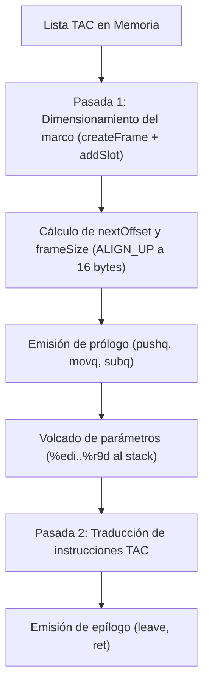

# Generación de Código Objeto y Gestión del Stack

!!! note "Estado de esta página"
    Cubre la ficha **F18** (el generador, `object_code.c`), todavía sin
    desarrollar al nivel de detalle de las demás. El plan está en
    `TODO_documentacion.md`.

    Las otras dos piezas del back-end tienen su propia página:
    [Instrucciones x86-64](06-asm-instructions.md) (F16) y
    [Marco de Pila](06.5-stack-frame.md) (F17).

La etapa de generación de código objeto traduce las cuádruplas TAC a instrucciones en lenguaje ensamblador x86-64 bajo la sintaxis AT&T de GNU Assembler. Esta etapa organiza la memoria en tiempo de ejecución: define el diseño del marco de activación (*stack frame*), coordina el uso de `%rsp` y `%rbp`, y aplica las reglas de la convención de llamada System V AMD64 ABI.

---

## 1. Arquitectura y Fases de Emisión

El backend procesa la lista TAC en dos pasadas por cada función:



### Componentes de la Etapa
- Gestor de marcos de activación: Estructuras `FunctionFrame` y `StackSlot` para calcular los desplazamientos negativos respecto a `%rbp`.
- Emisor de instrucciones: Estructura `AsmInstruction` con enumerados para opcodes y registros (`ASM_RAX`, `ASM_RDX`, `ASM_RCX`), evitando concatenar cadenas manualmente.
- Traductor de cuádruplas: Funciones de carga y guardado de operandos (`loadOperand`, `storeOperand`), emisores de operaciones binarias y relacionales, y control de bifurcaciones.

---

## 2. El marco de pila

La organización del stack, las estructuras `FunctionFrame` y `StackSlot`, la
pasada de dimensionamiento, la alineación a 16 bytes y el prólogo/epílogo tienen
ahora su propia página: [Marco de Pila](06.5-stack-frame.md) (ficha F17).

---

## 3. Convención de Llamada (System V AMD64 ABI)

La convención System V AMD64 ABI en Linux asigna los primeros seis argumentos enteros o booleanos a registros de 32 bits:

| Parámetro | Registro de 64 bits | Registro de 32 bits utilizado |
| :---: | :---: | :---: |
| 1 | `%rdi` | `%edi` |
| 2 | `%rsi` | `%esi` |
| 3 | `%rdx` | `%edx` |
| 4 | `%rcx` | `%ecx` |
| 5 | `%r8`  | `%r8d` |
| 6 | `%r9`  | `%r9d` |

### Recepción en la Función Llamada (*Callee*)

Al inicio del cuerpo de la función, cada instrucción `TAC_PARAM_DECL` toma el registro correspondiente del arreglo `ARG_REGISTERS_32` y guarda su valor en la ranura reservada en la pila:

```assembly
movl %edi, -4(%rbp)     # Guarda el primer parametro formal
movl %esi, -8(%rbp)     # Guarda el segundo parametro formal
```

Esto resguarda los argumentos en memoria local para que futuras operaciones o llamadas internas no los sobrescriban, permitiendo referenciarlos de forma uniforme mediante `offset(%rbp)`.

### Preparación en la Función Llamadora (*Caller*)

Cuando una función llama a otra:
1. Por cada instrucción `TAC_PARAM`, el valor del argumento se carga en el registro correspondiente (`%edi`, `%esi`, etc.) mediante `loadOperand`.
2. Al procesar `TAC_CALL`:
   - Se emite `call <nombre_metodo>`.
   - Se reinicia el índice de argumentos a 0.
   - Si la cuádrupla requiere guardar el resultado (`result.kind != OPERAND_NONE`), se lee el valor del acumulador `%eax` y se almacena en el slot asignado con `storeOperand`.

---

## 4. Instrucciones Condicionales y Extensión de Cero (`setCC` y `movzbl`)

En x86-64, las instrucciones de seteo condicional (`setl`, `setg`, `sete`, etc.) solo pueden escribir su resultado en un registro de 8 bits (el byte bajo de un registro general, como `%al`).

Al emitir una comparación como `setl %al`:
1. La instrucción escribe 1 (si la condición se cumple) o 0 (si no se cumple) únicamente en el byte `%al`.
2. Los 24 bits superiores de `%eax` conservan valores previos indeterminados.
3. El compilador emite a continuación la instrucción `movzbl %al, %eax`, que extiende `%al` con ceros rellenando los 32 bits completos de `%eax`.

Este patrón asegura que el booleano resultante quede normalizado como `0` o `1` en un entero de 32 bits antes de guardarlo en el marco.

---

## 5. Mapeo de Cuádruplas TAC a Assembly

A continuación se detalla la traducción implementada en el backend para cada operación:

### Declaraciones Globales (`TAC_GLOBAL_DECL`)
La función `emitGlobals` recorre la lista TAC antes de generar código ejecutable. Si existen variables globales, emite la sección de datos estáticos:
```assembly
.data
.globl total
.align 4
total:
    .long 0
```
Utiliza `getGlobalName` para obtener el identificador original del símbolo (`total`), omitiendo la calificación `@uid`.

### Asignación (`TAC_ASSIGN`)
Carga el operando fuente en `%eax` y lo almacena en el operando de destino:
```assembly
movl -4(%rbp), %eax       # loadOperand
movl %eax, -8(%rbp)        # storeOperand
```
Si el destino es una variable global, `storeOperand` emite direccionamiento relativo a `%rip`: `movl %eax, total(%rip)`.

### Operaciones Aritméticas Binarias (`TAC_ADD`, `TAC_SUB`, `TAC_MUL`)
La función auxiliar `emitBinaryOp` ejecuta el siguiente patrón:
1. Carga `arg1` en `%eax`.
2. Carga `arg2` en `%edx`.
3. Emite la instrucción de cómputo sobre `%eax`:
   - `TAC_ADD`: `addl %edx, %eax`
   - `TAC_SUB`: `subl %edx, %eax`
   - `TAC_MUL`: `imull %edx, %eax`
4. Guarda el contenido de `%eax` en el slot de `result`.

> [!NOTE] Operaciones Aritméticas Pendientes
> En la implementación actual del backend, las operaciones `TAC_DIV`, `TAC_MOD` y `TAC_NEG` figuran marcadas como pendientes (`todo`) dentro del generador de instrucciones.

### Operaciones de Comparación (`TAC_LT`, `TAC_GT`, `TAC_EQ`)
La función auxiliar `emitRelationalOp` ejecuta:
1. Carga `arg1` en `%eax`.
2. Carga `arg2` en `%edx`.
3. Compara los registros: `cmpl %edx, %eax`.
4. Emite la instrucción condicional correspondiente sobre `%al`:
   - `TAC_LT`: `setl %al`
   - `TAC_GT`: `setg %al`
   - `TAC_EQ`: `sete %al`
5. Extiende con ceros a 32 bits: `movzbl %al, %eax`.
6. Guarda `%eax` en el slot del temporal de destino.

### Negación Lógica (`TAC_NOT`)
Carga `arg1` en `%eax`, invierte el bit de valor booleano mediante disyunción exclusiva inmediata `xorl $1, %eax`, y almacena el resultado en el slot de destino.

### Conversión de Entero a Real (`TAC_INT_TO_FLOAT`)
Carga el operando entero en `%eax` y emite la instrucción de conversión escalar SSE:
```assembly
movl -4(%rbp), %eax
cvtsi2ss %eax, %xmm0
```

### Control de Flujo y Saltos
- `TAC_LABEL`: Emite la etiqueta local: `.<nombre>:`.
- `TAC_GOTO`: Emite un salto incondicional: `jmp .<etiqueta>`.
- `TAC_IF_FALSE`: Carga la condición en `%eax`, compara contra cero (`cmpl $0, %eax`) y salta si es cero: `je .<etiqueta>`.
- `TAC_IF_TRUE`: Carga la condición en `%eax`, compara contra cero (`cmpl $0, %eax`) y salta si es distinta de cero: `jne .<etiqueta>`.

### Retorno (`TAC_RETURN`)
Si la instrucción incluye un argumento de retorno, lo carga en `%eax` mediante `loadOperand`. Luego emite un salto incondicional al epílogo unificado:
```assembly
movl -12(%rbp), %eax
jmp .L_calcular_epilogue
```

---

## 6. Ejemplo Completo de Compilación

### Código Fuente en C-TDS
```c
int calcular(int a, int b) {
    int res;
    res = a + b;
    return res;
}
```

### Código Intermedio (TAC)
```text
begin_func calcular, 2
param_decl a@1
param_decl b@2
local_decl res@3
t0 = a@1 + b@2
res@3 = t0
ret res@3
end_func calcular
```

### Pasada 1: Dimensionamiento del Marco
1. `param_decl a@1` reserva el slot `-4(%rbp)`.
2. `param_decl b@2` reserva el slot `-8(%rbp)`.
3. `local_decl res@3` reserva el slot `-12(%rbp)`.
4. `t0 = a@1 + b@2` reserva el slot `-16(%rbp)` para el temporal `t0`.
5. `nextOffset` llega a 16. La alineación con `ALIGN_UP(16, 16)` produce `frameSize = 16`.

### Pasada 2: Código Assembly Generado

```assembly
.globl calcular
.type calcular, @function
calcular:
    # Prologo
    pushq %rbp
    movq %rsp, %rbp
    subq $16, %rsp

    # Recuperacion de parametros formales (registros a slots de pila)
    movl %edi, -4(%rbp)
    movl %esi, -8(%rbp)

    # t0 = a@1 + b@2
    movl -4(%rbp), %eax
    movl -8(%rbp), %edx
    addl %edx, %eax
    movl %eax, -16(%rbp)

    # res@3 = t0
    movl -16(%rbp), %eax
    movl %eax, -12(%rbp)

    # ret res@3
    movl -12(%rbp), %eax
    jmp .L_calcular_epilogue

    # Epilogo unificado
.L_calcular_epilogue:
    leave
    ret
```

---

**Anterior:** [Generación de Código Intermedio (TAC)](05.5-tac-generation.md) | **Volver al:** [Índice de Onboarding](00-index.md)
