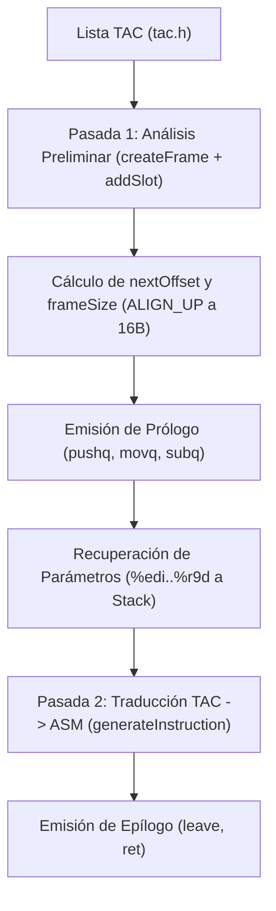
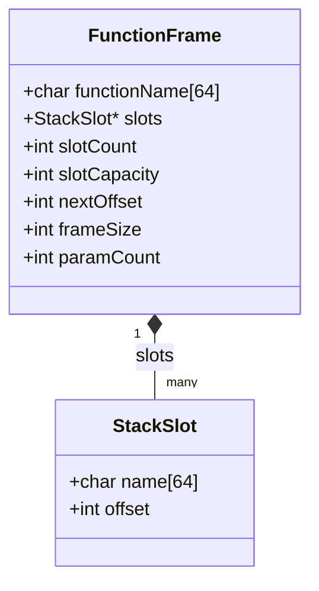

# Generación de Código Objeto y Gestión del Stack

La etapa de generación de código objeto traduce el Código de Tres Direcciones (TAC) a instrucciones de Assembly x86-64 bajo la sintaxis de GNU Assembler (GAS / AT&T). Uno de los aspectos centrales de esta fase es el diseño y la administración de la memoria en tiempo de ejecución: la organización del **Stack**, la gestión del **Stack Pointer** (`%rsp`), el **Base Pointer** (`%rbp`), la estructura del **Function Frame** (*marco de activación*) y la aplicación de las convenciones de llamada estándar (**System V AMD64 ABI**) con pasaje de argumentos en registros.

---

## 1. Arquitectura y Archivos Relevantes

El backend organiza la emisión de código en dos pasadas por cada función: una primera pasada de dimensionamiento y reserva del marco, seguida de la pasada de emisión de instrucciones Assembly.



### Archivos Fuente Relevantes
- [`src/object_code.h`](file:///home/francisco/tt/compiler/src/object_code.h): Definición de las estructuras `FunctionFrame` y `StackSlot`, macro de alineación `ALIGN_UP`, y prototipos de generación de código.
- [`src/object_code.c`](file:///home/francisco/tt/compiler/src/object_code.c): Implementación del dimensionamiento del frame, prólogo, epílogo, resolución de operandos locales/globales y convención de llamada.
- [`src/tac.h`](file:///home/francisco/tt/compiler/src/tac.h): Definiciones de los códigos de operación (`TAC_PARAM_DECL`, `TAC_LOCAL_DECL`, `TAC_CALL`, etc.) y operandos intermedios.

---

## 2. El Stack, el Stack Pointer (`%rsp`) y el Base Pointer (`%rbp`)

En la arquitectura x86-64, la pila de ejecución (*Call Stack*) es una región contigua de memoria que **crece hacia abajo**, es decir, desde direcciones altas de memoria hacia direcciones numéricamente más bajas.

```text
Direcciones Altas (Memoria)
  ▲
  │   ┌──────────────────────────────────────────┐
  │   │ Parámetros 7+ (si los hubiera)           │ > +16(%rbp)
  │   ├──────────────────────────────────────────┤
  │   │ Dirección de Retorno (puesta por 'call') │  +8(%rbp)
  │   ├──────────────────────────────────────────┤
  │   │ %rbp anterior (guardado por el prólogo)  │   0(%rbp)  ◄── %rbp (Frame Pointer)
  │   ├──────────────────────────────────────────┤
  │   │ Primer slot local / parámetro 1          │  -4(%rbp)
  │   │ Segundo slot local / parámetro 2         │  -8(%rbp)
  │   │ Variable local x                         │ -12(%rbp)
  │   │ Temporal t0                              │ -16(%rbp)
  │   │ ...                                      │ ...
  │   │ Padding / Relleno (Alineación a 16 bytes)│
  ▼   └──────────────────────────────────────────┘            ◄── %rsp (Stack Pointer)
Direcciones Bajas (Memoria)
```

### Roles de los Registros Puntero

1. **Stack Pointer (`%rsp`):**
   - Delimita de forma estricta la cima activa (*top*) del stack en cada instante.
   - Cualquier valor colocado mediante `push` decrementa `%rsp`; al hacer `pop`, `%rsp` se incrementa.
   - En nuestro compilador, en lugar de alterar `%rsp` con operaciones dinámicas individuales, se decrementa de una sola vez durante el prólogo (`subq $frameSize, %rsp`), reservando el espacio de memoria completo que la función necesitará.

2. **Base Pointer / Frame Pointer (`%rbp`):**
   - Sirve como punto de anclaje estático e invariable dentro de la función.
   - A lo largo de la ejecución del cuerpo del método, `%rbp` permanece fijo apuntando a la base del frame actual.
   - Todas las variables locales, parámetros formales y resultados temporales se acceden como **desplazamientos negativos constantes** respecto a `%rbp` (por ejemplo, `-4(%rbp)`, `-8(%rbp)`).

---

## 3. Modelo del Function Frame (`FunctionFrame` y `StackSlot`)

Para llevar el control exacto de dónde reside cada variable en el stack y cuántos bytes totales se deben reservar, el compilador utiliza las estructuras `StackSlot` y `FunctionFrame` definidas en [`src/object_code.h`](file:///home/francisco/tt/compiler/src/object_code.h#L21-L41):



### Estructura `StackSlot`
Representa una ranura de memoria en el stack asociada a un identificador concreto (sea una variable de usuario, un parámetro formal o una variable temporal generada por el TAC):
- **`name`**: Nombre textual del operando (ejemplo: `"a"`, `"total"`, `"t0"`).
- **`offset`**: Desplazamiento negativo respecto a `%rbp` (por ejemplo, `-4`, `-8`, `-12`).

### Estructura `FunctionFrame`
Mantiene el estado y dimensiones del marco de activación para la función en curso:
- **`nextOffset`**: Acumulador en bytes del espacio requerido hasta el momento. Cada variable de 32 bits (enteros y booleanos) añade 4 bytes.
- **`frameSize`**: Tamaño total final del marco expresado en bytes, redondeado hacia arriba al múltiplo de 16 más cercano para respetar la alineación de la arquitectura.
- **`paramCount`**: Cantidad de parámetros formales declarados en la firma, utilizado para mapear los registros de entrada.

---

## 4. Análisis Preliminar de Memoria (Pasada 1)

Antes de emitir una sola línea de código ensamblador para una función, el generador realiza una **pasada preliminar** de análisis de requerimientos de memoria.

### ¿Por qué se realiza un análisis preliminar?

1. **Reserva atómica en el prólogo:** La arquitectura x86-64 y la convención ABI exigen conocer de antemano el tamaño total que la función ocupará en la pila para emitir una única instrucción `subq $frameSize, %rsp`.
2. **Alineación a 16 bytes:** La especificación System V ABI establece que antes de ejecutar una instrucción `call`, el puntero de pila `%rsp` debe estar alineado a un múltiplo de 16 bytes. Si no se calcula el tamaño de forma preliminar, no es posible garantizar dicho padding.
3. **Mapeo determinista de variables a memoria:** Al asignar un slot a cada operando antes de procesar las operaciones aritméticas o lógicas, las funciones auxiliares de carga (`loadOperand`) y guardado (`storeOperand`) conocen inequívocamente el desplazamiento `offset(%rbp)` de cada variable o temporal.

### Algoritmo de Mapeo de Slots

Al encontrarse la instrucción TAC `TAC_BEGIN_FUNC`:
1. Se crea el marco mediante `createFrame(nombre_funcion)`.
2. Se recorre la lista enlazada de instrucciones TAC correspondientes al cuerpo de la función hasta llegar a `TAC_END_FUNC`.
3. Para cada instrucción, se invoca `addSlot(frame, operand)` en las siguientes situaciones:
   - **`TAC_PARAM_DECL`:** Para cada parámetro recibido en la cabecera.
   - **`TAC_LOCAL_DECL`:** Para cada variable local declarada en el código fuente.
   - **Instrucciones con resultado temporal (`OPERAND_TEMP`):** En operaciones de asignación, aritméticas (`TAC_ADD`, `TAC_SUB`, etc.), lógicas (`TAC_LT`, `TAC_EQ`, etc.) y llamadas (`TAC_CALL`), si el resultado es un temporal (`t0, t1, ...`), se le asigna un slot exclusivo en el stack.

```c
/* Lógica de addSlot en src/object_code.c */
int addSlot(FunctionFrame *frame, const TACOperand *operand) {
    /* 1. Si el operando ya tiene un slot asignado, reutilizar su offset */
    for (int i = 0; i < frame->slotCount; i++) {
        if (strcmp(frame->slots[i].name, operand->name) == 0) {
            return frame->slots[i].offset;
        }
    }

    /* 2. Reservar 4 bytes para enteros / booleanos */
    frame->nextOffset += 4;

    /* 3. Registrar el nuevo slot con offset negativo relativo a %rbp */
    StackSlot *slot = &frame->slots[frame->slotCount];
    strncpy(slot->name, operand->name, TAC_NAME_LENGTH - 1);
    slot->offset = -frame->nextOffset;  /* ej: -4, -8, -12, ... */

    frame->slotCount++;
    return slot->offset;
}
```

### Cálculo de `frameSize` con Alineación

Una vez recorrida la función y sumado `nextOffset`, el tamaño final se calcula utilizando la macro `ALIGN_UP`:

```c
#define ALIGN_UP(value, alignment) (((value) + (alignment) - 1) & ~((alignment) - 1))

/* Alineación estricta a 16 bytes */
frame->frameSize = ALIGN_UP(frame->nextOffset, 16);
```

| `nextOffset` (bytes brutos requeridos) | `frameSize` calculado (alineado a 16 bytes) | Padding agregado |
|:---------------------------------------|:--------------------------------------------|:-----------------|
| 4 bytes (1 variable)                   | 16 bytes                                    | 12 bytes         |
| 12 bytes (3 variables)                 | 16 bytes                                    | 4 bytes          |
| 16 bytes (4 variables)                 | 16 bytes                                    | 0 bytes          |
| 20 bytes (5 variables)                 | 32 bytes                                    | 12 bytes         |

---

## 5. Prólogo y Epílogo de una Función

Una vez finalizado el análisis preliminar de memoria, el compilador emite la estructura estándar de ensamblador que administra el marco de ejecución:

### Prólogo (`emitPrologue`)

```assembly
.globl sumar
.type sumar, @function
sumar:
    pushq %rbp              # 1. Guarda en el stack el frame pointer de la función llamadora
    movq %rsp, %rbp         # 2. Establece el frame pointer actual apuntando a la cima
    subq $16, %rsp          # 3. Reserva el espacio calculado en el análisis preliminar
```

1. `pushq %rbp`: Coloca el `%rbp` del llamador en la pila (ocupa 8 bytes) y mueve `%rsp` automáticamente 8 bytes hacia abajo.
2. `movq %rsp, %rbp`: Fija el inicio del marco de la nueva función.
3. `subq $frameSize, %rsp`: Ajusta el puntero de la pila `%rsp` reservando todo el bloque para variables locales, parámetros y temporales.

### Epílogo (`emitEpilogue`)

```assembly
.L_sumar_epilogue:
    leave                   # Deshace el marco: movq %rbp, %rsp ; popq %rbp
    ret                     # Extrae la dirección de retorno del stack y salta a ella
```

1. `leave`: Instrucción x86-64 de alta eficiencia que equivale a:
   - `movq %rbp, %rsp`: Descarta de un solo paso todo el espacio reservado para variables locales y temporales.
   - `popq %rbp`: Restaura el puntero de base previo del llamador.
2. `ret`: Extrae de la cima de la pila la dirección de retorno (puesta previamente por la instrucción `call`) y devuelve el control al flujo llamador.

---

## 6. Convención de Llamada y Uso de Registros (1 al 6)

El estándar **System V AMD64 ABI** adoptado por los compiladores en plataformas Linux define que los primeros **6 argumentos de tipo entero, booleano o puntero** no se transfieren por el stack, sino a través de un conjunto fijo de registros de la CPU.

### Mapeo de Registros para Argumentos (32 bits)

En el compilador, al operar con valores enteros y booleanos de 32 bits, se utiliza la variante de 32 bits de dichos registros:

| Número de Argumento | Registro x86-64 (64-bit) | Registro Usado (32-bit) | Constante en Código (`ARG_REGISTERS_32`) |
|:-------------------:|:------------------------:|:-----------------------:|:-----------------------------------------:|
| **1**               | `%rdi`                   | `%edi`                  | `ARG_REGISTERS_32[0]`                     |
| **2**               | `%rsi`                   | `%esi`                  | `ARG_REGISTERS_32[1]`                     |
| **3**               | `%rdx`                   | `%edx`                  | `ARG_REGISTERS_32[2]`                     |
| **4**               | `%rcx`                   | `%ecx`                  | `ARG_REGISTERS_32[3]`                     |
| **5**               | `%r8`                    | `%r8d`                  | `ARG_REGISTERS_32[4]`                     |
| **6**               | `%r9`                    | `%r9d`                  | `ARG_REGISTERS_32[5]`                     |

> [!NOTE] Parámetros más allá del 6to
> Si una función requiere 7 o más argumentos, los parámetros adicionales a partir del séptimo se pasan a través del stack por el llamador antes de ejecutar `call`.

### Mecánica de Recuperación en la Función Llamada (*Callee*)

Cuando una función comienza su ejecución tras el prólogo, los valores pasados como argumentos se encuentran en los registros `%edi`, `%esi`, `%edx`, etc. 

Para que estos valores no se pierdan cuando la función ejecute operaciones aritméticas o invoque a otras funciones, el compilador procesa las instrucciones `TAC_PARAM_DECL` generando instrucciones de volcado (*spill*) desde los registros hacia las posiciones reservadas en el stack:

```assembly
# Recuperación de los parámetros 1 y 2 en sus slots locales
movl %edi, -4(%rbp)     # Guarda el 1er parámetro (a) en su slot local
movl %esi, -8(%rbp)     # Guarda el 2do parámetro (b) en su slot local
```

```c
/* Implementación en generateInstruction (TAC_PARAM_DECL) */
case TAC_PARAM_DECL:
    if (frame->paramCount < MAX_ARG_REGISTERS) {
        int offset = getSlotOffset(frame, instruction->arg1.name);
        if (offset != 0) {
            buildStringf("    movl %s, %d(%%rbp)\n",
                         ARG_REGISTERS_32[frame->paramCount], offset);
        }
        frame->paramCount++;
    }
    break;
```

De esta manera:
- Se preservan los parámetros a salvo en el stack frame para todo el ciclo de vida de la función.
- Las variables de parámetros se referencian uniformemente usando direccionamiento relativo `offset(%rbp)` exactamente igual que cualquier variable local.
- Los registros `%edi..%r9d` quedan liberados para ser utilizados en futuras llamadas a otras funciones dentro del cuerpo.

### Mecánica al Invocar una Función (*Caller*)

Cuando una función va a invocar a otra:
1. Por cada instrucción `TAC_PARAM <arg>`, se carga el valor del argumento en el registro correspondiente (del 1 al 6):
   ```c
   /* TAC_PARAM */
   loadOperand(&instruction->arg1, ARG_REGISTERS_32[callArgIndex], frame);
   callArgIndex++;
   ```
2. Al procesar `TAC_CALL <funcion>`:
   - Se emite `call <funcion>`.
   - La convención ABI indica que el valor devuelto por la función se encuentra en el registro `%eax`.
   - Si la llamada produce un resultado, se toma de `%eax` y se almacena en el slot del temporal asignado:
     ```c
     /* TAC_CALL */
     buildStringf("    call %s\n", instruction->arg1.name);
     callArgIndex = 0;
     if (instruction->result.kind != OPERAND_NONE) {
         storeOperand(&instruction->result, "%eax", frame);
     }
     ```

---

## 7. Ejemplo Integral: Código Fuente a Assembly x86-64

Analicemos un ejemplo completo para observar cómo interactúan el análisis preliminar de memoria, el cálculo de offsets, el prólogo/epílogo y el pasaje por registros.

### Código Fuente en C-TDS
```c
int calcular(int a, int b) {
    int res;
    res = a + b;
    return res;
}
```

### Código Intermedio (TAC)
```text
calcular:
    param_decl a
    param_decl b
    local_decl res
    t0 = a + b
    res = t0
    ret res
end_func
```

### Pasada 1: Análisis Preliminar de Memoria

El compilador recorre las instrucciones TAC de la función:

1. `param_decl a`   -> Registra slot `"a"`   en offset `-4` (`nextOffset = 4`)
2. `param_decl b`   -> Registra slot `"b"`   en offset `-8` (`nextOffset = 8`)
3. `local_decl res` -> Registra slot `"res"` en offset `-12` (`nextOffset = 12`)
4. `t0 = a + b`     -> Temporal `t0`: slot `"t0"` en offset `-16` (`nextOffset = 16`)
5. Cálculo de tamaño final: `ALIGN_UP(16, 16) = 16 bytes`.

### Pasada 2: Código Assembly x86-64 Generado

```assembly
.globl calcular
.type calcular, @function
calcular:
    # --- PRÓLOGO ---
    pushq %rbp                  # Salva frame pointer anterior
    movq %rsp, %rbp             # Establece nuevo frame pointer
    subq $16, %rsp              # Reserva 16 bytes en el stack (alineado a 16)

    # --- RECUPERACIÓN DE PARÁMETROS (Registros 1 y 2 al Stack) ---
    movl %edi, -4(%rbp)         # Guarda parámetro 'a' (1er registro) en -4(%rbp)
    movl %esi, -8(%rbp)         # Guarda parámetro 'b' (2do registro) en -8(%rbp)

    # --- CUERPO: t0 = a + b ---
    movl -4(%rbp), %eax         # Carga 'a' en %eax
    movl -8(%rbp), %edx         # Carga 'b' en %edx
    addl %edx, %eax             # %eax = a + b
    movl %eax, -16(%rbp)        # Almacena suma en slot de 't0' (-16(%rbp))

    # --- CUERPO: res = t0 ---
    movl -16(%rbp), %eax        # Carga 't0' en %eax
    movl %eax, -12(%rbp)        # Almacena en slot de 'res' (-12(%rbp))

    # --- RETORNO: ret res ---
    movl -12(%rbp), %eax        # Coloca valor de retorno en %eax
    jmp .L_calcular_epilogue    # Salto al epílogo de la función

    # --- EPÍLOGO ---
.L_calcular_epilogue:
    leave                       # Restaura %rsp y %rbp
    ret                         # Retorna al llamador
```

---

## 8. Resumen de Decisiones de Diseño

1. **Gestión Determinista en el Stack:** Todas las variables y temporales tienen un lugar garantizado en memoria en su respectivo `StackSlot`, simplificando sustancialmente el generador de código y evitando requerir un asignador de registros (*register allocator*) complejo con algoritmos de coloración de grafos.
2. **Cumplimiento Estricto de la ABI:** La alineación de `frameSize` mediante `ALIGN_UP(..., 16)` garantiza compatibilidad total con librerías C del sistema y la llamada a rutinas estándar (como `printf` o funciones auxiliares).
3. **Separación de Responsabilidades:** El análisis en dos pasadas desacopla por completo la medición del tamaño del marco de la posterior emisión de código Assembly.

---

**Anterior:** [Generación de Código Intermedio (TAC)](05-intermediate-code.md) | **Volver al:** [Índice de Onboarding](00-index.md)
