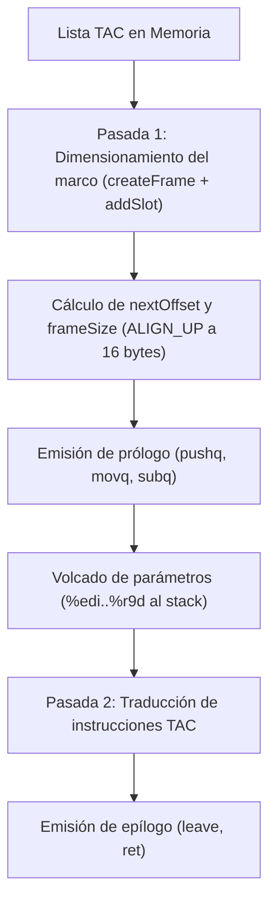
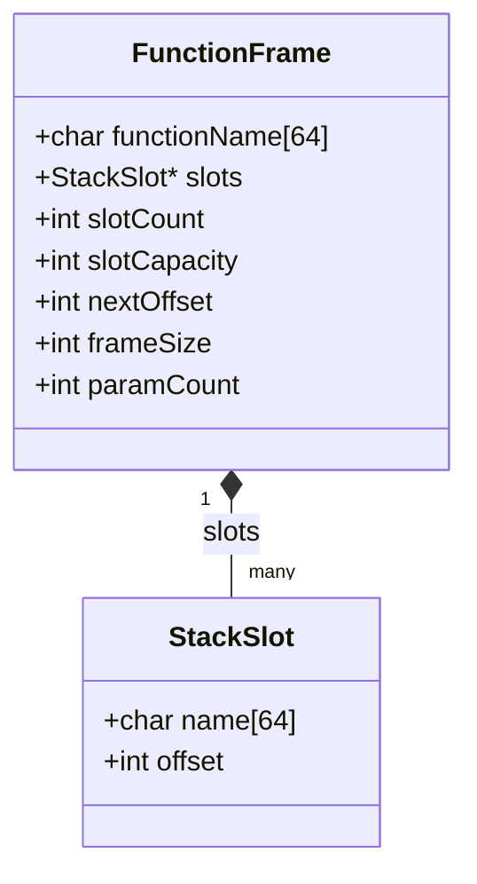

# Generación de Código Objeto y Gestión del Stack

La etapa de generación de código objeto traduce las cuádruplas TAC a instrucciones en lenguaje ensamblador x86-64 bajo la sintaxis AT&T de GNU Assembler. Esta etapa organiza la memoria en tiempo de ejecución: define el diseño del marco de activación (*stack frame*), coordina el uso de `%rsp` y `%rbp`, y aplica las reglas de la convención de llamada System V AMD64 ABI.

---

## 1. Arquitectura y Fases de Emisión

El backend procesa la lista TAC en dos pasadas por cada función:



### Componentes de la Etapa
- Gestor de marcos de activación: Estructuras `FunctionFrame` y `StackSlot` para calcular los desplazamientos negativos respecto a `%rbp`.
- Emisor de instrucciones: Estructura `AsmInstruction` con enumerados para opcodes y registros (`ASM_RAX`, `ASM_RDX`, `ASM_RCX`), evitando concatenar cadenas manualmente.
- Traductor de cuádruplas: Funciones de carga y guardado de operandos (`loadOperand`, `storeOperand`), emisores de operaciones binarias y relacionales, y control de bifurcaciones.

---

## 2. Organización del Stack y Registros Base

En x86-64 la pila crece hacia direcciones de memoria más bajas. La organización del marco para cada función es la siguiente:

```text
Direcciones altas
  ▲
  │   ┌──────────────────────────────────────────┐
  │   │ Parámetros 7 en adelante (si existieran) │ > +16(%rbp)
  │   ├──────────────────────────────────────────┤
  │   │ Dirección de retorno (colocada por call) │  +8(%rbp)
  │   ├──────────────────────────────────────────┤
  │   │ %rbp anterior (guardado en el prólogo)   │   0(%rbp)  ◄── %rbp (Frame Pointer)
  │   ├──────────────────────────────────────────┤
  │   │ Primer slot local o parámetro 1          │  -4(%rbp)
  │   │ Segundo slot local o parámetro 2         │  -8(%rbp)
  │   │ Variable local x                         │ -12(%rbp)
  │   │ Temporal t0                              │ -16(%rbp)
  │   │ ...                                      │ ...
  │   │ Relleno de alineación a 16 bytes         │
  ▼   └──────────────────────────────────────────┘            ◄── %rsp (Stack Pointer)
Direcciones bajas
```

### Funciones de `%rsp` y `%rbp`

- `%rsp` (Stack Pointer): Apunta a la cima de la pila. El compilador calcula el espacio total necesario de antemano y lo resta de `%rsp` una sola vez en el prólogo con `subq $frameSize, %rsp`.
- `%rbp` (Base Pointer): Permanece fijo en la base del marco durante la ejecución del método. Todas las variables locales, parámetros y temporales se referencian como desplazamientos negativos respecto a `%rbp` (por ejemplo `-4(%rbp)` o `-8(%rbp)`).

---

## 3. Estructuras del Marco (`FunctionFrame` y `StackSlot`)

El compilador utiliza dos estructuras para llevar la cuenta de las posiciones asignadas en el marco:



### `StackSlot`
Representa una ranura de 4 bytes en la pila:
- `name`: Nombre del operando (por ejemplo `"x@2"`, `"total@1"`, `"t0"`).
- `offset`: Desplazamiento negativo respecto a `%rbp` (por ejemplo `-4`, `-8`, `-12`).

### `FunctionFrame`
Almacena el estado del marco durante la compilación de una función:
- `functionName`: Nombre de la función en curso.
- `nextOffset`: Contador acumulado en bytes para los slots registrados. Cada variable o temporal de 32 bits suma 4 bytes.
- `frameSize`: Tamaño total final del marco, ajustado al múltiplo de 16 más cercano.
- `paramCount`: Contador de parámetros procesados, utilizado para asociar registros en la convención de llamada.

---

## 4. Análisis Preliminar de Memoria (Pasada 1)

Antes de emitir el código ensamblador del cuerpo de la función, el compilador realiza una pasada preliminar sobre las cuádruplas para calcular el tamaño del marco. Esto responde a dos necesidades:
1. Conocer `frameSize` para emitir la reserva de espacio `subq $frameSize, %rsp` en el prólogo.
2. Cumplir con la convención System V ABI, que exige que el puntero `%rsp` esté alineado a 16 bytes antes de ejecutar cualquier instrucción `call`.

### Asignación de Ranuras con `addSlot`

Durante la pasada preliminar, se invoca `addSlot(frame, operand)` en los siguientes casos:
- Al encontrar `TAC_PARAM_DECL`: Reserva espacio para cada parámetro formal.
- Al encontrar `TAC_LOCAL_DECL`: Reserva espacio para cada variable local.
- Al encontrar instrucciones intermedias cuyo resultado sea un temporal (`OPERAND_TEMP`), como en operaciones aritméticas, relacionales o llamadas con retorno.

```c
int addSlot(FunctionFrame *frame, const TACOperand *operand) {
    for (int i = 0; i < frame->slotCount; i++) {
        if (strcmp(frame->slots[i].name, operand->name) == 0) {
            return frame->slots[i].offset;
        }
    }

    frame->nextOffset += 4;

    StackSlot *slot = &frame->slots[frame->slotCount];
    strncpy(slot->name, operand->name, TAC_NAME_LENGTH - 1);
    slot->name[TAC_NAME_LENGTH - 1] = '\0';
    slot->offset = -frame->nextOffset;

    frame->slotCount++;
    return slot->offset;
}
```

Si el operando ya tenía una ranura asignada en el marco, se devuelve su desplazamiento existente sin duplicar espacio.

### Alineación a 16 Bytes

Al finalizar la pasada preliminar, el compilador calcula `frameSize` aplicando una macro de redondeo hacia arriba:

```c
#define ALIGN_UP(value, alignment) (((value) + (alignment) - 1) & ~((alignment) - 1))

frame->frameSize = ALIGN_UP(frame->nextOffset, 16);
```

| `nextOffset` (bytes brutos) | `frameSize` (alineado a 16 bytes) | Relleno añadido |
| :---: | :---: | :---: |
| 4 bytes (1 variable) | 16 bytes | 12 bytes |
| 12 bytes (3 variables) | 16 bytes | 4 bytes |
| 16 bytes (4 variables) | 16 bytes | 0 bytes |
| 20 bytes (5 variables) | 32 bytes | 12 bytes |

---

## 5. Prólogo y Epílogo

### Prólogo (`emitPrologue`)

```assembly
.globl sumar
.type sumar, @function
sumar:
    pushq %rbp              # Guarda el frame pointer del llamador
    movq %rsp, %rbp         # Establece el nuevo frame pointer
    subq $16, %rsp          # Reserva el espacio calculado para la funcion
```

1. `pushq %rbp` almacena el `%rbp` previo en la pila y desplaza `%rsp` 8 bytes hacia abajo.
2. `movq %rsp, %rbp` fija el inicio del marco actual.
3. `subq $frameSize, %rsp` decrementa `%rsp` si `frameSize > 0`, reservando el bloque de pila.

### Epílogo (`emitEpilogue`)

```assembly
.L_sumar_epilogue:
    leave                   # Equivale a: movq %rbp, %rsp ; popq %rbp
    ret                     # Extrae la direccion de retorno y vuelve al llamador
```

1. La etiqueta `.L_<funcion>_epilogue` sirve como punto de convergencia para todas las instrucciones de retorno de la función.
2. `leave` restaura `%rsp` al valor de `%rbp` y recupera el `%rbp` previo del llamador mediante `popq %rbp`.
3. `ret` salta a la dirección de retorno que quedó en la cima de la pila.

---

## 6. Convención de Llamada (System V AMD64 ABI)

La convención System V AMD64 ABI en Linux asigna los primeros seis argumentos enteros o booleanos a registros de 32 bits:

| Parámetro | Registro de 64 bits | Registro de 32 bits utilizado |
| :---: | :---: | :---: |
| 1 | `%rdi` | `%edi` |
| 2 | `%rsi` | `%esi` |
| 3 | `%rdx` | `%edx` |
| 4 | `%rcx` | `%ecx` |
| 5 | `%r8`  | `%r8d` |
| 6 | `%r9`  | `%r9d` |

### Recepción en la Función Llamada (*Callee*)

Al inicio del cuerpo de la función, cada instrucción `TAC_PARAM_DECL` toma el registro correspondiente del arreglo `ARG_REGISTERS_32` y guarda su valor en la ranura reservada en la pila:

```assembly
movl %edi, -4(%rbp)     # Guarda el primer parametro formal
movl %esi, -8(%rbp)     # Guarda el segundo parametro formal
```

Esto resguarda los argumentos en memoria local para que futuras operaciones o llamadas internas no los sobrescriban, permitiendo referenciarlos de forma uniforme mediante `offset(%rbp)`.

### Preparación en la Función Llamadora (*Caller*)

Cuando una función llama a otra:
1. Por cada instrucción `TAC_PARAM`, el valor del argumento se carga en el registro correspondiente (`%edi`, `%esi`, etc.) mediante `loadOperand`.
2. Al procesar `TAC_CALL`:
   - Se emite `call <nombre_metodo>`.
   - Se reinicia el índice de argumentos a 0.
   - Si la cuádrupla requiere guardar el resultado (`result.kind != OPERAND_NONE`), se lee el valor del acumulador `%eax` y se almacena en el slot asignado con `storeOperand`.

---

## 7. Instrucciones Condicionales y Extensión de Cero (`setCC` y `movzbl`)

En x86-64, las instrucciones de seteo condicional (`setl`, `setg`, `sete`, etc.) solo pueden escribir su resultado en un registro de 8 bits (el byte bajo de un registro general, como `%al`).

Al emitir una comparación como `setl %al`:
1. La instrucción escribe 1 (si la condición se cumple) o 0 (si no se cumple) únicamente en el byte `%al`.
2. Los 24 bits superiores de `%eax` conservan valores previos indeterminados.
3. El compilador emite a continuación la instrucción `movzbl %al, %eax`, que extiende `%al` con ceros rellenando los 32 bits completos de `%eax`.

Este patrón asegura que el booleano resultante quede normalizado como `0` o `1` en un entero de 32 bits antes de guardarlo en el marco.

---

## 8. Mapeo de Cuádruplas TAC a Assembly

A continuación se detalla la traducción implementada en el backend para cada operación:

### Declaraciones Globales (`TAC_GLOBAL_DECL`)
La función `emitGlobals` recorre la lista TAC antes de generar código ejecutable. Si existen variables globales, emite la sección de datos estáticos:
```assembly
.data
.globl total
.align 4
total:
    .long 0
```
Utiliza `getGlobalName` para obtener el identificador original del símbolo (`total`), omitiendo la calificación `@uid`.

### Asignación (`TAC_ASSIGN`)
Carga el operando fuente en `%eax` y lo almacena en el operando de destino:
```assembly
movl -4(%rbp), %eax       # loadOperand
movl %eax, -8(%rbp)        # storeOperand
```
Si el destino es una variable global, `storeOperand` emite direccionamiento relativo a `%rip`: `movl %eax, total(%rip)`.

### Operaciones Aritméticas Binarias (`TAC_ADD`, `TAC_SUB`, `TAC_MUL`)
La función auxiliar `emitBinaryOp` ejecuta el siguiente patrón:
1. Carga `arg1` en `%eax`.
2. Carga `arg2` en `%edx`.
3. Emite la instrucción de cómputo sobre `%eax`:
   - `TAC_ADD`: `addl %edx, %eax`
   - `TAC_SUB`: `subl %edx, %eax`
   - `TAC_MUL`: `imull %edx, %eax`
4. Guarda el contenido de `%eax` en el slot de `result`.

> [!NOTE] Operaciones Aritméticas Pendientes
> En la implementación actual del backend, las operaciones `TAC_DIV`, `TAC_MOD` y `TAC_NEG` figuran marcadas como pendientes (`todo`) dentro del generador de instrucciones.

### Operaciones de Comparación (`TAC_LT`, `TAC_GT`, `TAC_EQ`)
La función auxiliar `emitRelationalOp` ejecuta:
1. Carga `arg1` en `%eax`.
2. Carga `arg2` en `%edx`.
3. Compara los registros: `cmpl %edx, %eax`.
4. Emite la instrucción condicional correspondiente sobre `%al`:
   - `TAC_LT`: `setl %al`
   - `TAC_GT`: `setg %al`
   - `TAC_EQ`: `sete %al`
5. Extiende con ceros a 32 bits: `movzbl %al, %eax`.
6. Guarda `%eax` en el slot del temporal de destino.

### Negación Lógica (`TAC_NOT`)
Carga `arg1` en `%eax`, invierte el bit de valor booleano mediante disyunción exclusiva inmediata `xorl $1, %eax`, y almacena el resultado en el slot de destino.

### Conversión de Entero a Real (`TAC_INT_TO_FLOAT`)
Carga el operando entero en `%eax` y emite la instrucción de conversión escalar SSE:
```assembly
movl -4(%rbp), %eax
cvtsi2ss %eax, %xmm0
```

### Control de Flujo y Saltos
- `TAC_LABEL`: Emite la etiqueta local: `.<nombre>:`.
- `TAC_GOTO`: Emite un salto incondicional: `jmp .<etiqueta>`.
- `TAC_IF_FALSE`: Carga la condición en `%eax`, compara contra cero (`cmpl $0, %eax`) y salta si es cero: `je .<etiqueta>`.
- `TAC_IF_TRUE`: Carga la condición en `%eax`, compara contra cero (`cmpl $0, %eax`) y salta si es distinta de cero: `jne .<etiqueta>`.

### Retorno (`TAC_RETURN`)
Si la instrucción incluye un argumento de retorno, lo carga en `%eax` mediante `loadOperand`. Luego emite un salto incondicional al epílogo unificado:
```assembly
movl -12(%rbp), %eax
jmp .L_calcular_epilogue
```

---

## 9. Ejemplo Completo de Compilación

### Código Fuente en C-TDS
```c
int calcular(int a, int b) {
    int res;
    res = a + b;
    return res;
}
```

### Código Intermedio (TAC)
```text
begin_func calcular, 2
param_decl a@1
param_decl b@2
local_decl res@3
t0 = a@1 + b@2
res@3 = t0
ret res@3
end_func calcular
```

### Pasada 1: Dimensionamiento del Marco
1. `param_decl a@1` reserva el slot `-4(%rbp)`.
2. `param_decl b@2` reserva el slot `-8(%rbp)`.
3. `local_decl res@3` reserva el slot `-12(%rbp)`.
4. `t0 = a@1 + b@2` reserva el slot `-16(%rbp)` para el temporal `t0`.
5. `nextOffset` llega a 16. La alineación con `ALIGN_UP(16, 16)` produce `frameSize = 16`.

### Pasada 2: Código Assembly Generado

```assembly
.globl calcular
.type calcular, @function
calcular:
    # Prologo
    pushq %rbp
    movq %rsp, %rbp
    subq $16, %rsp

    # Recuperacion de parametros formales (registros a slots de pila)
    movl %edi, -4(%rbp)
    movl %esi, -8(%rbp)

    # t0 = a@1 + b@2
    movl -4(%rbp), %eax
    movl -8(%rbp), %edx
    addl %edx, %eax
    movl %eax, -16(%rbp)

    # res@3 = t0
    movl -16(%rbp), %eax
    movl %eax, -12(%rbp)

    # ret res@3
    movl -12(%rbp), %eax
    jmp .L_calcular_epilogue

    # Epilogo unificado
.L_calcular_epilogue:
    leave
    ret
```

---

**Anterior:** [Generación de Código Intermedio (TAC)](05-intermediate-code.md) | **Volver al:** [Índice de Onboarding](00-index.md)
