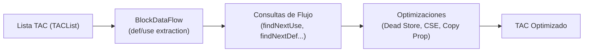
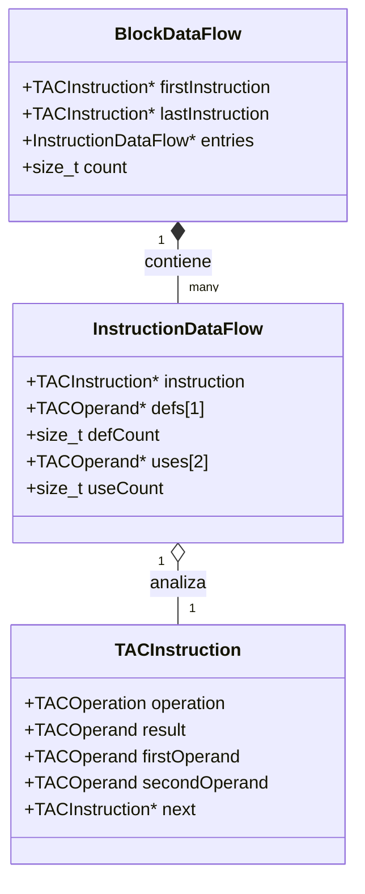

# Análisis de Flujo de Datos (Data Flow Analysis)

El análisis de flujo de datos es la base para las optimizaciones sobre el Código de Tres Direcciones (TAC). Permite responder preguntas acerca del ciclo de vida de variables y temporales dentro de un bloque o función (dónde se definen, dónde se leen y qué valores están vivos en cada punto de ejecución), desacoplando la fase de **análisis** de la fase de **transformación**.



---

## 1. Motivación y Consideraciones de Diseño

### ¿Por qué sobre TAC y no sobre el AST?
En el AST, las expresiones son árboles anidados y el orden de evaluación no siempre es lineal. En el TAC, las operaciones intermedias están aplanadas en cuádruplas secuenciales ([`TACInstruction`](file:///home/francisco/compiler/include/tac_instruction.h)), donde cada instrucción define a lo sumo un resultado y lee a lo sumo dos operandos. Esto simplifica drásticamente el seguimiento de flujo lineal.

### Diferencia entre Variables y Temporales
En este compilador:
* Las **variables declaradas** (`OPERAND_VARIABLE`) provienen del código fuente y cuentan con un puntero a su [`Symbol`](file:///home/francisco/compiler/include/symbol_table.h). Su nombre calificado incluye el identificador único de ámbito (ej. `x@1`, `x@2`).
* Los **temporales generados por el compilador** (`OPERAND_TEMP`, como `t0`, `t1`) **no tienen símbolo** (su campo `symbol` es `NULL`).

Por esta razón, el análisis de datos no puede indexar únicamente por `Symbol*`: opera con [`TACOperand`](file:///home/francisco/compiler/include/tac_operand.h) y nombres calificados (`op->name`), cubriendo de forma transparente tanto a variables de usuario como a temporales internos.

---

## 2. Modelo de Datos (`data_flow.h`)

El análisis se estructura en dos niveles: por instrucción y por bloque.



### `InstructionDataFlow`
Almacena los conjuntos $def$ y $use$ de una única cuádrupla. En el Código de Tres Direcciones:
* $def \le 1$: La instrucción solo puede escribir en su `result` (o en ninguno).
* $use \le 2$: La instrucción lee como máximo dos operandos fuentes (`firstOperand`, `secondOperand`).

Al tener límites acotados y fijos, se evita la sobrecarga de reservar memoria dinámica por cada instrucción.

### `BlockDataFlow`
Representa una secuencia de instrucciones (una ventana de análisis, un bloque básico o el cuerpo de una función completa). Mantiene un arreglo contiguo indexado de `InstructionDataFlow`, lo que permite navegar adelante y atrás en el bloque en tiempo $O(N)$ sin modificar la lista enlazada de TAC.

---

## 3. Clasificación de Operaciones TAC

No todo operando es un dato de flujo. Las constantes literales (`OPERAND_CONSTANT`), etiquetas de salto (`OPERAND_LABEL`) y métodos (`OPERAND_METHOD`) no son candidatos a $def$ o $use$. Solo se consideran operandos de tipo `OPERAND_VARIABLE` u `OPERAND_TEMP`.

| Categoría TAC | Operaciones | $def$ | $use$ |
| :--- | :--- | :--- | :--- |
| **Operaciones Binarias** | `TAC_ADD`, `TAC_SUB`, `TAC_MUL`, `TAC_DIV`, `TAC_MOD`, `TAC_LT`, `TAC_GT`, `TAC_EQ` | `result` | `firstOperand`, `secondOperand` |
| **Asignaciones y Unarias** | `TAC_ASSIGN`, `TAC_NEG`, `TAC_NOT`, `TAC_INT_TO_FLOAT` | `result` | `firstOperand` |
| **Llamadas a Método** | `TAC_CALL` | `result` (si captura retorno) | — (los argumentos van en `TAC_PARAM`) |
| **Argumentos y Retornos** | `TAC_PARAM`, `TAC_RETURN` | — | `firstOperand` (si no es `OPERAND_NONE`) |
| **Saltos Condicionales** | `TAC_IF_TRUE`, `TAC_IF_FALSE` | — | `firstOperand` (condición evaluada) |
| **Control Estructural** | `TAC_LABEL`, `TAC_GOTO`, `TAC_BEGIN_FUNC`, `TAC_END_FUNC`, `TAC_*_DECL` | — | — |

---

## 4. API de Consultas ("Hacerle preguntas al bloque")

Una vez instanciado el bloque con `createBlockDataFlow(inicio, fin)`, se pueden realizar las siguientes consultas:

### 1. `blockFindNextUse(block, from, varName)`
Busca la siguiente instrucción dentro del bloque que **lee** la variable o temporal especificado.
* **Retorno:** Puntero a la `TACInstruction` lectora, o `NULL` si no hay lecturas posteriores en el bloque.

### 2. `blockFindNextDef(block, from, varName)`
Busca la siguiente instrucción dentro del bloque que **escribe o redefine** la variable.
* **Retorno:** Puntero a la `TACInstruction` escritora, o `NULL` si no se vuelve a asignar en el bloque.

### 3. `blockIsRedefinedBetween(block, from, to, varName)`
Determina si `varName` fue modificada por alguna instrucción intermedia en el rango abierto `(from, to)`.
* **Retorno:** `true` si al menos una instrucción entre `from` y `to` define `varName`, `false` si retiene su valor intacto.

### 4. `blockIsDeadDefinition(block, defInst)`
Determina si la asignación realizada en `defInst` es una definición muerta (*dead store*).
* **Criterio:** Si dentro del bloque existe una redefinición posterior (`nextDef != NULL`) y no hubo ninguna lectura intermedia (`nextUse == NULL` o `nextDef` aparece antes de `nextUse`), el valor escrito en `defInst` nunca fue leído.

---

## 5. Casos de Uso y Optimizaciones Habilitadas

### Caso 1: Eliminación de Asignaciones Muertas (*Dead Store Elimination*)

Ocurre cuando una variable o temporal se sobreescribe antes de que nadie consuma su valor anterior.

```
// TAC Original:
x@1 = 5         <-- blockIsDeadDefinition() devuelve true
y@1 = 10
x@1 = 20        <-- Redefinición sin lectura previa de x@1
t0 = x@1 + y@1
```

**Optimización:** La primera instrucción `x@1 = 5` se desvincula de la lista con `unlinkInstruction()` sin alterar el comportamiento observable del programa.

---

### Caso 2: Propagación de Copias (*Copy Propagation*)

Dada una copia `y = x`, si en un uso posterior leemos `y`, podemos reemplazar `y` por `x` siempre que ninguna de las dos haya cambiado entre medio.

```
// TAC Original:
y@1 = x@1
t0 = a@1 + 2
t1 = y@1 + 4    <-- Uso de y@1
```

**Consulta:**
```c
if (!blockIsRedefinedBetween(block, instCopia, instUso, "x@1") &&
    !blockIsRedefinedBetween(block, instCopia, instUso, "y@1")) {
    /* Es seguro propagar: reemplazar y@1 por x@1 en instUso */
}
```

**Resultado:** `t1 = x@1 + 4`. Posteriormente, si `y@1` no tiene más usos, la instrucción `y@1 = x@1` quedará muerta y será removida.

---

### Caso 3: Eliminación de Subexpresiones Comunes Locales (*Local CSE*)

Si el compilador calcula dos veces la misma expresión dentro del mismo bloque básico:

```
t0 = a@1 + b@1
c@1 = 10
t1 = a@1 + b@1   <-- Expresión repetida
```

**Consulta:**
```c
if (!blockIsRedefinedBetween(block, instT0, instT1, "a@1") &&
    !blockIsRedefinedBetween(block, instT0, instT1, "b@1")) {
    /* Ni a@1 ni b@1 cambiaron: reemplazar t1 = a@1 + b@1 por t1 = t0 */
}
```

---

### Caso 4: Análisis de Vida (*Liveness*) y Asignación de Registros

Para saber durante qué intervalo de instrucciones un temporal del compilador necesita ocupar un registro físico:
* **Inicio del intervalo:** La instrucción donde se define (`instDef`).
* **Fin del intervalo:** El último uso antes de ser redefinido o de finalizar el bloque básico.

Si dos temporales `t0` y `t1` no tienen rangos de vida superpuestos (el último uso de `t0` ocurre antes de la definición de `t1`), ambos pueden compartir exactamente el mismo registro de CPU (por ejemplo `%rax` o `%r10`), reduciendo el derrame (*spilling*) en la pila.

---

## 6. Integración en el Pipeline de Optimización

El análisis de flujo se integra naturalmente en el bucle iterativo de [`optimizeIntermediateCode`](file:///home/francisco/compiler/src/optimizer.c#L22):

```c
int runDataFlowOptimizations(TACList *tacList) {
    int changes = 0;
    
    /* 1. Construir el grafo de flujo del bloque */
    BlockDataFlow *block = createBlockDataFlow(tacList->head, tacList->tail);
    if (block == NULL) return 0;

    TACInstruction *prev = NULL;
    TACInstruction *curr = tacList->head;

    /* 2. Recorrer y consultar */
    while (curr != NULL) {
        TACInstruction *next = curr->next;

        if (blockIsDeadDefinition(block, curr)) {
            unlinkInstruction(tacList, prev, curr);
            changes++;
        } else {
            prev = curr;
        }

        curr = next;
    }

    /* 3. Liberar metadatos */
    freeBlockDataFlow(block);
    return changes;
}
```

Si una ronda introduce transformaciones (`changes > 0`), en la siguiente ronda del optimizador se vuelve a calcular un nuevo `BlockDataFlow` sobre la lista modificada, garantizando que los análisis siempre operen sobre información fresca hasta converger.
